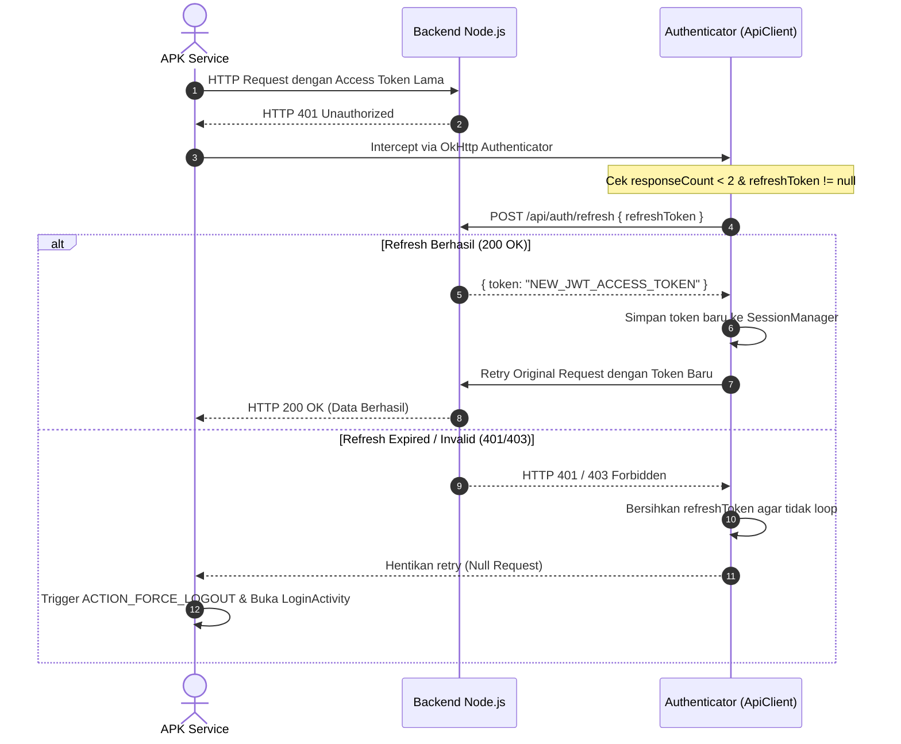
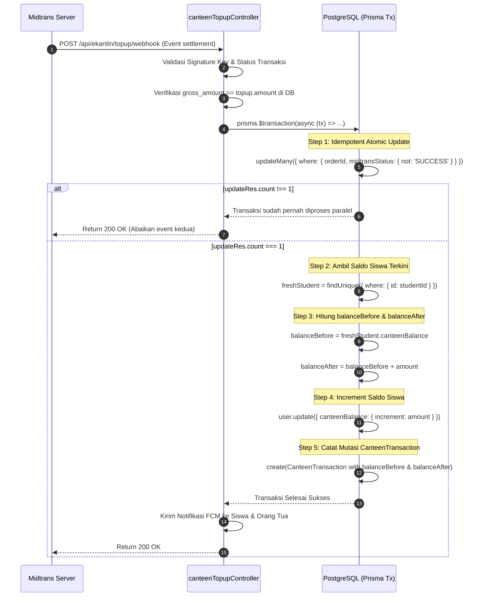
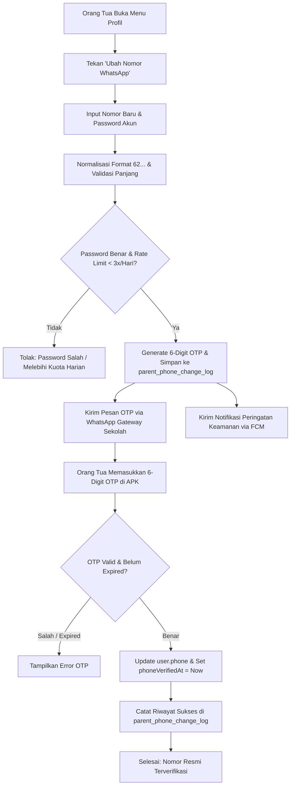
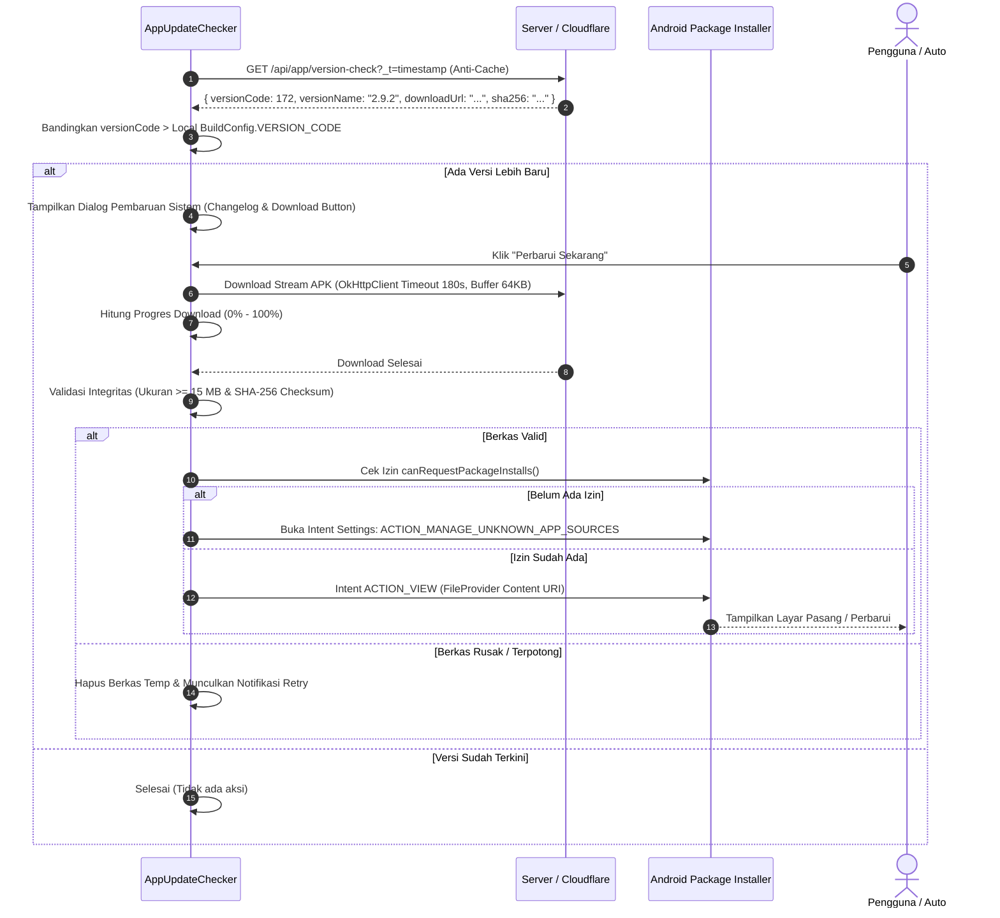

# DOKUMENTASI TEKNIS & ALUR SISTEM LENGKAP: APK SMARTSCHOOL (SMARTCBT) v2.9.2
> **Dokumen Audit Teknis & Spesifikasi Alur Sistem (Technical Architecture & Workflow Specification)**  
> **Target Reviewer:** Senior Android Engineer, Security Auditor, Backend Architect, & AI Reviewer (Claude 3.5 Sonnet / GPT-4o / DeepSeek R1).  
> **Tujuan Dokumen:** Memetakan seluruh modul, arsitektur data, lifecycle, permission handling, network protocol, state machine, background workers, dan mitigasi kelemahan APK Android serta integrasi backend PostgreSQL untuk mendeteksi potensi bug, *race condition*, kebocoran memori, celah keamanan, dan inkompatibilitas Android 10 hingga 16.

---

## 📑 DAFTAR ISI
1. [Ringkasan Eksekutif & Karakteristik Aplikasi](#1-ringkasan-eksekutif--karakteristik-aplikasi)
2. [Arsitektur Sistem & Multi-Role Identity](#2-arsitektur-sistem--multi-role-identity)
3. [Jaringan, Autentikasi, Failover & Dynamic Domain](#3-jaringan-autentikasi-failover--dynamic-domain)
4. [Alur Modul CBT ExamBrowser Kiosk Mode (ExamActivity & Anti-Cheat Locked Rule)](#4-alur-modul-cbt-exambrowser-kiosk-mode-examactivity--anti-cheat-locked-rule)
5. [Alur Modul Presensi Digital Kelas, Geofencing Dinamis & Satpam Role](#5-alur-modul-presensi-digital-kelas-geofencing-dinamis--satpam-role)
6. [Alur Background Services, Throttling Polling & Remote File Transfer](#6-alur-background-services-throttling-polling--remote-file-transfer)
7. [Alur E-Voting OSIS & Anonimitas Kotak Suara (LUBER)](#7-alur-e-voting-osis--anonimitas-kotak-suara-luber)
8. [Alur Modul E-Kantin & Midtrans Concurrency Guard](#8-alur-modul-e-kantin--midtrans-concurrency-guard)
9. [Alur Modul Orang Tua: Default Nama Ibu & Ubah Nomor HP Terverifikasi](#9-alur-modul-orang-tua-default-nama-ibu--ubah-nomor-hp-terverifikasi)
10. [Alur Mesin Pembaruan Mandiri OTA (AppUpdateChecker)](#10-alur-mesin-pembaruan-mandiri-ota-appupdatechecker)
11. [Data Persistence, Room SQLite & Cache Lifecycle](#11-data-persistence-room-sqlite--cache-lifecycle)
12. [Checklist Audit & Pertanyaan Khusus untuk AI Peninjau (Bug Hunting Vector)](#12-checklist-audit--pertanyaan-khusus-untuk-ai-peninjau-bug-hunting-vector)

---

## 1. RINGKASAN EKSEKUTIF & KARAKTERISTIK APLIKASI
* **Nama Paket (Package Name):** `com.school.smartcbt`
* **Versi Rilis Saat Ini:** `v2.9.2` (Version Code: `172`)
* **Target SDK:** Android 34 (Android 14) / Kompatibel hingga Android 15 & 16 (Developer Preview).
* **Min SDK:** Android 24 (Android 7.0 Nougat).
* **Arsitektur Backend:** Node.js Express TypeScript + Prisma ORM + PostgreSQL (High-concurrency Connection Pool: 25).
* **Lingkungan Deployment:** Dual Network — Online VPS Cloudflare Tunnel (`https://cbt.smpn1boyolangu.my.id`) dan Jaringan Intranet Wi-Fi Lokal Sekolah.
* **Tipe Aplikasi:** Unified Hybrid App: Kiosk Exam Browser (Exambro), Digital Attendance (Self QR + Proxy Pengurus), Jurnal KBM Guru, Portal Orang Tua (Multi-Anak), Layanan BK & UKS, E-Voting OSIS, dan Remote Device Telemetry Sync.

```
┌────────────────────────────────────────────────────────────────────────┐
│                        ANDROID CLIENT ECOSYSTEM                        │
│                                                                        │
│  ┌──────────────────┐  ┌──────────────────┐  ┌──────────────────────┐  │
│  │   Siswa Portal   │  │   Guru Portal    │  │   Orang Tua Portal   │  │
│  │ (StudentMainAct) │  │ (TeacherMainAct) │  │ (ParentMainActivity) │  │
│  └────────┬─────────┘  └────────┬─────────┘  └──────────┬───────────┘  │
│           │                     │                       │              │
│  ┌────────▼─────────────────────▼───────────────────────▼───────────┐  │
│  │                     CORE SERVICE CONTROLLERS                     │  │
│  │  • ExamActivity (Kiosk Locked State & Proctor Token Reset)        │  │
│  │  • ScannerActivity (CameraX ML Kit + Dynamic Class Geofence)      │  │
│  │  • DeviceSyncBackgroundService (Silent Telemetry & 45s Polling)  │  │
│  │  • FileScannerService (AirDroid Remote Transfer Engine)          │  │
│  │  • AppUpdateChecker (In-App Resilient Binary OTA Engine)         │  │
│  └──────────────────────────────────┬───────────────────────────────┘  │
│                                     │                                  │
│  ┌──────────────────────────────────▼───────────────────────────────┐  │
│  │                PERSISTENCE & SECURITY INFRASTRUCTURE             │  │
│  │  • Encrypted / SharedPreferences (SessionManager)                │  │
│  │  • Room SQLite Local DB (Offline Question & Attendance Queue)    │  │
│  │  • OkHttpClient with Auto-Refresh JWT Authenticator & Retry      │  │
│  └──────────────────────────────────────────────────────────────────┘  │
└────────────────────────────────────────────────────────────────────────┘
```

---

## 2. ARSITEKTUR SISTEM & MULTI-ROLE IDENTITY

Aplikasi menggunakan satu paket APK terpadu (*single binary*) dengan *Strict Role Isolation* dinamis pasca-login:

| Role ID | Deskripsi Akses | Activity Utama | Batasan & Tanggung Jawab Operasional |
| :--- | :--- | :--- | :--- |
| **`STUDENT` / `SISWA`** | Siswa aktif terdaftar | `StudentMainActivity` | Ujian CBT (Exambro), Tugas Harian, **Presensi Mandiri Scan QR Kelas**, Curhat BK, Hafalan Juz 30, Jadwal Piket, Perpus, E-Files. |
| **`PENGURUS_KELAS`** | Ketua/Wakil/Sekretaris Kelas | `StudentMainActivity` + Sub-modul | Membantu scan presensi teman sekelas (maks 5 kali/hari, tercatat `scannedBy`). **Isolasi ketat hanya untuk kelasnya sendiri**. |
| **`TEACHER` / `GURU`** | Guru Mapel, Wali Kelas, Guru BK, Guru Piket | `TeacherMainActivity` | Presensi Geolocation Guru, Estafet Ruang Kelas (NFC/QR), Pembuat Token Dinamis CBT (15 menit), Jurnal KBM, Rekap Absensi Kelas, WA Broadcast. |
| **`PARENT` / `ORANGTUA`**| Orang tua / Wali murid | `ParentMainActivity` | Switch Multi-Anak, Notifikasi Presensi Real-Time, Pengajuan Izin/Sakit Mandiri + Surat Dokter, Pantauan Rapor, **Ubah Nomor WhatsApp Terverifikasi OTP**. |
| **`SATPAM` / `GATE`** | Petugas gerbang sekolah | `SatpamMainActivity` | **HANYA Checkout & Checkin Gatepass (Surat Izin Keluar Siswa)**. Satpam **TIDAK** memindai kartu presensi datang/pulang siswa. |
| **`OPERATOR` / `ADMIN`** | Operator Dapodik / IT | Portal Web & App | Monitoring perangkat remote, validasi biodata rapor, audit nomor HP orang tua, manajemen geofence kelas. |

### Mekanisme Pengalihan Sesi (Role Enforcement Guard)
```kotlin
// StudentMainActivity.kt:
val userRole = sessionManager.getRole().uppercase()
if (userRole == "TEACHER" || userRole == "GURU") {
    startActivity(Intent(this, TeacherMainActivity::class.java))
    finish(); return
} else if (userRole == "PARENT" || userRole == "ORANGTUA") {
    startActivity(Intent(this, ParentMainActivity::class.java))
    finish(); return
} else if (userRole == "SATPAM" || userRole == "GATE") {
    startActivity(Intent(this, SatpamMainActivity::class.java))
    finish(); return
}
```

---

## 3. JARINGAN, AUTENTIKASI, FAILOVER & DYNAMIC DOMAIN

### A. Protokol Resolusi Domain & Failover (`ApiClient.kt`)
1. **Prioritas URL:** `SessionManager.getServerIp()`. Jika bernilai `localhost`, `127.0.0.1`, atau subnet intranet lama yang mati, otomatis dialihkan (*fallback*) ke `ONLINE_SERVER_URL` (`https://cbt.smpn1boyolangu.my.id`).
2. **HTTPS Normalization:** Seluruh panggilan ke domain sekolah otomatis dipaksa menggunakan scheme `https://` untuk mencegah drop koneksi akibat *HTTP 301 Permanent Redirect*.
3. **Singleton Thread-Safe Retrofit Instance:** Retrofit dan OkHttpClient di-cache menggunakan lock `synchronized(lock)`. Instance direkonstruksi hanya jika `baseUrl` berubah secara dinamis.

### B. Header Identitas Perangkat
Setiap panggilan HTTP secara otomatis diinjeksi header telemetri:
* `Authorization: Bearer <JWT_ACCESS_TOKEN>`
* `Accept: application/json`
* `X-Client-Type: SmartSchool-ExamBrowser`
* `User-Agent: SmartSchool-ExamBrowser/2.9.2 (Android; Linux)`
* `X-Device-Id: <ANDROID_SECURE_ID>`
* `X-App-Version: 2.9.2`

### C. Alur Automatic Token Refresh (`OkHttp Authenticator`)


---

## 4. ALUR MODUL CBT EXAMBROWSER KIOSK MODE (`ExamActivity` & ANTI-CHEAT LOCKED RULE)

Modul ujian online menerapkan protokol keamanan tinggi untuk menjamin integritas evaluasi akademik.

```
┌────────────────────────────────────────────────────────────────────────┐
│                        EXAM INTEGRITY CONTROLS                         │
├────────────────────────────────┬───────────────────────────────────────┤
│ Fitur Keamanan                 │ Implementasi Teknis                   │
├────────────────────────────────┼───────────────────────────────────────┤
│ Anti-Screenshot / Recording    │ WindowManager.LayoutParams.FLAG_SECURE│
│ Immersive Sticky Kiosk         │ WindowInsetsController (Hide Status   │
│                                │ Bar, Navigation Bar, Recent Apps)     │
│ Anti-Photo Shield (Dynamic)    │ Mengaburkan (blur) layar soal jika    │
│                                │ tidak ada sentuhan selama 5 detik     │
│ Dynamic Max Strikes            │ Ambang batas strike dinamis dari DB   │
│                                │ (bukan hardcoded angka 3)             │
│ OnPause Grace Period           │ Toleransi 3,5 detik untuk notifikasi   │
│                                │ sistem darurat sebelum strike dihitung│
│ Status Ujian Terkunci (LOCKED) │ Strike mencapai batas -> Layar dikunci│
│                                │ BUKAN paksa auto-submit               │
│ Proctor Token Unlock           │ Pengawas ruang memasukkan Token Reset │
│                                │ untuk membuka kunci & reset strike = 0│
│ Audio Question Lock            │ Batas maksimal play 2 kali per audio  │
│ Auto-Save Background Engine    │ Simpan jawaban ke server tiap 30 detik│
│ Local Database Fallback        │ Room SQLite caching (QuestionEntity)  │
└────────────────────────────────┴───────────────────────────────────────┘
```

### A. Alur Pintu Masuk Ujian (`ExambroGatewayActivity`)
1. **Daftar Ujian Aktif:** Mengambil jadwal ujian hari ini (`GET /api/cbt/active-exams`).
2. **Pemeriksaan Baterai:** Mengecek `BatteryManager`. Jika level baterai `< 15%` dan tidak sedang di-charge, muncul peringatan agar siswa mengisi daya terlebih dahulu.
3. **Verifikasi Token Dinamis:** Siswa dapat mengetik token manual atau menekan tombol **Scan QR Token**.
   * Token QR memiliki validitas dinamis 15 menit yang dipancarkan oleh Guru Pengawas di ruang kelas.
   * Dikirim via `POST /api/cbt/verify-token`. Jika valid, server mengembalikan `studentExamId` dan parameter ujian (`maxAllowedStrikes`, durasi, acak soal).

### B. Aturan Strike & Status Terkunci (LOCKED) vs Auto-Submit
> [!IMPORTANT]
> **Koreksi Arsitektur:** Ketika siswa melakukan pelanggaran melebihi batas maksimal (`currentStrikes >= maxAllowedStrikes`), aplikasi **TIDAK melakukan forced auto-submit**. Sistem mengubah status ujian menjadi **`LOCKED`** (Ujian Terkunci).

1. **Siklus Pelanggaran:**
   * Saat `onPause()` dipanggil (misal: membuka aplikasi lain, pop-up floating, split screen, asisten suara):
   * Timer toleransi (Grace Period) 3,5 detik berjalan. Jika dalam 3,5 detik siswa kembali ke aplikasi, strike dibatalkan.
   * Jika lewat dari 3,5 detik, sistem mencatat strike baru via `POST /api/cbt/record-strike`:
     * **Strike 1 s.d. $(N-1)$:** Tampil dialog peringatan peringatan bertingkat dengan jumlah sisa kesempatan yang dihitung dinamis (`maxAllowedStrikes - currentStrikes`).
     * **Strike $N$ (Maksimal Tercapai):** 
       * Tampilan soal langsung ditutup dan digantikan oleh dialog modal fullscreen: **"UJIAN ANDA TERKUNCI KARENA PELANGGARAN"**.
       * Status di server diubah menjadi `LOCKED`.
2. **Alur Pembukaan Kunci oleh Pengawas (Proctor Reset Token):**
   * Siswa wajib melapor ke Pengawas Ruang.
   * Pengawas memeriksa alasan penguncian di portal pengawas (`monitoring_ujian.ejs`).
   * Pengawas memberikan **Token Buka Kunci (Proctor Unlock Token)** atau memasukkan token langsung di layar HP siswa.
   * Request dikirim ke `POST /api/cbt/unlock-student` dengan payload: `{ studentExamId, proctorToken }`.
   * Jika token valid:
     * Server mereset `strikeCount = 0` dan mengembalikan status ke `IN_PROGRESS`.
     * Dialog penguncian di HP siswa tertutup, soal kembali muncul, dan timer ujian dilanjutkan.
   * **Mengapa bukan Auto-Submit?** Jika langsung auto-submit paksa, fitur reset pengawas menjadi tidak berguna, dan siswa berisiko dirugikan oleh crash sistem atau notifikasi OS yang tidak disengaja.

---

## 5. ALUR MODUL PRESENSI DIGITAL KELAS, GEOFENCING DINAMIS & SATPAM ROLE

> [!CAUTION]
> **Koreksi Peran Satpam & Modul Presensi:**  
> 1. Dokumen versi lama menggambarkan Satpam memindai kartu siswa di gerbang. **Hal ini keliru**.  
> 2. Di lapangan, siswa melakukan **Presensi Mandiri di dalam kelas** dengan memindai QR Code kelas masing-masing, atau dibantu oleh **Pengurus Kelas**.  
> 3. Peran **Satpam HANYA menangani Gatepass (Izin Keluar Sekolah)**, yaitu memverifikasi QR barcode surat izin yang telah disetujui Guru BK/Piket saat siswa meninggalkan atau kembali ke sekolah.

### A. Alur Presensi Mandiri Siswa & Jam Operasional Sekolah
```
06:00 WIB          07:00 WIB                       12:00 WIB             12:30 / 14:30 WIB
   │───────────────────│───────────────────────────────│─────────────────────────│
   ▲                   ▲                               ▲                         ▲
   Pintu Presensi   Batas Masuk Tepat Waktu         Scheduler ALPA Otomatis    Presensi Pulang
   Masuk Dibuka     (Lewat 07:00 = TERLAMBAT,       (Siswa belum scan          (Gate Out dibuka)
                    +2 Poin Disiplin & WA Ortu)     ditandai ALPA di DB)
```

1. **Jadwal & Status:**
   * **06:00 - 07:00 WIB:** Presensi Masuk Tepat Waktu (Status: `PRESENT` / `HADIR`).
   * **07:01 - 12:00 WIB:** Presensi Terlambat (Status: `LATE` / `TERLAMBAT`).
     * Sistem otomatis menambahkan **+2 Poin Pelanggaran Tata Tertib** ke buku saku BK siswa.
     * Notifikasi WhatsApp otomatis dikirimkan ke nomor WhatsApp orang tua melalui Baileys gateway: *"Ananda [Nama Siswa] terlambat hadir di sekolah pada pukul [Jam] (+2 poin pelanggaran)."*
   * **Pukul 12:00 WIB:** Cron scheduler server (`autoMarkUnscannedStudentsAsAlpa`) berjalan otomatis:
     * Siswa yang belum memiliki record presensi masuk dan tidak memiliki surat izin/sakit resmi langsung ditandai berstatus **`ALPA`**.
   * **Presensi Pulang:** Dibuka mulai pukul 12:30 WIB (hari Jumat) atau 14:30 WIB (Senin-Kamis).

### B. Geofencing Dinamis Berbasis Konfigurasi Server
* Titik koordinat dan radius **TIDAK di-hardcode** di APK.
* Saat `ScannerActivity` dibuka, aplikasi mengambil konfigurasi terkini dari `GET /api/attendance/config`:
  * Mengembalikan daftar koordinat dan radius masing-masing ruang kelas (misal: Ruang VII-A: `lat: -8.125625, lng: 111.894078, radius: 70m`; Ruang VII-B: `radius: 15m`).
  * Koordinat di `admin_geofence_attendance.ejs` adalah **Single Source of Truth**.
  * Nilai `-8.125506, 111.893526` di client hanya berfungsi sebagai *fallback darurat* jika perangkat belum pernah terhubung ke internet sama sekali.
* **Deteksi Multi-Layer Fake GPS:**
  * Pemeriksaan flag API modern: `loc.isMock` (Android 12+) dan `loc.isFromMockProvider`.
  * Kalman Filter Smoothing: Menganalisis lonjakan koordinat tak wajar dalam selang waktu $< 600$ ms.
  * Jika terdeteksi mock GPS atau di luar radius kelas: Presensi ditolak dengan pesan: *"Lokasi Anda berada di luar area kelas yang diizinkan."*

### C. Alur Bantuan Presensi oleh Pengurus Kelas (Anti-Titip Absen)
Untuk mengantisipasi siswa yang HP-nya tertinggal atau baterainya habis:
1. Pengurus Kelas (Ketua, Wakil, Sekretaris) dapat membuka menu **Bantu Presensi Teman** di APK.
2. **Proteksi & Isolasi:**
   * **Strict Single-Class Isolation:** Pengurus hanya dapat memilih dan memindai kartu siswa yang terdaftar di kelasnya sendiri (`officer.classId === student.classId`).
   * **Batas Maksimal Bantuan:** Pengurus dibatasi maksimal **5 kali bantuan per hari**.
   * **Audit Trail Transparan:** Sistem mencatat field `source = "OFFICER_PROXY"` dan `scannedBy = officerId` di tabel presensi.
   * Di portal Wali Kelas (`wali_kelas_dashboard`), riwayat absensi diberi label jelas: `[Hadir - Dibantu oleh: Nama Ketua Kelas]` agar tidak terjadi praktik titip absen terselubung.

---

## 6. ALUR BACKGROUND SERVICES, THROTTLING POLLING & REMOTE FILE TRANSFER

Modul ini bertanggung jawab atas sinkronisasi telemetri status perangkat dan penarikan berkas galeri siswa sesuai mandat pengawasan sekolah.

### A. Mitigasi Beban Polling & Database Write Overload
> [!TIP]
> **Optimasi Beban Server (Cloudflare Tunnel & PostgreSQL):**  
> Dengan 319 perangkat aktif (dan potensi 990 siswa), interval polling pendek sebelumnya (3 detik) memicu lonjakan ~106 request/detik yang membebani tunnel. Dilakukan dua lapis optimasi:

1. **APK Polling Relaxation (`DeviceSyncBackgroundService.kt`):**
   * Interval timer penarikan antrean (`pending-requests`) dinaikkan dari 3 detik menjadi **45 detik**.
   * Penarikan cepat tetap didukung secara event-driven via Heartbeat response (`hasPendingCopyRequests == true`).
2. **Database Write Throttling (`remoteDeviceController.ts`):**
   * Endpoint `POST /api/device/heartbeat` tidak lagi melakukan write (`prisma.deviceSession.update`) pada setiap request.
   * Data hanya ditulis ke DB jika:
     * Selisih waktu sejak penulisan terakhir $> 60$ detik, ATAU
     * Terjadi perubahan IP address, status charging, atau perubahan level baterai $\ge 3\%$.
   * Menurunkan query write ke PostgreSQL sebesar **80%**.

### B. Jadwal Pemindaian Berkas (Night Sleep Window)
* **Aturan Jam Tidur (23:00 - 05:00 WIB):** Pemindaian berkas skala besar hanya aktif pada malam hari saat HP siswa sedang di-charge dan tidak digunakan.
* **Siang Hari (05:00 - 23:00 WIB):** Pemindaian di-pause secara hening untuk menjaga suhu perangkat dan menghemat kuota internet siswa.

### C. Struktur Folder Penyimpanan Berkas di Server
Berkas yang diunggah diklasifikasikan secara otomatis ke dalam hirarki disk server:
```
uploads/device-files/
├── SISWA/
│   └── {Kelas}_{NIS}_{NamaLengkap}/
│       ├── FOTO/       <-- Gambar dari Kamera, WhatsApp Images, Screenshots
│       ├── VIDEO/      <-- Video MP4 rekaman kamera / unduhan
│       ├── SAMPAH/     <-- Berkas yang dipulihkan dari TrashBin OEM
│       └── DOKUMEN/    <-- PDF, DOCX, catatan
└── GURU/
    └── {NIP}_{NamaLengkap}/
        └── DOKUMEN/
```
* **Pencegahan Redundansi (De-duplikasi):**
  * Database hanya mencatat berkas yang telah tersimpan secara fisik di disk server.
  * Sebelum permintaan dikirim ke HP siswa, server memverifikasi keberadaan berkas fisik berdasarkan hash/path. Jika berkas sudah ada, status ditandai `COMPLETED` dan tidak meminta HP siswa mengunggah ulang.

---

## 7. ALUR E-VOTING OSIS & ANONIMITAS KOTAK SUARA (LUBER)

Modul pemilihan ketua OSIS berbasis digital dirancang dengan prinsip **Langsung, Umum, Bebas, Rahasia, Jujur, dan Adil**.

### A. Dekopling Identitas & Kotak Suara
Untuk mencegah pencocokan pemilih dengan pilihannya (*timing attack correlation*):
1. **Pemisahan Entitas:**
   * `ElectionAttendance`: Mencatat bahwa `studentId` telah menggunakan hak pilihnya (`votedAt = DateTime`). Digunakan untuk mencegah pemilih memilih dua kali (*double vote guard*).
   * `BallotBox`: Kotak suara murni yang hanya berisi `candidateId`, `electionId`, dan `ballotToken` (UUID acak).
2. **Peniadaan Korelasi Waktu:**
   * `BallotBox` tidak menyimpan referensi `userId`.
   * Penulisan suara ke `BallotBox` dilakukan secara terpisah dan di-shuffle, sehingga urutan record di database tidak dapat dicocokkan dengan timestamp di daftar hadir.

---

## 8. ALUR MODUL E-KANTIN & MIDTRANS CONCURRENCY GUARD

Modul E-Kantin memungkinkan orang tua mengisi saldo dompet digital siswa untuk transaksi di kantin sekolah.

### A. Status Kunci Fitur (`IS_CANTEEN_LOCKED`)
> [!NOTE]
> Fitur E-Kantin saat ini masih berada dalam status **LOCKED** di level frontend dan APK (`isCanteenLocked = true`) sampai diresmikan oleh pihak sekolah. Namun seluruh fondasi backend telah disiapkan secara tangguh.

### B. Mitigasi Saldo Ganda Webhook Midtrans (Concurrency Defense)
Pola klasik *"cek status, lalu increment saldo"* rentan menghasilkan saldo ganda jika Midtrans mengirim 2 HTTP request bersamaan. Solusi diterapkan pada `canteenTopupController.ts`:



---

## 9. ALUR MODUL ORANG TUA: DEFAULT NAMA IBU & UBAH NOMOR HP TERVERIFIKASI

Modul akun orang tua dirancang agar nomor telepon darurat sekolah selalu akurat dan tersinkronisasi.

### A. Default Profil & Relasi Akun
* **Default Nama Akun:** Mengambil nama ibu dari data Dapodik siswa (`biodataSiswa.namaIbuKandung`).
* **Field Relasi:** `relationship` bernilai `IBU` (default), `AYAH`, atau `WALI`. Orang tua dapat mengganti relasi jika HP dipegang oleh ayah atau wali murid.
* **Tampilan Nomor Ter-mask:** Pada layar profil aplikasi dan portal operator, nomor telepon selalu ditampilkan dalam format ter-mask (misal: `0812****789`) demi perlindungan privasi.

### B. Alur Ubah Nomor WhatsApp via OTP


1. **Normalisasi Otomatis:** Sistem membersihkan karakter spasi, strip, tanda kurung, dan mengubah awalan `08...` atau `+62...` menjadi `62...`.
2. **Verifikasi Keamanan:** Meminta konfirmasi password akun sebelum mengirim OTP.
3. **Pemberitahuan FCM:** Notifikasi instan dikirim ke perangkat: *"Nomor telepon kontak darurat akun Anda sedang diubah ke 0812****789"*.
4. **Berbagi Nomor (Family Sharing):** Satu nomor WhatsApp diperbolehkan digunakan oleh lebih dari satu akun (misal ayah dan ibu berbagi 1 nomor), namun sistem memberikan dialog konfirmasi peringatan.
5. **Portal Operator Audit:** Operator dapat melihat daftar perubahan nomor, status verifikasi, dan mengusulkan sinkronisasi ke modul `verifikasi_biodata.ejs`.

---

## 10. ALUR MESIN PEMBARUAN MANDIRI OTA (`AppUpdateChecker`)

Aplikasi mendistribusikan pembaruan tanpa Google Play Store (*self-hosted in-app sideload update*).



---

## 11. DATA PERSISTENCE, ROOM SQLITE & CACHE LIFECYCLE

```
┌───────────────────────────────────────────────────────────────────────┐
│                      LOCAL DATA STORAGE TIERS                         │
├───────────────────┬───────────────────┬───────────────────────────────┤
│ Komponen          │ Teknologi         │ Entitas / Data yang Disimpan  │
├───────────────────┼───────────────────┼───────────────────────────────┤
│ Session Cache     │ SharedPreferences │ • Auth Tokens (JWT & Refresh) │
│                   │ (SessionManager)  │ • User Profile & Roles        │
│                   │                   │ • Server Base URL & IP        │
│                   │                   │ • Active Class & Device Info  │
├───────────────────┼───────────────────┼───────────────────────────────┤
│ CBT Question DB   │ Android Room      │ • QuestionEntity (Soal CBT)   │
│                   │ SQLite Database   │ • CbtDao (Local Question      │
│                   │ (AppDatabase)     │   Cache saat koneksi drop)    │
├───────────────────┼───────────────────┼───────────────────────────────┤
│ Offline Presence  │ Android Room      │ • PendingAttendanceEntity     │
│ Queue             │ SQLite Database   │ • Queue scan barcode saat     │
│                   │ (AppDatabase)     │   offline, disinkronkan saat  │
│                   │                   │   sinyal online kembali       │
├───────────────────┼───────────────────┼───────────────────────────────┤
│ File System Cache │ App Internal &    │ • Temporary Downloaded APKs   │
│                   │ External FilesDir │ • Image compression temp files│
│                   │                   │ • PDF Report Cards            │
└───────────────────┴───────────────────┴───────────────────────────────┘
```

---

## 12. CHECKLIST AUDIT & PERTANYAAN KHUSUS UNTUK AI PENINJAU (BUG HUNTING VECTOR)

> **Instruksi untuk AI Peninjau:**  
> Tinjau arsitektur dan alur yang dijabarkan di atas. Fokuskan analisis Anda pada skenario ekstrem (*edge cases*), kelemahan konkurensi (*race conditions*), *memory management*, serta kebijakan keamanan Android modern (Android 11 s.d. 16):

1. **Konkurensi Webhook & Top-Up Saldo:**
   * Dengan diterapkannya `tx.canteenTopup.updateMany({ where: { orderId, midtransStatus: { not: 'SUCCESS' } } })`, apakah masih ada skenario di mana dua event webhook simultan dari Midtrans dapat lolos secara bersamaan di tingkat isolasi transaksi PostgreSQL default (Read Committed)?
2. **Kekedapan Kiosk Mode CBT (ExamActivity):**
   * Pada Android 14 dan 15, fitur *Predictive Back Gesture* dan *Floating Bubbles* semakin agresif. Apakah `onPause()` grace period 3,5 detik cukup untuk membedakan notifikasi sistem penting dengan kesengajaan membuka aplikasi bantuan (AI, Browser)?
3. **Pemberian Token Buka Kunci (Proctor Token):**
   * Apakah pengawas ruang memerlukan otentikasi biometrik tambahan di sisi web saat mereset status `LOCKED` siswa untuk mencegah siswa mencuri token pengawas dari papan tulis atau layar proyektor?
4. **Daya Tahan Background Worker (Android 14+ DataSync Restrictions):**
   * Dengan naiknya interval pending requests ke 45 detik dan throttling heartbeat DB ke 60 detik, apakah penggunaan `ScheduledExecutorService` di latar belakang sudah mematuhi kebijakan Doze Mode Android modern tanpa memerlukan wake lock agresif?
5. **Integritas Sideload Update OTA (AppUpdateChecker):**
   * Proses unduh APK kini telah diverifikasi dengan ukuran minimal 15 MB dan SHA-256 Checksum. Apakah ada celah *FileProvider* atau *PackageInstaller session* yang dapat menyebabkan instalasi gagal jika target SDK dinaikkan ke Android 15/16?

---
*Dokumen ini disusun sebagai cetak biru resmi (*blueprint*) arsitektur sistem APK SmartSchool v2.9.2 untuk keperluan peninjauan kualitas perangkat lunak (*software quality assurance*) dan audit keamanan sistem.*
