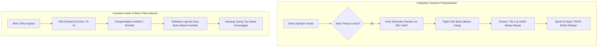

# DOKUMEN ANALISIS & REKAYASA SISTEM PERPUSTAKAAN
**SMP Negeri 1 Boyolangu — Smart School E-Library & Buku Paket Terpadu**

---

## 1. Ringkasan Eksekutif & Prinsip Kebijakan Sekolah

Berdasarkan audit operasional dan arahan pimpinan sekolah, sistem perpustakaan SMPN 1 Boyolangu menganut **kebijakan perpustakaan modern, humanis, dan pro-literasi anak**:
1. **Penghapusan Denda 100%:** Denda keterlambatan uang tunai (finansial) **ditiadakan secara permanen**. Sekolah tidak memungut uang dari keterlambatan pengembalian buku guna mendorong minat baca tanpa rasa takut terkena denda.
2. **Penghapusan Penahanan Ijazah / Rapor:** Sistem Bebas Pustaka bersifat edukatif dan inventarisasi aset negara, **sama sekali tidak boleh menahan ijazah, rapor, maupun hak kelulusan siswa**.
3. **Kolektif Akhir Tahun KBM:** Alur kenaikan kelas membutuhkan pengembalian buku paket tahunan massal per rombongan belajar (rombel) disertai pelaporan sisa buku yang belum kembali.
4. **Penagihan Siswa Lulus / Keluar:** Siswa berstatus nonaktif (alumni/mutasi) yang masih memegang buku fisik tetap wajib terdeteksi dalam laporan tagihan dan dihubungi melalui pesan WhatsApp orang tua.
5. **Pembalikan Status Buku Hilang (Lost-to-Found):** Buku yang sempat dilaporkan hilang dan ditemukan kembali harus memiliki alur pemulihan status instan ke stok tersedia.
6. **Batas Pinjam Berdasarkan Kategori:** Buku kategori Referensi (Kamus, Ensiklopedia, Atlas Langka) **hanya boleh dibaca di tempat**. Buku fiksi/umum dibatasi maksimal 3 buku dengan masa pinjam 7 hari kerja.
7. **Perlindungan Privasi Riwayat Baca:** Data peminjaman dan preferensi bacaan adalah data pribadi anak yang dilindungi; tidak boleh diakses sembarang pihak.
8. **Konsistensi Zona Waktu:** Seluruh batas jatuh tempo dihitung seragam menggunakan waktu lokal Indonesia Barat (`Asia/Jakarta` / WIB, UTC+7).

---

## 2. Analisis Kritis Temuan & Rencana Penyelesaian



---

### A. Kenaikan Kelas: Pengembalian Massal per Rombel & Laporan Sisa

#### Masalah Saat Ini
Saat ini di [`libraryController.ts`](file:///c:/APK/backend/src/controllers/libraryController.ts) dan [`bookCirculationController.ts`](file:///c:/APK/backend/src/controllers/bookCirculationController.ts), pengembalian buku dilakukan manual satu per satu (`returnBookCopy` dan `operatorContinuousReturn`). Ketika kenaikan kelas tiba (misal ~1.000 siswa mengembalikan rata-rata 10–12 buku paket per siswa = >10.000 buku), loket perpustakaan mengalami penumpukan antrean parah jika harus dipindai satu per satu tanpa opsi batch rombel.

#### Solusi Rekayasa
1. **Endpoint Pengembalian Kolektif per Rombel (`POST /api/v1/library/bulk-return-class`):**
   - Menerima parameter `className` (contoh: `VII-A`), `academicYear` (default `2026/2027`), dan opsional `bookType` (`BUKU_PAKET`).
   - Melakukan batch update transaksional:
     * Menandai seluruh `StudentBookAssignment` atau `LibraryBorrowing` aktif di kelas tersebut menjadi `status: 'RETURNED'`, `returnedAt: new Date()`.
     * Memperbarui eksemplar fisik `PackageBookCopy` / `BookCopy` menjadi `status: 'TERSEDIA'` / `AVAILABLE`.
     * Mengosongkan peminjam aktif.
2. **Laporan Sisa Tanggungan per Rombel (`GET /api/v1/library/unreturned-report`):**
   - Menghasilkan rekap matriks per rombel:
     * Jumlah siswa di rombel.
     * Jumlah buku paket yang sudah kembali vs belum kembali.
     * Daftar nama siswa, NISN, judul buku, dan kode barcode yang belum dikembalikan.
     * Persentase kelengkapan pengembalian untuk bahan evaluasi rapat kenaikan kelas.

---

### B. Siswa Lulus / Keluar: Akun Nonaktif Tetap Bisa Ditagih

#### Masalah Saat Ini
Sebagian query pencarian di modul perpustakaan menyaring siswa dengan `user.isActive: true` atau hanya mengambil siswa terdaftar di kelas aktif. Akibatnya, siswa kelas IX yang telah berstatus `ALUMNI` atau siswa yang `MUTASI` keluar tidak muncul di laporan inventaris penunggak buku.

#### Solusi Rekayasa
1. **Hapus Filter `isActive: true` pada Query Penagihan:**
   Pada fungsi pencarian tunggakan dan sirkulasi, relasi `user` tidak boleh dibatasi oleh status aktif akun.
2. **Tagihan Buku Fisik Alumni:**
   Buat alur penagihan WhatsApp Gateway ke nomor telepon orang tua siswa lulus/keluar yang masih tercatat memegang buku fisik sekolah:
   > *"Yth. Orang Tua dari Ananda [Nama Siswa] (Alumni/Mutasi). Menurut catatan inventaris perpustakaan SMPN 1 Boyolangu, terdapat 1 buku perpustakaan yang belum diserahterimakan kembali: [Judul Buku] (Barcode: [Barcode]). Mohon bantuan untuk mengembalikan buku fisik tersebut ke ruang perpustakaan sekolah pada hari dan jam kerja. Terima kasih atas kerja samanya."*

---

### C. Alur Pembalikan Status: Buku Hilang vs "Ditemukan Kembali"

#### Masalah Saat Ini
Ketika buku hilang dilaporkan (`status: 'HILANG'` atau `LOST`), status eksemplar terkunci sebagai hilang. Tidak ada alur resmi di API/UI untuk mencatat pembalikan status (*Lost-to-Found Reversal*) saat buku tersebut ditemukan kembali di laci kelas atau dikembalikan belakangan oleh siswa.

#### Solusi Rekayasa
1. **Endpoint Pemulihan Status Buku (`POST /api/v1/library/revert-lost-status`):**
   - Parameter: `barcodeCode`, `kondisi` (`BAIK`, `RUSAK_RINGAN`), `keterangan` (contoh: *"Buku tertinggal di lab IPA dan ditemukan kembali"*).
   - Aksi:
     * Eksemplar buku (`BookCopy` / `PackageBookCopy` / `LibraryBookCopy`) dikembalikan ke status `AVAILABLE` / `TERSEDIA`.
     * Riwayat peminjaman yang tertunda diselesaikan dengan status `RETURNED` tanpa denda.
     * Mencatat audit log inventaris pemulihan buku aset sekolah.

---

### D. Penghapusan Denda 100% & Peniadaan Penahanan Ijazah

#### Masalah Saat Ini
Di [`libraryEnhancedController.ts`](file:///c:/APK/backend/src/controllers/libraryEnhancedController.ts#L115-L132), terdapat kalkulasi denda:
```typescript
const diffTime = Math.abs(now.getTime() - activeLoan.jatuhTempo.getTime());
const diffDays = Math.ceil(diffTime / (1000 * 60 * 60 * 24));
fine = diffDays * finePerDay; // Rp 1.000 / hari
```
Ini bertentangan dengan kebijakan humanis sekolah dan instruksi pimpinan. Siswa juga khawatir ijazah ditahan karena urusan denda/tanggungan perpus.

#### Solusi Rekayasa
1. **Denda Nol Mutlak:**
   - Hapus kalkulasi `diffDays * 1000`. Set nilai denda menjadi `0` dan `statusDenda: 'LUNAS'` secara otomatis.
   - Hapus seluruh notifikasi dan pesan SMS/WhatsApp yang menyebut nominal denda rupiah.
2. **Klausul Anti-Penahanan Ijazah / Rapor:**
   - Surat Bebas Pustaka dinyatakan sebagai **dokumen verifikasi aset edukatif**, bukan syarat penahan hak ijazah.
   - Hak kelulusan siswa tidak boleh dibatalkan atau ditangguhkan oleh petugas perpustakaan.

---

### E. Batas Pinjam & Masa Pinjam per Kategori

#### Aturan Kebijakan
| Kategori Buku | Batas Maksimum | Masa Pinjam | Kebijakan Peminjaman |
|---|:---:|:---:|---|
| **Buku Referensi** (Kamus, Ensiklopedia, Atlas, Buku Pegangan Guru) | 1 buku | 0 hari (Sesi jam buka) | **Hanya Baca di Tempat** (In-Library Reading). Ditolak jika dipinjam bawa pulang. |
| **Buku Umum / Fiksi / Non-Fiksi** | **Maks. 3 buku** / siswa | **7 Hari Kerja** | Boleh dipinjam pulang, perpanjangan maks. 1x. |
| **Buku Paket Tahunan Rombel** | 1 eks / mapel | **1 Tahun Pelajaran** | Hak wajib belajar seluruh siswa tiap mata pelajaran. |

#### Validasi di Controller:
```typescript
// 1. Cek Kategori Referensi
if (buku.category === 'REFERENSI' || copy.buku.kategori === 'REFERENSI') {
    return res.status(400).json({
        success: false,
        message: 'Buku kategori Referensi (Kamus/Ensiklopedia/Atlas) hanya dapat dibaca di ruang perpustakaan dan tidak diizinkan untuk dipinjam bawa pulang.'
    });
}

// 2. Cek Kuota Maksimum Buku Umum
const activeGeneralLoansCount = await prisma.libraryBorrowing.count({
    where: {
        userId: student.id,
        status: 'BORROWED',
        book: { category: { not: 'BUKU_PAKET' } }
    }
});
if (activeGeneralLoansCount >= 3) {
    return res.status(400).json({
        success: false,
        message: 'Batas peminjaman buku umum telah mencapai kuota maksimum (3 buku). Harap kembalikan buku sebelumnya sebelum meminjam judul baru.'
    });
}
```

---

### F. Perlindungan Privasi Riwayat Baca Siswa

1. **Akses Data Terbatas (Need-to-Know Basis):**
   - Riwayat bacaan siswa adalah data pribadi anak yang dilindungi undang-undang pelindungan data pribadi (UU PDP).
   - Siswa hanya berhak melihat riwayat bacanya sendiri (`req.user.id === studentId`).
   - Siswa lain, guru non-wali kelas, atau pengguna luar tidak diizinkan mengakses judul buku yang pernah dipinjam anak lain.
   - Hak akses melihat riwayat baca kelas hanya dimiliki oleh: Pustakawan (`LIBRARIAN`), Wali Kelas bersangkutan, dan Administrator Sekolah.
2. **Kebijakan Retensi:**
   - Riwayat log baca disimpan selama masa aktif anak bersekolah untuk keperluan monitoring literasi GLS (Gerakan Literasi Sekolah). Setelah 1 tahun siswa lulus, data riwayat detail dapat diarsipkan secara anonim.

---

### G. Konsistensi Zona Waktu Asia/Jakarta (WIB)

1. Perhitungan jatuh tempo (`dueDate`) harus selalu dinormalisasi ke zona waktu `Asia/Jakarta` (WIB, UTC+7) pada pukul **15:00 WIB** (jam operasional tutup loket perpustakaan) atau **23:59:59 WIB** akhir hari.
2. Menghindari pergeseran tanggal akibat UTC-offset saat dikonversi ke ISO-string:
```typescript
function calculateJakartaDueDate(days: number): Date {
    const date = new Date();
    // Tambah hari
    date.setDate(date.getDate() + days);
    // Set batas akhir jam kerja perpus: 15:00 WIB (08:00 UTC)
    date.setUTCHours(8, 0, 0, 0);
    return date;
}
```

---

## 3. Matriks Perubahan Kode & Endpoint Baru

| No | Endpoint / Fungsi | File Target | Deskripsi Perubahan |
|:---:|---|---|---|
| 1 | `POST /api/v1/library/bulk-return-class` | [`libraryController.ts`](file:///c:/APK/backend/src/controllers/libraryController.ts) | Pengembalian kolektif buku paket per rombel saat kenaikan kelas |
| 2 | `GET /api/v1/library/unreturned-report` | [`libraryController.ts`](file:///c:/APK/backend/src/controllers/libraryController.ts) | Laporan sisa buku belum kembali per rombel & siswa nonaktif |
| 3 | `POST /api/v1/library/revert-lost-status` | [`libraryController.ts`](file:///c:/APK/backend/src/controllers/libraryController.ts) | Alur pembalikan status buku hilang yang ditemukan kembali |
| 4 | Penghapusan denda & set `denda: 0` | [`libraryEnhancedController.ts`](file:///c:/APK/backend/src/controllers/libraryEnhancedController.ts) | Bebas denda total dan hapus status denda finansial |
| 5 | Validasi kuota 3 buku & referensi | [`libraryController.ts`](file:///c:/APK/backend/src/controllers/libraryController.ts) | Batas kuota dan larangan bawa pulang buku referensi |
| 6 | Proteksi kepemilikan riwayat baca | [`libraryController.ts`](file:///c:/APK/backend/src/controllers/libraryController.ts) | Pembatasan akses riwayat baca (hanya siswa sendiri & pustakawan) |
| 7 | Normalisasi jam WIB `Asia/Jakarta` | [`libraryController.ts`](file:///c:/APK/backend/src/controllers/libraryController.ts) | Standardisasi waktu jatuh tempo perpustakaan |
