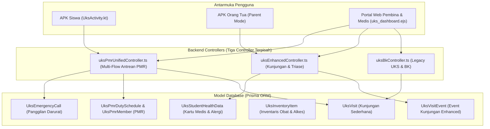

# DOKUMEN ANALISIS & REKAYASA SISTEM UKS & PMR
**SMP Negeri 1 Boyolangu — Unit Kesehatan Sekolah & Palang Merah Remaja (APK & Portal Web)**

---

## 1. Ringkasan Eksekutif & Ruang Lingkup Sistem

Modul Unit Kesehatan Sekolah (UKS) dan Palang Merah Remaja (PMR) di SMPN 1 Boyolangu berfungsi sebagai pusat pertolongan pertama, pemantauan kesehatan siswa, rujukan faskes, dan tata kelola piket relawan siswa PMR. Modul ini terpasang pada dua antarmuka utama:
1. **Aplikasi Android Siswa & Petugas (`android_app/`):**
   - [`UksActivity.kt`](file:///c:/APK/android_app/app/src/main/java/com/school/smartcbt/ui/UksActivity.kt) & [`activity_uks.xml`](file:///c:/APK/android_app/app/src/main/res/layout/activity_uks.xml).
   - Layanan: Permohonan sakit mandiri dari kelas, pantau ranjang UKS, notifikasi orang tua, rekam medis kartu kesehatan, dan daftar piket PMR.
2. **Portal Web Manajemen UKS (`backend/src/views/`):**
   - [`uks_dashboard.ejs`](file:///c:/APK/backend/src/views/uks_dashboard.ejs).
   - Layanan: Meja Triase Petugas Medis, inventaris obat & alkes, penanganan insiden darurat, monitoring keterisian tempat tidur (bed tracking), dan penerbitan izin checkout/rujukan faskes.

---

## 2. Arsitektur Komponen Saat Ini & Peta Data

---

## 3. Analisis Kritis Temuan & Risiko Sistem

### Temuan 1: Fragmentasi Model Kunjungan & Status Pasien (Risiko Data Ganda)
* **Kondisi Saat Ini:**
  Terdapat dua tabel kunjungan yang berjalan sendiri-sendiri:
  - `UksVisit`: dipakai oleh [`uksPmrUnifiedController.ts`](file:///c:/APK/backend/src/controllers/uksPmrUnifiedController.ts) dengan status `WAITING`, `IN_TREATMENT`, `RESTING`, `FINISHED`, `PICKED_UP`.
  - `UksVisitEvent`: dipakai oleh [`uksEnhancedController.ts`](file:///c:/APK/backend/src/controllers/uksEnhancedController.ts) dengan status `SEDANG_DIRAWAT`, `PERLU_DIJEMPUT`, `DIRUJUK_PUSKESMAS`, `SUDAH_KEMBALI`.
* **Dampak:**
  Siswa yang melapor via APK bisa tidak muncul di dashboard portal web jika salah satu modul memanggil endpoint yang berbeda. Petugas medis di portal melihat data `UksVisitEvent`, sedangkan antrean PMR melihat `UksVisit`.
* **Solusi Penyatuan (Unified Architecture):**
  - Standarisasi satu *single source of truth* untuk siklus hidup pasien UKS:
    $$\text{WAITING} \longrightarrow \text{IN_TREATMENT} \longrightarrow \begin{cases} \text{RESTING (Observasi Tempat Tidur)} \\ \text{PERLU_DIJEMPUT (Notif Ortu via WA)} \\ \text{RUJUK_FASKES (Puskesmas / RS)} \\ \text{KEMBALI_KE_KELAS (Selesai/Sehat)} \end{cases}$$
  - Sinkronkan kedua controller agar membaca dan memperbarui data secara konsisten.

---

### Temuan 2: Presensi Siswa Rawan Alpa saat Dirawat di UKS
* **Kondisi Saat Ini:**
  Ketika seorang siswa pingsan saat upacara atau sakit di tengah KBM dan harus dirawat 2–3 jam di UKS, guru mata pelajaran di kelas yang mengabsen jurnal KBM tidak mendapat indikator bahwa anak tersebut sah berada di ruang UKS. Anak berisiko ditandai `ALPA` atau bolos kelas.
* **Solusi Rekayasa:**
  - Tambahkan integrasi otomatis ke modul presensi (`attendanceController` / `classAttendanceSessionController`):
    Ketika petugas UKS menandai status pasien `IN_TREATMENT` atau `RESTING`, sistem secara otomatis mengibarkan status `IS_AT_UKS` pada presensi siswa untuk tanggal & jam pelajaran tersebut.
  - Guru mapel di portal dan APK Guru melihat badge hijau: **"🏥 Sedang di UKS (Sejak 08:15 WIB)"**, sehingga tidak ada salah sangka siswa membolos.

---

### Temuan 3: Notifikasi Darurat & Integrasi WhatsApp Orang Tua
* **Kondisi Saat Ini:**
  Di [`uksEnhancedController.ts`](file:///c:/APK/backend/src/controllers/uksEnhancedController.ts#L106-L125), ketika kondisi anak memburuk (`triage === 'PERLU_DIJEMPUT'`), sistem hanya mengirimkan push notifikasi FCM (`sendFcmToUser`). Jika HP orang tua sedang offline atau aplikasi tidak aktif di latar belakang, pesan darurat tidak terbaca.
* **Solusi Rekayasa:**
  - Tambahkan pengiriman otomatis pesan darurat via **WhatsApp Gateway** langsung ke nomor `parentPhone`:
    > *"Pemberitahuan Darurat UKS SMPN 1 Boyolangu: Ananda [Nama Siswa] (Kelas [Kelas]) saat ini sedang dirawat di ruang UKS dengan keluhan: [Keluhan]. Petugas medis menyarankan agar ananda dijemput untuk istirahat di rumah. Silakan menuju Pos Satpam/Ruang UKS sekolah. Konfirmasi penjemputan dapat dilakukan melalui aplikasi."*
  - Saat orang tua tiba di gerbang sekolah, satpam di [`activity_satpam_main.xml`](file:///c:/APK/android_app/app/src/main/res/layout/activity_satpam_main.xml) dapat memverifikasi QR Gatepass penjemputan siswa sakit secara sah.

---

### Temuan 4: Manajemen Stok Obat, Kadaluwarsa (Expired), dan Pengurangan Otomatis
* **Kondisi Saat Ini:**
  - Fungsi pemberian obat di [`uksBkController.ts`](file:///c:/APK/backend/src/controllers/uksBkController.ts) dan [`uks_dashboard.ejs`](file:///c:/APK/backend/src/views/uks_dashboard.ejs) masih mengizinkan pengubahan stok manual (`prompt`).
  - Belum ada validasi stok atomik (stok bisa bernilai negatif / minus).
  - Belum ada pelacak tanggal kadaluwarsa (*expiry date*) obat, yang sangat berisiko bagi keselamatan siswa jika obat kadaluwarsa tanpa sengaja terminum.
* **Solusi Rekayasa:**
  1. Tambahkan kolom `expiryDate: DateTime?` dan `batchNumber: String?` pada model obat.
  2. Implementasikan *early warning alert*: Obat yang kadaluwarsa dalam 30 hari atau sudah lewat tanggalnya otomatis ditandai merah (*EXPIRED*) dan dinonaktifkan dari pilihan resep.
  3. Pengurangan otomatis (*auto-deduct*): Ketika petugas merawat siswa dan memilih *"Beri Paracetamol 1 Tablet"*, stok obat di inventaris langsung berkurang 1 unit secara atomik dengan catatan audit resep.

---

### Temuan 5: Tata Kelola Triase & Batas Hak Akses Anggota PMR
* **Kondisi Saat Ini:**
  Siswa anggota PMR memiliki hak login di APK, namun batasan wewenang antara tindakan siswa PMR vs Guru Pembina UKS belum tegas di tingkat API:
* **Matriks Wewenang Baru:**
  | Tindakan UKS | Siswa Piket PMR | Guru Pembina / Medis |
  |---|:---:|:---:|
  | Catat keluhan siswa datang & tensi/suhu | ✅ Boleh | ✅ Boleh |
  | Berikan air teh hangat / minyak kayu putih | ✅ Boleh | ✅ Boleh |
  | Berikan obat oral (Paracetamol, Antasida) | ⚠️ Butuh Konfirmasi Pembina | ✅ Boleh |
  | Putuskan siswa dipulangkan / dijemput orang tua | ❌ Dilarang (Harus Pembina) | ✅ Boleh |
  | Putuskan rujukan Puskesmas / Rumah Sakit | ❌ Dilarang | ✅ Boleh |
  | Tambah / kurangi master obat inventaris | ❌ Dilarang | ✅ Boleh |

---

### Temuan 6: Privasi Rekam Medis Anak & Keamanan Data (UU PDP)
* **Kondisi Saat Ini:**
  Data alergi dan riwayat penyakit siswa tersimpan di tabel `UksStudentHealthData` dan `User`.
* **Solusi Rekayasa:**
  - Data rekam medis siswa (riwayat asma, alergi berat, penyakit jantung bawaan) diklasifikasikan sebagai data sensitif.
  - Siswa lain yang bertugas piket PMR hanya dapat melihat informasi dasar yang relevan dengan pertolongan pertama (contoh: *"Alergi Paracetamol"* atau *"Riwayat Asma"* saat anak sesak napas), tanpa melihat catatan konseling psikologis atau diagnosa mendalam yang bersifat rahasia.
  - Akses riwayat penuh hanya dibuka untuk Tenaga Kesehatan Sekolah dan Orang Tua yang bersangkutan.

---

### Temuan 7: Monitoring Ranjang Pasien (Bed Occupancy) Real-Time
* **Kondisi Saat Ini:**
  Kapasitas ranjang UKS sekolah (misal 6 tempat tidur: 3 ruang putra, 3 ruang putri) sering tidak akurat antara data di papan tulis UKS dengan aplikasi.
* **Solusi Rekayasa:**
  - Tambahkan pemetaan nomor bed: `bedNumber: 'BED-PA-1'`, `'BED-PI-2'`, dst.
  - Saat siswa dialokasikan istirahat (`RESTING`), ranjang otomatis berubah warna menjadi merah (Terisi - Nama Siswa). Saat checkout / kembali ke kelas, ranjang berubah hijau (Kosong).
  - Tampilan visual denah ranjang disajikan interaktif baik di [`uks_dashboard.ejs`](file:///c:/APK/backend/src/views/uks_dashboard.ejs) maupun di kartu atas [`UksActivity.kt`](file:///c:/APK/android_app/app/src/main/java/com/school/smartcbt/ui/UksActivity.kt).

---

## 4. Matriks Rencana Implementasi & Perbaikan Kode

| No | Modul / Komponen | File Target | Rencana Perbaikan Konkret |
|:---:|---|---|---|
| 1 | **Unified Kunjungan UKS** | [`uksPmrUnifiedController.ts`](file:///c:/APK/backend/src/controllers/uksPmrUnifiedController.ts) & [`uksEnhancedController.ts`](file:///c:/APK/backend/src/controllers/uksEnhancedController.ts) | Sinkronisasi alur status: `WAITING` $\to$ `IN_TREATMENT` $\to$ `RESTING` / `PERLU_DIJEMPUT` / `RUJUK_FASKES` / `KEMBALI_KE_KELAS`. |
| 2 | **Presensi KBM Otomatis** | [`uksPmrUnifiedController.ts`](file:///c:/APK/backend/src/controllers/uksPmrUnifiedController.ts) | Sinkronisasi status siswa di UKS agar guru mapel melihat status `IZIN_UKS` (bebas tuduhan alpa). |
| 3 | **WhatsApp Darurat Ortu** | [`uksEnhancedController.ts`](file:///c:/APK/backend/src/controllers/uksEnhancedController.ts) & [`whatsappBlastService.ts`](file:///c:/APK/backend/src/services/whatsappBlastService.ts) | Kirim notifikasi WA instan ke nomor orang tua saat status `PERLU_DIJEMPUT` atau `RUJUK_FASKES`. |
| 4 | **Inventaris Obat & Kadaluwarsa** | [`uksBkController.ts`](file:///c:/APK/backend/src/controllers/uksBkController.ts) & [`uks_dashboard.ejs`](file:///c:/APK/backend/src/views/uks_dashboard.ejs) | Validasi stok anti-minus, peringatan obat kadaluwarsa, dan rekam pemakaian obat per pasien. |
| 5 | **Pembatasan Peran PMR** | [`uksPmrUnifiedController.ts`](file:///c:/APK/backend/src/controllers/uksPmrUnifiedController.ts) | Filter role: PMR hanya boleh catat keluhan & pertolongan pertama, pembina/medis yang validasi kepulangan. |
| 6 | **Live Bed Tracking** | [`uks_dashboard.ejs`](file:///c:/APK/backend/src/views/uks_dashboard.ejs) & [`UksActivity.kt`](file:///c:/APK/android_app/app/src/main/java/com/school/smartcbt/ui/UksActivity.kt) | Sinkronisasi real-time nomor bed pasien putra dan putri. |
| 7 | **UI Refinement APK Siswa** | [`UksActivity.kt`](file:///c:/APK/android_app/app/src/main/java/com/school/smartcbt/ui/UksActivity.kt) & [`activity_uks.xml`](file:///c:/APK/android_app/app/src/main/res/layout/activity_uks.xml) | Form pelaporan sakit yang ramah anak, panduan pertolongan pertama cepat, dan tombol darurat. |
