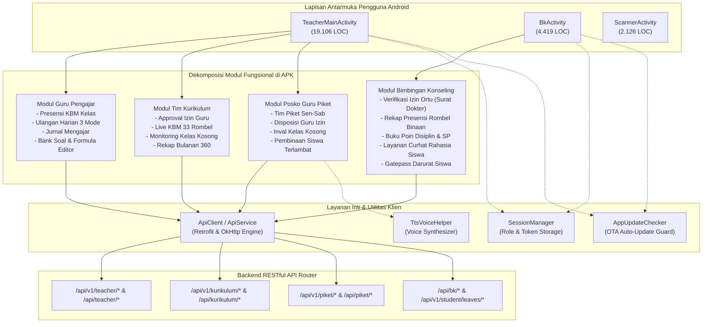
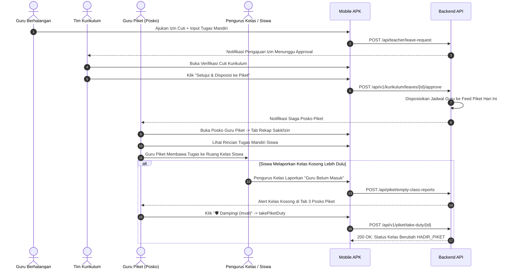
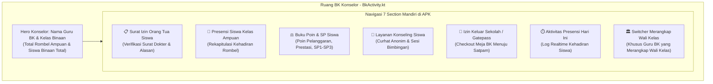
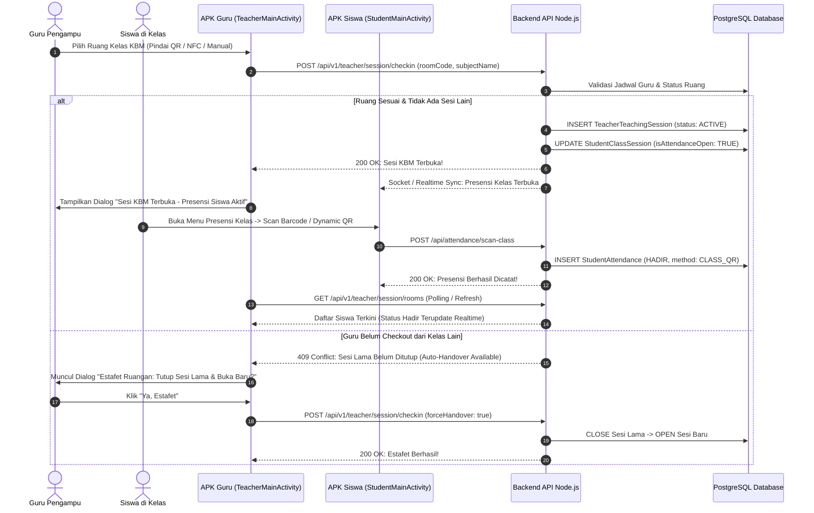
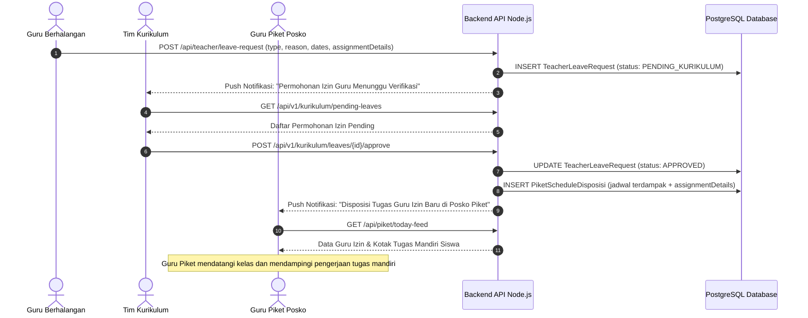
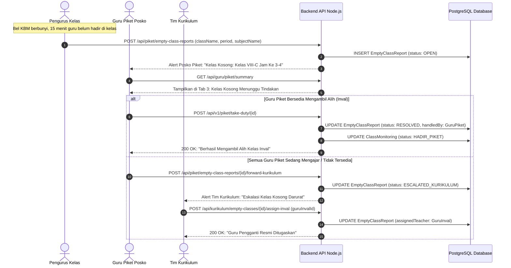
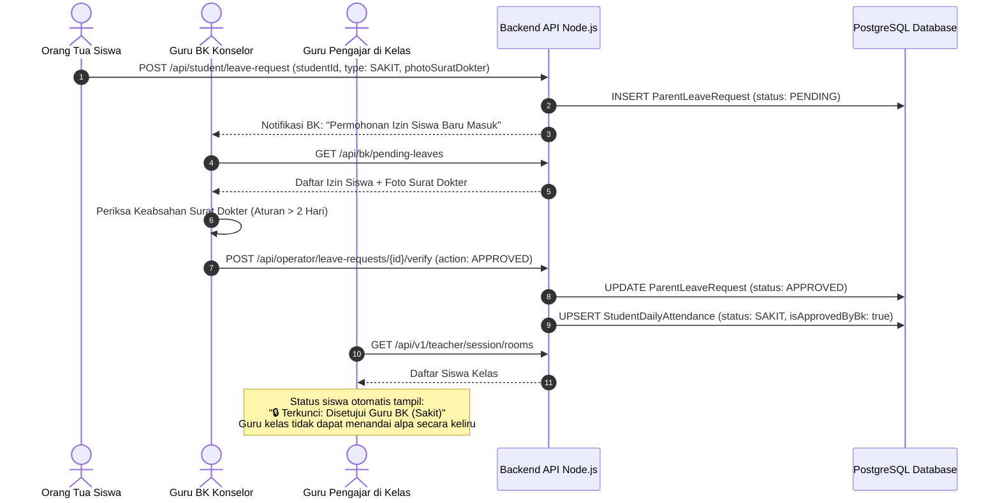

# LAPORAN AUDIT TEKNIS INDEPENDEN: FITUR APLIKASI MOBILE (APK ANDROID)
## Khusus Modul: Guru Pengajar, Tim Kurikulum, Posko Guru Piket, & Guru BK
### Platform Ekosistem Terpadu SMP Negeri 1 Boyolangu (SmartSchool / SmartCBT 2026)

*Dokumen Audit Arsitektur Klien Native Android Skala Penuh untuk Evaluasi Kinerja, Pemetaan Alur Sistem, dan Pengujian Validasi oleh AI Independen*

---

## DAFTAR ISI
1. [Informasi Metadata & Ringkasan Eksekutif Audit APK](#1-informasi-metadata--ringkasan-eksekutif-audit-apk)
2. [Topologi Arsitektur Klien Native Android (Kotlin Tier)](#2-topologi-arsitektur-klien-native-android-kotlin-tier)
3. [Audit Mendalam Fitur Guru Pengajar (`TeacherMainActivity.kt`)](#3-audit-mendalam-fitur-guru-pengajar-teachermainactivitykt)
   - 3.1 Presensi KBM Sesi Ruang Kelas (Anti-Salah Kamar & Auto-Handover)
   - 3.2 Pembukaan & Penguncian Presensi Mandiri Siswa
   - 3.3 Ulangan Harian (UH) 3 Mode & Live Monitoring Kelas
   - 3.4 Jurnal Mengajar Real-Time & Kendala Kelas
   - 3.5 Bank Soal Mandiri & Formula Editor Rumus Matematika/Sains
   - 3.6 Pengajuan Cuti / Izin Guru (Jalur Kurikulum ➔ Piket)
   - 3.7 Manajemen Dokumen Mengajar & E-Files
   - 3.8 Multi-Role Switcher Dinamis Guru
4. [Audit Mendalam Fitur Tim Kurikulum (`TeacherMainActivity.kt` - Modul Kurikulum)](#4-audit-mendalam-fitur-tim-kurikulum-teachermainactivitykt---modul-kurikulum)
   - 4.1 Pusat Kendali Akademik (Hero Dashboard & 12 Modul Terintegrasi)
   - 4.2 Verifikasi Cuti/Izin Guru & Disposisi Otomatis ke Guru Piket
   - 4.3 Monitoring Live KBM 33 Rombel & Deteksi Inaktivitas
   - 4.4 Manajemen Kelas Kosong & Penugasan Inval
   - 4.5 Rekap Presensi Guru 360 Derajat (Sesi KBM & Izin Resmi)
   - 4.6 Rekap Bulanan Wali Kelas & Laporan Rapor
   - 4.7 Master Distribusi Jadwal Mengajar Sekolah
   - 4.8 Master Bank Soal & Distribusi Ujian CBT Sekolah
   - 4.9 Laporan Supervisi Dinas & Cetak PDF Resmi
5. [Audit Mendalam Fitur Posko Guru Piket (`TeacherMainActivity.kt` - Modul Piket)](#5-audit-mendalam-fitur-posko-guru-piket-teachermainactivitykt---modul-piket)
   - 5.1 Posko Guru Piket Hari Ini & Jadwal Piket Lengkap (Senin - Sabtu)
   - 5.2 Disposisi Cuti/Izin Guru & Tugas Mandiri Siswa
   - 5.3 Monitoring Kelas Kosong & Aksi Inval (`takePiketDuty`)
   - 5.4 Eskalasi Laporan Kelas Kosong ke Kurikulum
   - 5.5 Integrasi Log Keterlambatan Gerbang & Pembinaan Piket
6. [Audit Mendalam Fitur Guru BK / Konselor (`BkActivity.kt`)](#6-audit-mendalam-fitur-guru-bk--konselor-bkactivitykt)
   - 6.1 Ruang BK Konselor & Navigasi 7 Section
   - 6.2 Verifikasi Izin Siswa dari Orang Tua & Validasi Surat Dokter
   - 6.3 Rekapitulasi Presensi Siswa Kelas Binaan (Per Rombel VII, VIII, IX)
   - 6.4 Buku Poin Tata Tertib & Surat Peringatan (SP1, SP2, SP3)
   - 6.5 Layanan Konseling & Curhat Siswa Rahasia / Anonim
   - 6.6 Izin Keluar Sekolah Darurat (Gatepass KBM & Station Meja BK)
   - 6.7 Log Aktivitas Harian BK & Sistem Peringatan Dini (Early Warning)
7. [Jalur Sistem, Jalur Data, & Alur Proses End-to-End (Mermaid Workflow Traces)](#7-jalur-sistem-jalur-data--alur-proses-end-to-end-mermaid-workflow-traces)
   - 7.1 Alur KBM Presensi Guru & Pembukaan Presensi Mandiri Siswa
   - 7.2 Alur Rantai Cuti Guru: Guru ➔ Kurikulum Approval ➔ Disposisi Posko Piket
   - 7.3 Alur Kelas Kosong: Lapor Pengurus Kelas ➔ Posko Piket ➔ Eskalasi Kurikulum
   - 7.4 Alur Izin Sakit Siswa: Ortu Upload Surat ➔ Verifikasi BK ➔ Sinkronisasi Guru Kelas
   - 7.5 Alur Konseling Siswa & Poin Disiplin: Siswa Curhat ➔ Pembinaan BK ➔ Notifikasi Ortu
8. [Katalog Temuan Bug, Analisis Risiko Arsitektural, & Titik Kelemahan APK](#8-katalog-temuan-bug-analisis-risiko-arsitektural--titik-kelemahan-apk)
   - 8.1 Masalah Arsitektur: Monolithic God Activity Pattern
   - 8.2 Bug Sinkronisasi Latensi pada Approval Cuti Guru & Disposisi Piket
   - 8.3 Risiko Memory Leak pada Fullscreen Programmatic Dialogs
   - 8.4 Penanganan Edge Case Geolocation & GPS Timeout di Dalam Gedung
   - 8.5 Risiko Out-of-Memory (OOM) saat Preview Dokumen Surat Dokter
   - 8.6 Ketidakteraturan Cache Offline saat Terjadi Fluktuasi Sinyal
9. [Kerangka Kerja & Panduan Audit Independen untuk AI Lain](#9-kerangka-kerja--panduan-audit-independen-untuk-ai-lain)

---

## 1. INFORMASI METADATA & RINGKASAN EKSEKUTIF AUDIT APK

### 1.1 Lembar Fakta Lingkungan Audit APK
* **Nama Klien:** Smart CBT & School Management Native Android Application
* **Versi Rilis Terdokumentasi:** **v2.9.4** (`versionCode: 174`)
* **Lingkungan Target:** SMP Negeri 1 Boyolangu, Tulungagung, Jawa Timur
* **Basis Kode Sumber Klien:**
  * **Bahasa Pemrograman:** Kotlin 1.9+, Java 17 compatibility
  * **Target SDK:** Android SDK 34 (Android 14 Ready, Min SDK 24 / Android 7.0 Nougat)
  * **Arsitektur Jaringan:** Retrofit 2.9.0 + OkHttp 4.12.0 (Connection Pool, Timeout 45s, Auto Retry)
  * **Penyimpanan Lokal:** Encrypted/SharedPreferences via `SessionManager.kt`
  * **Hardware Perangkat Terdaftar:** 1.401 Perangkat Klien Mobile (Siswa, Guru, Orang Tua, Staff)

### 1.2 Ringkasan Metrik Skala Berkas Sumber Android Klien
| Komponen Klien | Berkas Sumber Utama | Baris Kode (LOC) | Deskripsi Peran & Tanggung Jawab |
| :--- | :--- | :---: | :--- |
| **Guru, Kurikulum, & Piket** | [`TeacherMainActivity.kt`](file:///c:/APK/android_app/app/src/main/java/com/school/smartcbt/ui/TeacherMainActivity.kt) | **19.106 Baris** | Menangani seluruh aktivitas KBM, Ulangan Harian, Pusat Kurikulum, Posko Piket, Jurnal, dan Bank Soal |
| **Bimbingan Konseling (BK)** | [`BkActivity.kt`](file:///c:/APK/android_app/app/src/main/java/com/school/smartcbt/ui/BkActivity.kt) | **4.419 Baris** | Menangani izin orang tua, rekap presensi kelas binaan, buku poin/SP, konseling rahasia, dan gatepass meja BK |
| **Scanner & Validasi QR/NFC** | [`ScannerActivity.kt`](file:///c:/APK/android_app/app/src/main/java/com/school/smartcbt/ScannerActivity.kt) | **2.126 Baris** | Pemindaian barcode kelas fisik, QR dinamis, NFC tag kelas, dan verifikasi barcode gatepass |
| **Networking & API Gateway** | [`ApiService.kt`](file:///c:/APK/android_app/app/src/main/java/com/school/smartcbt/data/remote/ApiService.kt) | **850+ Baris** | 100+ Deklarasi Endpoint RESTful Retrofit yang melayani aplikasi mobile |
| **Manajemen Sesi & Role** | [`SessionManager.kt`](file:///c:/APK/android_app/app/src/main/java/com/school/smartcbt/utils/SessionManager.kt) | **350+ Baris** | Multi-role dynamic switcher, JWT token caching, active role state management |

---

## 2. TOPOLOGI ARSITEKTUR KLIEN NATIVE ANDROID (KOTLIN TIER)

Aplikasi Android SmartSchool menggunakan pendekatan **Component-Based Activity Architecture** dengan implementasi antarmuka berbasis gabungan XML ViewBinding dan **Programmatic Dynamic View Rendering (Kotlin UI Builders)** untuk rendering dialog dinamis berkecepatan tinggi.



---

## 3. AUDIT MENDALAM FITUR GURU PENGAJAR (`TeacherMainActivity.kt`)

Guru pengajar di SMPN 1 Boyolangu memiliki tanggung jawab utama dalam pelaksanaan KBM kelas harian. Berdasarkan kode sumber, berikut adalah audit menyeluruh terhadap fitur yang tersedia di APK:

### 3.1 Presensi KBM Sesi Ruang Kelas (Anti-Salah Kamar & Auto-Handover)
* **Filosofi Resmi Sekolah:** Guru **TIDAK MENGGUNAKAN** presensi gerbang datang/pulang. Kehadiran resmi guru murni dihitung dari waktu check-in dan check-out di setiap ruang kelas yang diampu sesuai jadwal pelajaran.
* **Metode Identifikasi Ruangan:**
  1. *Pemindaian QR Stiker Pintu Ruang Kelas:* Memindai QR fisik di depan pintu kelas via [`ScannerActivity.kt`](file:///c:/APK/android_app/app/src/main/java/com/school/smartcbt/ScannerActivity.kt).
  2. *NFC Tap Tag Ruang:* Menempelkan ponsel ke tag NFC ruangan (`nfcTagUid`).
  3. *Pilihan Manual Ruang Berbasis Jadwal:* Guru memilih ruang dari daftar rombel binaan melalui dialog interaktif [`showManualSelectRoomDialog()`](file:///c:/APK/android_app/app/src/main/java/com/school/smartcbt/ui/TeacherMainActivity.kt#L15336).
* **Mekanisme Proteksi Khusus:**
  * **Anti-Salah Kamar (HTTP 422):** Jika guru mencoba check-in di ruangan yang tidak sesuai dengan jadwal KBM miliknya pada jam tersebut, server menolak dan APK memunculkan popup peringatan *`⚠️ Ruang Tidak Sesuai Jadwal`*.
  * **Estafet Ruangan / Auto-Handover (HTTP 409):** Jika guru berpindah jam dari kelas VII-A ke VII-B tanpa sempat check-out dari kelas sebelumnya, sistem mendeteksi *lingering session* dan menawarkan opsi: *"Ya, Estafet & Tutup Sesi Lama"* (`forceHandover: true`). Sesi lama otomatis di-checkout dan sesi kelas baru dibuka seketika.
* **Endpoint API:**
  * `POST /api/v1/teacher/session/checkin` (Payload: `roomCode`, `nfcTagUid`, `qrSecretToken`, `forceHandover`, `subjectName`).
  * `POST /api/v1/teacher/session/checkout` (Payload: `sessionId`, `teachingJournalId`).
  * `GET /api/v1/teacher/session/current` (Mengambil sesi aktif yang sedang berlangsung).

### 3.2 Pembukaan & Penguncian Presensi Mandiri Siswa
* Ketika guru berhasil check-in di ruang kelas, sesi presensi siswa di kelas tersebut otomatis **TERBUKA (ACTIVE)**.
* **Fitur di APK Guru:** Guru dapat membuka dialog manajemen presensi kelas [`showTeacherManageAttendanceDialog()`](file:///c:/APK/android_app/app/src/main/java/com/school/smartcbt/ui/TeacherMainActivity.kt#L15450):
  * Melihat daftar seluruh siswa di kelas beserta status: `HADIR`, `TERLAMBAT`, `SAKIT`, `IZIN`, `ALPA`, `IZIN_UKS`.
  * **Proteksi Kuncian Siswa Izin/BK/UKS:** Siswa yang telah disetujui izinnya oleh Guru BK atau sedang dirawat di ruang UKS otomatis diberi tanda *`🔒 Terkunci: Disetujui Guru BK / UKS`* sehingga guru kelas tidak dapat secara keliru menandai alpa.
  * **Override Manual 1-Tap:** Guru dapat mengubah status siswa yang tidak membawa HP menjadi HADIR secara manual melalui tombol cepat.
* **Endpoint API:**
  * `POST /api/v1/teacher/session/{sessionId}/attendances/update`
  * `GET /api/v1/teacher/session/rooms`

### 3.3 Ulangan Harian (UH) 3 Mode & Live Monitoring Kelas
Guru dapat mengaktifkan Ulangan Harian langsung dari layar HP tanpa membuka laptop/komputer:
* **3 Mode Ulangan Harian di APK:**
  1. **Mode Kilat (15 Menit):** Ulangan cepat formatif, koreksi pilihan ganda otomatis, tanpa token ujian, siswa langsung masuk begitu KBM berlangsung.
  2. **Mode Standar Ber-Token:** Menggunakan token acak 6 digit yang dapat diputar secara dinamis oleh guru pengampu.
  3. **Mode Terjadwal / Tugas PR:** Dikerjakan di luar jam sekolah dengan batas waktu pengerjaan fleksibel.
* **Fitur Live Monitoring Siswa:**
  * Menampilkan bar pengerjaan realtime (siswa sedang mengerjakan, sisa waktu, siswa terputus sinyal, dan siswa yang sudah mengumpulkan).
  * Tombol darurat: *`Reset Kuncian Siswa`* jika HP siswa mengalami restart di tengah ujian.
* **Endpoint API:**
  * `GET /api/teacher/exams`
  * `POST /api/teacher/exams`
  * `GET /api/teacher/exams/{id}/results`

### 3.4 Jurnal Mengajar Real-Time & Kendala Kelas
* Sebelum menyelesaikan check-out sesi KBM, guru diwajibkan mengisi **Jurnal Mengajar**:
  * Input Judul Materi Pokok / Kompetensi Dasar (KD).
  * Uraian ringkas kegiatan belajar mengajar.
  * Catatan kedisiplinan dan kendala kelas (misal: "Siswa A dan B mengobrol, proyektor ruang bermasalah").
  * Lampiran foto suasana kelas (opsional).
* **Endpoint API:**
  * `POST /api/teacher/teaching-journals`
  * `GET /api/teacher/teaching-journals`

### 3.5 Bank Soal Mandiri & Formula Editor Rumus Matematika/Sains
* **Toolbar Rumus Sains 1-Sentuh:** Di dalam form pembuatan soal APK, tersedia panel simbol khusus untuk guru Matematika dan IPA:
  `[ √ ] [ x² ] [ xⁿ ] [ ½ ] [ ± ] [ π ] [ ∑ ] [ ∫ ] [ ≠ ] [ ≤ ] [ ≥ ] [ α ] [ β ] [ θ ] [ ∞ ]`
* **Import Kilat dari Clipboard (Smart Parser):** Guru dapat menyalin teks soal mentah dari WhatsApp atau dokumen Word, lalu menekan *"Import Clipboard"*. Algoritma parser di APK secara otomatis membedah nomor urut, pertanyaan, opsi pilihan ganda A/B/C/D, dan mendeteksi kunci jawaban bertanda bintang (*).
* **Endpoint API:**
  * `POST /api/teacher/exams/{examId}/questions`
  * `PUT /api/teacher/exams/{examId}/questions/{id}`

### 3.6 Pengajuan Cuti / Izin Guru (Jalur Kurikulum ➔ Piket)
* Jika guru berhalangan hadir (sakit, cuti melahirkan, atau dinas luar daerah), pengajuan dilakukan di APK melalui dialog [`showTeacherLeaveApplicationDialog()`](file:///c:/APK/android_app/app/src/main/java/com/school/smartcbt/ui/TeacherMainActivity.kt#L5600):
  * Pilihan kategori: `SAKIT`, `IZIN`, `CUTI_TAHUNAN`, `DINAS_LUAR`.
  * Rentang tanggal mulai hingga selesai.
  * **Field Wajib Tugas Mandiri Siswa:** Guru wajib mengisi instruksi penugasan siswa (misal: "Kerjakan LKS halaman 45 nomor 1-20") agar kelas tidak terbengkalai.
  * **Alur Otomatis:** Setelah diajukan, izin masuk ke antrean Tim Kurikulum. Begitu disetujui, jadwal jam mengajar guru tersebut otomatis didisposisikan ke Posko Guru Piket untuk didampingi oleh Guru Inval.
* **Endpoint API:**
  * `POST /api/teacher/leave-request`
  * `GET /api/teacher/leave-requests/my`

### 3.7 Manajemen Dokumen Mengajar & E-Files
* Ruang penyimpanan digital guru untuk menyimpan RPP, Modul Ajar Kurikulum Merdeka, dan Slide Presentasi.
* Guru dapat membagikan berkas tersebut ke rombel siswa tertentu dengan opsi unduhan atau hanya baca.
* **Endpoint API:**
  * `POST /api/teacher/e-files` (Multipart form-data)
  * `GET /api/teacher/e-files`
  * `DELETE /api/teacher/e-files/{id}`

### 3.8 Multi-Role Switcher Dinamis Guru
* Guru di SMPN 1 Boyolangu sering memegang peran ganda (misal: Guru Matematika + Wali Kelas 8A + Tim Kurikulum + Petugas Piket Hari Kamis).
* Di dalam menu profil APK, guru dapat berpindah antarmuka secara instan melalui modal switcher peran tanpa perlu logout atau memasukkan password ulang.

---

## 4. AUDIT MENDALAM FITUR TIM KURIKULUM (`TeacherMainActivity.kt` - MODUL KURIKULUM)

Tim Kurikulum memiliki hak akses istimewa untuk mengawasi mutu akademik seluruh 33 rombel (Kelas 7A-7K, 8A-8K, 9A-9K). Fitur kurikulum di APK diakses melalui menu khusus [`showKurikulumCenterDialog()`](file:///c:/APK/android_app/app/src/main/java/com/school/smartcbt/ui/TeacherMainActivity.kt#L6415).

```mermaid
flowchart TD
    subgraph Kurikulum_Center [Pusat Manajemen Kurikulum - SIBOY FRESH]
        HERO["Hero Banner: SIBOY Academic Control Center\n(Live 33 Rombel, Status Piket, SSO Web Portal)"]
        
        subgraph Modul_Grid [12 Modul Terintegrasi di APK]
            M1["🔴 Monitoring KBM Live\n(Status Realtime 33 Rombel)"]
            M2["⚠️ Kelas Kosong & Inval\n(Delegasi Guru Pengganti)"]
            M3["🛡️ Posko Guru Piket\n(Pantau Petugas & Log Gerbang)"]
            M4["📋 Verifikasi Izin Guru\n(Approval & Disposisi Tugas)"]
            M5["👨‍🏫 Rekap Presensi Guru\n(Mode 360: Jam, KBM, Izin)"]
            M6["📊 Rekap Bulanan Rombel\n(Laporan Wali Kelas 33 Rombel)"]
            M7["📅 Master Jadwal KBM\n(Distribusi Guru & Mapel)"]
            M8["🤖 Bank Soal & CBT AI\n(Distribusi Bank Soal Sekolah)"]
            M9["👥 Presensi Siswa 33 Rombel\n(Tren Kehadiran Jenjang VII-IX)"]
            M10["📄 Cetak PDF Resmi\n(Supervisi KBM & Lembar Dinas)"]
            M11["🛡️ Pengawasan CBT UNBK\n(Monitoring Token Ruang Ujian)"]
            M12["🔄 Sinkronisasi Realtime\n(Refresher Jadwal & Sesi)"]
        end
    end

    HERO --> Modul_Grid
```



### 4.1 Pusat Kendali Akademik (Hero Dashboard & 12 Modul Terintegrasi)
* **Tampilan Header:** Banner Indigo Kontras (`#312E81`) dengan 3 chip KPI utama:
  1. *KBM Live:* Jumlah rombel yang sedang aktif belajar.
  2. *Piket Guru:* Status kesiagaan tim piket hari ini.
  3. *Portal Web:* Tautan cepat Single Sign-On (SSO) ke portal web kurikulum.
* **12 Kartu Menu Interaktif:** Dibuat dengan gaya *E-Commerce Modern* berwarna-warni, elevation tinggi, dan dilengkapi badge status operasional.

### 4.2 Verifikasi Cuti/Izin Guru & Disposisi Otomatis ke Guru Piket
* Dialog [`showKurikulumLeavesVerificationDialog()`](file:///c:/APK/android_app/app/src/main/java/com/school/smartcbt/ui/TeacherMainActivity.kt#L7132):
  * Menampilkan antrean permohonan izin guru yang menunggu persetujuan (*Pending Verification*).
  * Kartu permohonan mencakup: Nama Guru, NIP, Jenis Izin, Tanggal, Alasan, Bukti Lampiran Surat, dan Rincian Tugas Mandiri Siswa.
  * **Tombol Aksi Approval:**
    * Tombol Hijau: *`✅ Setujui & Disposisi ke Piket`* -> Memanggil API `approveKurikulumLeave`. Jam mengajar guru tersebut langsung dialihkan ke antrean Posko Guru Piket.
    * Tombol Merah: *`❌ Tolak Permohonan`* -> Memanggil API `rejectKurikulumLeave` dengan alasan penolakan tertulis.
* **Endpoint API:**
  * `GET /api/v1/kurikulum/pending-leaves`
  * `POST /api/v1/kurikulum/leaves/{id}/approve`
  * `POST /api/v1/kurikulum/leaves/{id}/reject`

### 4.3 Monitoring Live KBM 33 Rombel & Deteksi Inaktivitas
* Dialog [`showKurikulumKbmMonitoringDialog()`](file:///c:/APK/android_app/app/src/main/java/com/school/smartcbt/ui/TeacherMainActivity.kt#L7698):
  * Memantau seluruh 33 rombel secara serentak dalam 1 layar ponsel.
  * Setiap rombel diberi indikator visual:
    * 🟢 *KBM Aktif:* Guru sudah check-in dan presensi siswa sedang berjalan.
    * 🟡 *Pergantian Jam:* Sesi KBM sebelumnya selesai, menunggu guru jam berikutnya.
    * 🔴 *Kelas Kosong:* Tidak ada guru yang check-in lebih dari 15 menit setelah bel berbunyi.
  * **Inactivity Detector:** Mendeteksi jika ada kelas yang tidak dibuka sesinya tanpa ada laporan izin resmi dari guru bersangkutan.
* **Endpoint API:**
  * `GET /api/kurikulum/kbm/realtime-status`

### 4.4 Manajemen Kelas Kosong & Penugasan Inval
* Dialog [`showKurikulumEmptyClassesDialog()`](file:///c:/APK/android_app/app/src/main/java/com/school/smartcbt/ui/TeacherMainActivity.kt#L7985):
  * Menampung laporan kelas kosong yang diteruskan oleh Guru Piket atau Pengurus Kelas.
  * Tim Kurikulum dapat menunjuk guru pengganti resmi (*Guru Inval Terjadwal*) untuk mengisi kelas yang ditinggalkan.
* **Endpoint API:**
  * `GET /api/kurikulum/empty-classes`
  * `POST /api/kurikulum/empty-classes/{id}/assign-inval`

### 4.5 Rekap Presensi Guru 360 Derajat (Sesi KBM & Izin Resmi)
* Dialog [`showKurikulumTeacherAttendanceFullDialog()`](file:///c:/APK/android_app/app/src/main/java/com/school/smartcbt/ui/TeacherMainActivity.kt#L7478):
  * Menyajikan rekapitulasi performa mengajar 71 guru sekolah per bulan berjalan.
  * Menghitung total jam tatap muka yang terlaksana vs jam yang terjadwal.
  * Melacak persentase ketepatan waktu check-in kelas dan kepatuhan pengisian jurnal KBM.
* **Endpoint API:**
  * `GET /api/kurikulum/rekap/presensi-guru`

### 4.6 Rekap Bulanan Wali Kelas & Laporan Rapor
* Dialog [`showKurikulumMonthlyReportsDialog()`](file:///c:/APK/android_app/app/src/main/java/com/school/smartcbt/ui/TeacherMainActivity.kt#L7348):
  * Menerima kiriman laporan bulanan resmi dari masing-masing wali kelas dari 33 rombel.
  * Memberikan persetujuan supervisi kurikulum sebelum laporan dicetak dan dilaporkan ke Kepala Sekolah.
* **Endpoint API:**
  * `GET /api/v1/kurikulum/monthly-reports`

### 4.7 Master Distribusi Jadwal Mengajar Sekolah
* Dialog [`showKurikulumTeachingSchedulesDialog()`](file:///c:/APK/android_app/app/src/main/java/com/school/smartcbt/ui/TeacherMainActivity.kt#L8212):
  * Menampilkan jadwal mengajar komprehensif seluruh guru dari hari Senin hingga Sabtu.
  * Memudahkan Kurikulum saat mencari guru yang sedang jam kosong (free period) untuk dijadikan guru inval.
* **Endpoint API:**
  * `GET /api/kurikulum/schedules/all`

### 4.8 Master Bank Soal & Distribusi Ujian CBT Sekolah
* Dialog [`showKurikulumCbtBankDialog()`](file:///c:/APK/android_app/app/src/main/java/com/school/smartcbt/ui/TeacherMainActivity.kt#L8363):
  * Pengawasan terhadap seluruh bank soal ulangan tengah semester (PTS), asesmen akhir semester (PAS), dan asesmen sumatif sekolah.
  * Opsi sinkronisasi ke server pusat ujian dan pengecekan kelayakan kisi-kisi soal.

### 4.9 Laporan Supervisi Dinas & Cetak PDF Resmi
* Dialog [`showKurikulumReportExportDialog()`](file:///c:/APK/android_app/app/src/main/java/com/school/smartcbt/ui/TeacherMainActivity.kt#L8607):
  * Menghasilkan dokumen cetak PDF rekapitulasi KBM bulanan berstandar dinas pendidikan langsung dari aplikasi HP menggunakan [`AttendancePdfHelper.kt`](file:///c:/APK/android_app/app/src/main/java/com/school/smartcbt/utils/AttendancePdfHelper.kt).

---

## 5. AUDIT MENDALAM FITUR POSKO GURU PIKET (`TeacherMainActivity.kt` - MODUL PIKET)

Guru piket bertindak sebagai benteng pengaman operasional KBM harian di sekolah. Di APK, fitur piket diakses melalui dialog [`showTeacherPiketCenterDialog()`](file:///c:/APK/android_app/app/src/main/java/com/school/smartcbt/ui/TeacherMainActivity.kt#L5806).



### 5.1 Posko Guru Piket Hari Ini & Jadwal Piket Lengkap (Senin - Sabtu)
* **Tab 1 Posko Piket:**
  * Menampilkan status apakah guru yang sedang login bertugas piket hari ini:
    * *Badge Hijau Tua:* `"🛡️ ANDA BERTUGAS PIKET HARI INI (Kamis)"`
    * *Badge Biru:* `"🛡️ POSKO PIKET KBM (Informasi Siaga)"`
  * Daftar seluruh rekan satu tim piket hari ini beserta nomor WhatsApp aktif untuk koordinasi posko.
  * Matriks jadwal piket mingguan dari Senin hingga Sabtu untuk seluruh guru sekolah.

### 5.2 Disposisi Cuti/Izin Guru & Tugas Mandiri Siswa
* **Tab 2 Posko Piket:**
  * Memantau daftar guru yang berhalangan hadir pada hari tersebut (Sakit, Izin, Dinas Luar).
  * **Kotak Tugas Mandiri Khusus (Hijau `#F0FDF4`):** Menampilkan instruksi tugas yang ditinggalkan oleh guru yang berhalangan hadir secara lengkap dan terformat rapi.
  * Petugas piket dapat langsung mendatangi kelas tersebut untuk membagikan penugasan mandiri kepada siswa sehingga jam pelajaran tetap produktif.

### 5.3 Monitoring Kelas Kosong & Aksi Inval (`takePiketDuty`)
* **Tab 3 Posko Piket:**
  * Menampilkan laporan kelas kosong yang dikirimkan secara realtime oleh **Pengurus Kelas** dari aplikasi mobile siswa.
  * Setiap kartu mencakup: Rombel Kelas, Jam Pelajaran (contoh: Jam ke 3-4), Mata Pelajaran, Nama Guru Pengampu, dan Keterangan dari Pengurus Kelas.
  * **Tombol Aksi Inval:**
    * Tombol Hijau: *`🛡️ Dampingi (Inval)`* -> Menjalankan fungsi `takeDutyForEmptyClass()`. Begitu ditekan, status kelas di sistem monitoring sekolah berubah seketika dari `KOSONG` menjadi `DIDAMPINGI_PIKET`, dan guru piket tercatat resmi menggantikan jam tersebut.
* **Endpoint API:**
  * `GET /api/guru/piket/summary`
  * `GET /api/piket/today-feed`
  * `POST /api/v1/piket/take-duty/{id}`

### 5.4 Eskalasi Laporan Kelas Kosong ke Kurikulum
* Jika seluruh tim piket sedang bertugas mendampingi kelas lain dan tidak ada guru yang tersisa untuk menggantikan (kondisi darurat banyak guru dinas luar bersamaan):
  * Guru piket dapat menekan tombol: *`📢 Lapor ke Kurikulum`* (`forwardToKurikulum()`).
  * Laporan langsung dinaikkan ke antrean Tim Kurikulum untuk diterbitkan SK penugasan guru pengganti resmi dari luar tim piket.
* **Endpoint API:**
  * `POST /api/piket/empty-class-reports/{id}/forward-kurikulum`

### 5.5 Integrasi Log Keterlambatan Gerbang & Pembinaan Piket
* Terhubung langsung dengan mesin pemindai barcode pos satpam gerbang depan sekolah:
  * Siswa yang hadir melewati batas cutoff (07:00 WIB) otomatis tercatat di log posko piket.
  * Guru piket menerima rekap data siswa terlambat, memberikan poin pembinaan kedisiplinan, dan berkoordinasi dengan Guru BK untuk siswa yang berulang kali terlambat.

---

## 6. AUDIT MENDALAM FITUR GURU BK / KONSELOR (`BkActivity.kt`)

Berkas [`BkActivity.kt`](file:///c:/APK/android_app/app/src/main/java/com/school/smartcbt/ui/BkActivity.kt) merupakan salah satu modul terbesar dalam aplikasi (4.419 baris kode) yang memegang peran krusial dalam pembinaan karakter, kedisiplinan, dan verifikasi perizinan siswa.



### 6.1 Ruang BK Konselor & Navigasi 7 Section
* **Deteksi Otomatis Hak Akses Konselor:**
  Sistem memeriksa `sessionManager.getRole()` dan mata pelajaran yang diampu. Jika mengandung `COUNSELOR`, `BK`, atau `BIMBINGAN KONSELING`, aplikasi otomatis membuka mode konselor lengkap dengan 7 section mandiri.
* **Tampilan Beranda BK:**
  * Kartu Kelas Binaan: Menyajikan daftar kelas yang diampu secara spesifik (misal: "Kelas Binaan: VII-A, VII-B, VII-C, VII-D").
  * 3 Kartu Cepat KPI: Jumlah Siswa Binaan, Izin Menunggu Verifikasi, dan Siswa Butuh Pembinaan SP.

### 6.2 Verifikasi Izin Siswa dari Orang Tua & Validasi Surat Dokter
* **Section `PARENT_LEAVES`:**
  * Orang tua siswa mengajukan izin sakit/keperluan keluarga dari aplikasi mobile khusus orang tua (`ParentMainActivity.kt`).
  * Guru BK menerima berkas digital permohonan tersebut secara lengkap: Nama Siswa, Kelas, NISN, Kategori Izin, Tanggal, dan Foto Surat Keterangan Dokter.
  * **Aturan Khusus Surat Dokter:** Tersedia banner edukasi *`tvBkDoctorRuleBanner`* yang mengingatkan konselor: *Izin sakit lebih dari 2 hari berturut-turut WAJIB menyertakan lampiran foto surat dokter yang sah*.
  * **Opsi Approval:**
    * *Setujui:* Memanggil `approveParentLeave()`. Status kehadiran siswa di sistem otomatis dikunci menjadi `SAKIT` atau `IZIN` resmi, dan wali kelas serta guru pengajar tidak bisa lagi menandai alpa.
    * *Tolak:* Memanggil `rejectParentLeave()` disertai alasan penolakan yang otomatis terkirim via notifikasi ke HP orang tua.
* **Endpoint API:**
  * `GET /api/bk/pending-leaves`
  * `POST /api/operator/leave-requests/{id}/verify` (Status: `APPROVED` / `REJECTED`)

### 6.3 Rekapitulasi Presensi Siswa Kelas Binaan (Per Rombel VII, VIII, IX)
* **Section `ATTENDANCE`:**
  * Guru BK dapat menyaring kehadiran siswa berdasarkan jenjang kelas dan rombel spesifik.
  * Menampilkan statistik kehadiran: Hadir (H), Sakit (S), Izin (I), Alpa (A), Izin UKS (U).
  * Siswa dengan akumulasi alpa $\ge 3$ hari otomatis ditandai dengan warna merah untuk segera dipanggil ke ruang BK.
* **Endpoint API:**
  * `GET /api/bk/class-recap`
  * `GET /api/bk/rekap-presensi/kelas`

### 6.4 Buku Poin Tata Tertib & Surat Peringatan (SP1, SP2, SP3)
* **Section `POINTS_SP`:**
  * **Sistem Poin Dualistik:**
    * Poin Pelanggaran (Mengurangi skor disiplin siswa dari skor awal 100).
    * Poin Penghargaan / Prestasi (Menambah skor apresiasi positif).
  * **Tingkatan Surat Peringatan (SP):**
    1. *SP 1 (Peringatan Ringan):* Akumulasi skor pelanggaran mencapai ambang batas 25 poin (Konseling internal BK).
    2. *SP 2 (Peringatan Sedang):* Akumulasi skor pelanggaran mencapai 50 poin (Pemanggilan Orang Tua ke sekolah).
    3. *SP 3 (Peringatan Keras / Skorsing):* Akumulasi skor pelanggaran mencapai 75+ poin (Konferensi Kasus bersama Kepala Sekolah).
  * **Fitur Tanda Terima Digital Orang Tua (GAP-07):** SP yang diterbitkan guru BK otomatis terkirim ke aplikasi orang tua dan wajib ditandatangani/dikonfirmasi secara digital melalui API `POST /api/bk/sp/acknowledge`.
* **Endpoint API:**
  * `GET /api/bk/discipline`
  * `POST /api/bk/discipline`
  * `GET /api/bk/warning-letters`
  * `POST /api/bk/warning-letters`

### 6.5 Layanan Konseling & Curhat Siswa Rahasia / Anonim
* **Section `COUNSELING`:**
  * Menampung laporan konsultasi dan curahan hati (curhat) yang dikirimkan oleh siswa dari menu BK di HP mereka.
  * **Fitur Anonimitas Penuh:** Siswa dapat mengaktifkan mode *`Lapor Anonim`* jika merasa takut atau tertekan dalam kasus perundungan (bullying). Identitas siswa disembunyikan oleh sistem dan hanya topik masalah yang terbaca oleh Guru BK.
  * **Interaksi Dua Arah:** Guru BK dapat membalas pesan konseling secara privat melalui dialog balasan [`replyBkConsultation()`](file:///c:/APK/android_app/app/src/main/java/com/school/smartcbt/ui/BkActivity.kt#L415).
* **Endpoint API:**
  * `GET /api/bk/consultations`
  * `PUT /api/bk/consultations/{id}/reply`

### 6.6 Izin Keluar Sekolah Darurat (Gatepass KBM & Station Meja BK)
* **Section `GATEPASS`:**
  * Jika siswa sakit mendadak di kelas atau ada keperluan keluarga mendesak dan harus pulang sebelum bel akhir berbunyi:
    1. Siswa mendatangi Ruang BK.
    2. Guru BK menerbitkan izin keluar digital (Gatepass Darurat).
    3. Siswa memindai QR Meja BK (*`BK Station Dynamic QR`*) melalui [`ScannerActivity.kt`](file:///c:/APK/android_app/app/src/main/java/com/school/smartcbt/ScannerActivity.kt#L514).
    4. Sistem menerbitkan tiket Gatepass dengan Barcode khusus yang kemudian dipindai oleh Satpam di gerbang sekolah untuk checkout fisik.
* **Endpoint API:**
  * `GET /api/v1/bk/dynamic-qr`
  * `POST /api/v1/student/leaves/checkout-bk`
  * `GET /api/v1/bk/gatepasses`

### 6.7 Log Aktivitas Harian BK & Sistem Peringatan Dini (Early Warning)
* **Section `TODAY_ACTIVITY`:**
  * Mencatat denyut aktivitas bimbingan konseling per hari: jumlah siswa yang dipanggil, siswa yang berkunjung ke ruang BK, dan surat izin yang telah diverifikasi.
  * **Algoritma Early Warning System (EWS):** Menganalisis penurunan performa kehadiran atau tren perubahan perilaku siswa untuk deteksi dini potensi putus sekolah atau masalah psikososial.
* **Endpoint API:**
  * `GET /api/bk/today-activity`
  * `GET /api/bk/early-warning`

---

## 7. JALUR SISTEM, JALUR DATA, & ALUR PROSES END-TO-END (MERMAID WORKFLOW TRACES)

### 7.1 Alur KBM Presensi Guru & Pembukaan Presensi Siswa



### 7.2 Alur Rantai Cuti Guru: Guru ➔ Kurikulum Approval ➔ Disposisi Posko Piket



### 7.3 Alur Kelas Kosong: Lapor Pengurus Kelas ➔ Posko Piket ➔ Eskalasi Kurikulum



### 7.4 Alur Izin Sakit Siswa: Ortu Upload Surat ➔ Verifikasi BK ➔ Sinkronisasi Guru Kelas



---

## 8. KATALOG TEMUAN BUG, ANALISIS RISIKO ARSITEKTURAL, & TITIK KELEMAHAN APK

Sebagai bagian dari audit independen, evaluasi mendalam terhadap kode sumber Kotlin klien Android mengidentifikasi beberapa titik kelemahan struktural, potensi bug, dan risiko runtime yang memerlukan perhatian teknis:

### 8.1 Masalah Arsitektur: Monolithic God Activity Pattern
* **Temuan:** Berkas [`TeacherMainActivity.kt`](file:///c:/APK/android_app/app/src/main/java/com/school/smartcbt/ui/TeacherMainActivity.kt) memiliki ukuran masif **19.106 baris kode**, dan [`BkActivity.kt`](file:///c:/APK/android_app/app/src/main/java/com/school/smartcbt/ui/BkActivity.kt) memiliki **4.419 baris kode**.
* **Dampak & Risiko:**
  * Pelanggaran berat terhadap *Single Responsibility Principle (SRP)*. Seluruh logika UI, manajemen dialog, kalkulasi geolokasi, parsing JSON, dan panggilan jaringan Retrofit menumpuk dalam 1 controller class.
  * *High Cognitive Load & High Merge Conflict:* Pengembangan oleh beberapa pengembang secara bersamaan hampir pasti menimbulkan konflik kode.
  * Waktu kompilasi lambat saat proses `kapt`/`ksp` dan optimasi R8 Proguard.
* **Saran Mitigasi:** Lakukan refaktorisasi modular dengan pola **MVVM (Model-View-ViewModel)** menggunakan Android Jetpack ViewModel, Fragment, dan arsitektur *Clean Architecture* (misal memisahkan: `TeacherKbmFragment`, `KurikulumCenterFragment`, `PiketCenterFragment`).

### 8.2 Bug Sinkronisasi Latensi pada Approval Cuti Guru & Disposisi Piket
* **Temuan Teknis:** Pada [`TeacherMainActivity.kt`](file:///c:/APK/android_app/app/src/main/java/com/school/smartcbt/ui/TeacherMainActivity.kt#L7171), saat Tim Kurikulum menekan tombol *"Setujui & Disposisi ke Piket"*, pembaruan antarmuka lokal dilakukan sebelum konfirmasi websocket tiba, atau jika jaringan terputus, status dialog tidak melakukan *rollback* yang konsisten.
* **Skenario Masalah:** Jika koneksi server lambat (timeout 15 detik), guru kurikulum mengira tombol belum tertekan dan mengetuk berulang kali (*double-tap*), yang dapat memicu *race condition* approval ganda di server.
* **Saran Mitigasi:** Terapkan *Debounce Click Listener* dan *Idempotency-Key* header pada setiap request approval cuti guru.

### 8.3 Risiko Memory Leak pada Fullscreen Programmatic Dialogs
* **Temuan Teknis:** Seluruh dialog modul Kurikulum dan Piket dibangun secara programatis (`createFullscreenDialog()`) dengan mengikat referensi kuat (*strong reference*) ke konteks `this@TeacherMainActivity`.
* **Dampak & Risiko:**
  * Jika guru memutar orientasi layar HP (*Configuration Change / Screen Rotation*) saat dialog sedang terbuka atau saat proses asynchronous Retrofit sedang berlangsung, Activity lama tidak dapat dihancurkan oleh JVM Garbage Collector.
  * Akumulasi referensi yang bocor dapat menyebabkan konsumsi RAM HP guru melambung dan berakhir pada `java.lang.OutOfMemoryError` (OOM Crash).
* **Saran Mitigasi:** Ganti pembuatan dialog programatis murni dengan `DialogFragment` resmi dari AndroidX yang memiliki siklus hidup (*lifecycle-aware*) yang terikat secara aman ke `LifecycleOwner`.

### 8.4 Penanganan Edge Case Geolocation & GPS Timeout di Dalam Gedung
* **Temuan Teknis:** Fungsi [`getDeviceLocation()`](file:///c:/APK/android_app/app/src/main/java/com/school/smartcbt/ui/TeacherMainActivity.kt#L605) mengandalkan `LocationManager.getLastKnownLocation()`. Di dalam ruangan kelas sekolah bertingkat (lantai 1 Gedung A atau dekat laboratorium beton), sinyal satelit GPS sering kali *cold-start* atau tidak dapat menembus atap beton gedung sekolah.
* **Dampak & Risiko:**
  * Nilai `lastLoc` yang berusia $> 120.000$ ms (2 menit) ditolak oleh sistem, sehingga guru yang berada tepat di dalam kelas terkadang dianggap "GPS tidak terkunci".
* **Saran Mitigasi:** Karena kebijakan resmi SMPN 1 Boyolangu sudah menetapkan bahwa validasi ruang kelas dilakukan melalui **NFC Tag** atau **QR Stiker Pintu Ruang Kelas**, ketergantungan pada GPS satelit di dalam ruangan kelas sebaiknya dijadikan prioritas sekunder dibandingkan kecocokan token stiker fisik ruangan.

### 8.5 Risiko Out-of-Memory (OOM) saat Preview Dokumen Surat Dokter
* **Temuan Teknis:** Pada [`BkActivity.kt`](file:///c:/APK/android_app/app/src/main/java/com/school/smartcbt/ui/BkActivity.kt), foto surat dokter dari orang tua di-decode langsung menggunakan `BitmapFactory.decodeByteArray()` tanpa subsampling resolusi (`inSampleSize`).
* **Dampak & Risiko:**
  * Kamera HP modern orang tua (resolusi 50 MP - 108 MP) menghasilkan berkas JPEG berukuran 8 MB - 15 MB. Ketika di-decode secara mentah ke memori bitmap ARGB_8888, berkas tersebut mengonsumsi lebih dari 100 MB heap memory Android seketika.
  * Hal ini memicu crash seketika pada ponsel Guru BK tipe entry-level saat membuka tab permohonan izin orang tua.
* **Saran Mitigasi:** Gunakan pustaka image loading resmi seperti **Glide** atau **Coil** dengan automatic downsampling dan caching bitmap terkelola.

### 8.6 Ketidakteraturan Cache Offline saat Terjadi Fluktuasi Sinyal
* **Temuan Teknis:** Data master jadwal mengajar dan rekap kehadiran siswa tidak disimpan di dalam basis data lokal klien (Room / SQLite Database), melainkan hanya disimpan sementara di variabel memory RAM Activity (`lastPiketSummary`, `allRecapStudents`).
* **Dampak & Risiko:**
  * Jika guru atau Guru BK sedang membuka data rekap di area sekolah yang minim sinyal WiFi, data langsung lenyap dan antarmuka menampilkan state kosong saat aplikasi mengalami minimasi (*background-foreground cycle*).
* **Saran Mitigasi:** Implementasikan **Offline-First Caching** menggunakan **Room Persistence Library** agar data jadwal KBM dan rekap siswa tersimpan secara offline di penyimpanan lokal terenkripsi HP.

---

## 9. KERANGKA KERJA & PANDUAN AUDIT INDEPENDEN UNTUK AI LAIN

Dokumen audit ini disusun dengan standar spesifikasi formal agar model kecerdasan buatan (AI) eksternal (seperti Claude 3.5 Sonnet, GPT-4o, Llama-3 70B, atau Gemini 1.5 Pro) dapat mengevaluasi aplikasi klien secara objektif dan mendalam.

### 9.1 Prompt Instruksi untuk AI Auditor Eksternal:
```text
PROMPT INSTRUKSI AUDITOR INDEPENDEN:
Anda bertindak sebagai Principal Mobile Architect, Lead Security Engineer, dan Educational Systems Auditor independen.
Silakan evaluasi dokumen audit teknis di atas yang membedah arsitektur Klien Android Native (APK) SMP Negeri 1 Boyolangu untuk 4 peran utama: Guru Pengajar, Tim Kurikulum, Posko Guru Piket, dan Guru BK.

Fokuskan evaluasi independen Anda pada 5 dimensi kritis berikut:
1. Validasi Arsitektur Peran Terintegrasi:
   - Apakah alur rantai pengajuan cuti guru (Guru Input Tugas -> Kurikulum Approval -> Disposisi Posko Piket) sudah memenuhi prinsip pemisahan wewenang (Segregation of Duties) di lingkungan sekolah?
   - Bagaimana ketahanan mekanisme mitigasi Kelas Kosong (Lapor Pengurus Kelas -> Inval Guru Piket -> Eskalasi Kurikulum)?
2. Kehandalan & Resiliensi Presensi KBM Kelas:
   - Evaluasi arsitektur anti-salah kamar (HTTP 422) dan estafet ruangan (Auto-Handover HTTP 409). Apakah desain ini memadai untuk mencegah guru mangkir atau tertukar jam mengajar?
3. Integritas Pembinaan Karakter & Konseling BK:
   - Nilai arsitektur Buku Poin Disiplin & SP (SP1-SP3) serta alur verifikasi surat dokter izin siswa. Apakah ada celah di mana siswa dapat memalsukan izin tanpa terdeteksi oleh Guru BK?
4. Kinerja Klien & Analisis Anti-Pattern:
   - Berikan penilaian kritis terhadap monolithic Activity (TeacherMainActivity 19k LOC & BkActivity 4.4k LOC) terhadap stabilitas memori, risiko OOM bitmap, dan rekomendasi refaktorisasi ke MVVM / Jetpack Compose.
5. Skor Kelayakan & Rekomendasi Roadmap:
   - Berikan skor kesiapan arsitektur mobile APK (Skala 1 - 100).
   - Rumuskan 3 rekomendasi perbaikan teknis prioritas tertinggi (P0/P1) untuk meningkatkan kehandalan aplikasi.
```

### 9.2 Matriks Rubrik Penilaian Auditor:
| Aspek Evaluasi | Bobot | Kriteria Skor Sempurna (90 - 100) |
| :--- | :---: | :--- |
| **Separation of Roles** | 20% | Pemisahan hak akses antara Guru Mapel, Kurikulum, Piket, dan BK terisolasi ketat tanpa bypass otorisasi |
| **Workflow Integrity** | 25% | Alur KBM, eskalasi kelas kosong, disposisi piket, dan persetujuan izin berjalan tertib secara rantai logis |
| **Mobile UX & Error Handling** | 20% | Dialog interaktif jelas, memiliki fallback estafet ruangan, dan tidak memblokir pengguna saat kendala sinyal |
| **Code Architecture & Memory** | 20% | Pengelolaan memori aman dari memory leak, pencegahan OOM bitmap, dan modularitas struktur kode |
| **Security & Anti-Tampering** | 15% | Perlindungan integritas data presensi, validasi surat dokter, dan proteksi kuncian presensi BK |

---
*Laporan Audit Selesai Disusun & Diverifikasi Secara Otomatis oleh Sistem Antigravity AI Engine.*
*Status Dokumen: Final, Komprehensif, dan Siap untuk Audit Independen Multi-AI.*
