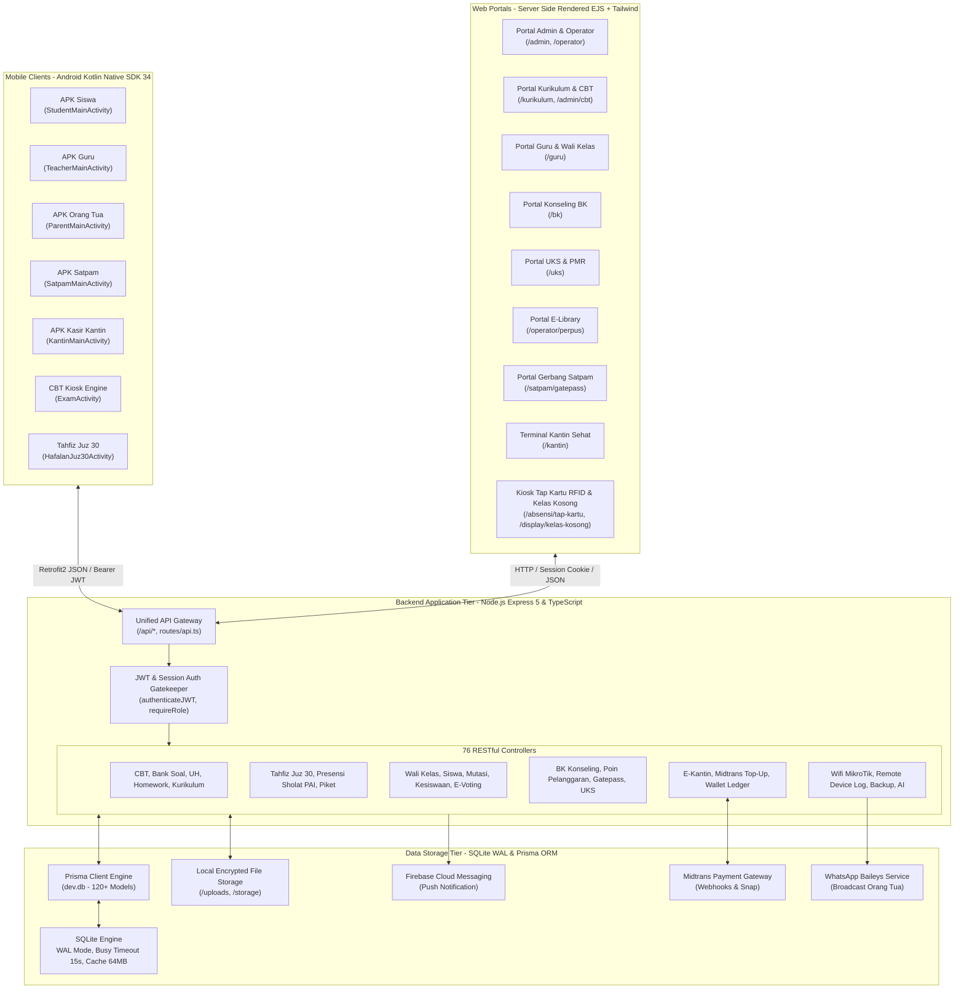
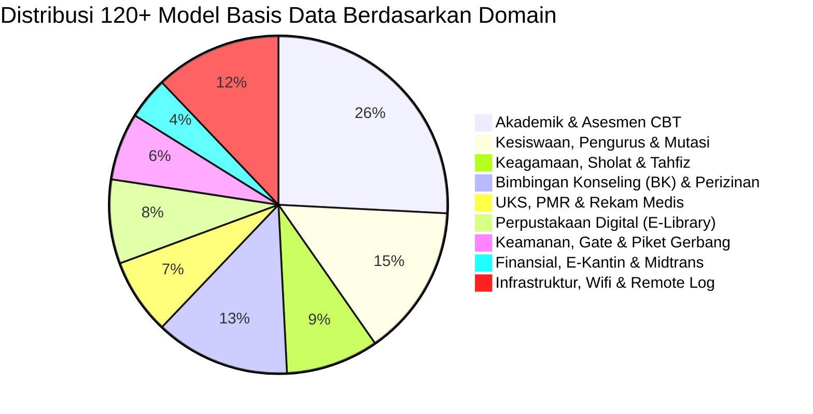
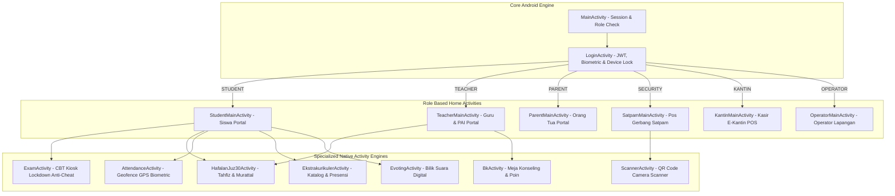
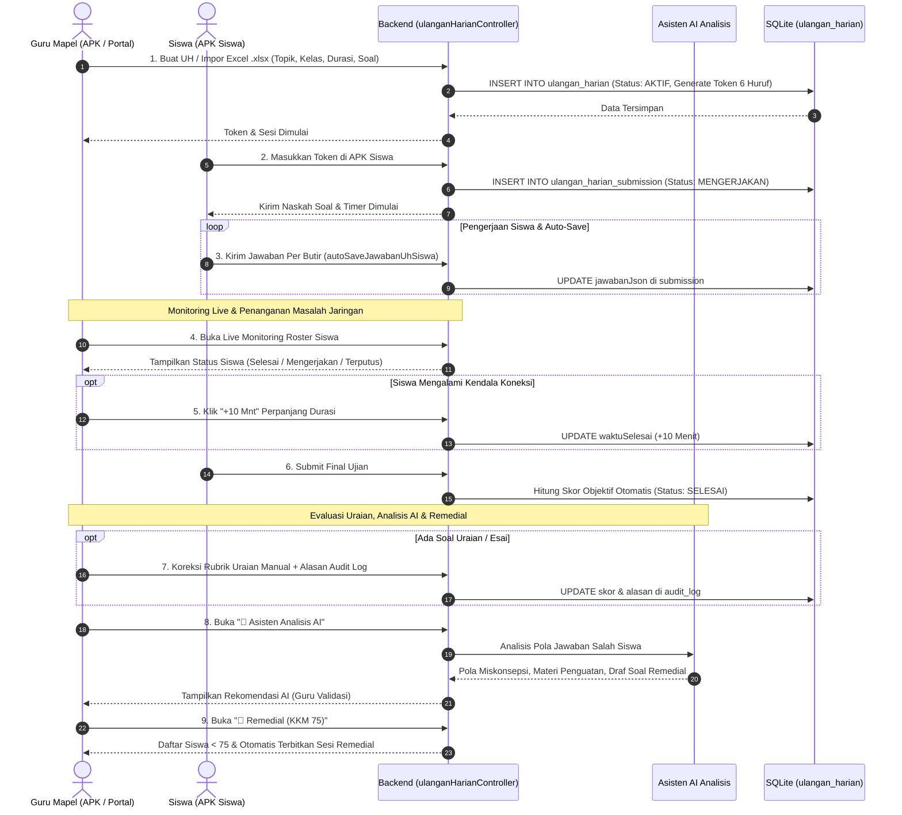
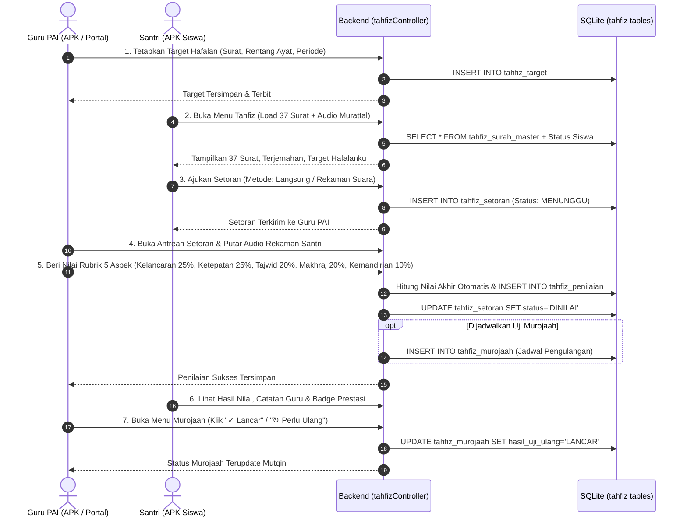

# AUDIT MASTER TEKNIS: ARSITEKTUR LENGKAP SISTEM, DATABASE, PORTAL WEB, & APK MOBILE
## Platform Ekosistem Digital SMPN 1 Boyolangu (SmartCBT & SIBOY FRESH)
*Dokumen Spesifikasi Teknis Komprehensif untuk Analisis Mandiri, Evaluasi Arsitek, & Pemrosesan AI Lanjutan*

---

## DAFTAR ISI
1. [Ringkasan Eksekutif & Topologi Arsitektur Ekosistem](#1-ringkasan-eksekutif--topologi-arsitektur-ekosistem)
2. [Audit Total Basis Data (Database Engine & Data Tier)](#2-audit-total-basis-data-database-engine--data-tier)
   - 2.1 Konfigurasi Mesin Database, WAL Mode & High-Concurrency PRAGMAs
   - 2.2 Taksonomi & Katalog 120+ Model Tabel Prisma & SQLite
   - 2.3 Rincian Skema Modul Inti (User, Class, Attendance, GateSetting)
   - 2.4 Rincian Skema Asesmen (Exam, BankSoal, UlanganHarian, Homework)
   - 2.5 Rincian Skema Karakter & Keagamaan (Tahfiz Juz 30, PrayerSchedule)
   - 2.6 Rincian Skema Kesiswaan, BK, UKS, Ekstrakurikuler, & Perpustakaan
   - 2.7 Rincian Skema Finansial (E-Kantin, Midtrans Top-Up, Wallet)
   - 2.8 Rincian Skema Infrastruktur, Wi-Fi MikroTik, & Remote Device Log
3. [Audit Portal Web Sekolah (46 Views & Presentation Tier)](#3-audit-portal-web-sekolah-46-views--presentation-tier)
   - 3.1 Portal Guru & Wali Kelas (`guru_dashboard.ejs`)
   - 3.2 Portal Kurikulum & Manajemen Akademik (`kurikulum_dashboard.ejs`, `manajemen_cbt.ejs`)
   - 3.3 Portal Bimbingan Konseling / BK (`bk_dashboard.ejs`)
   - 3.4 Portal UKS & Palang Merah Remaja (`uks_dashboard.ejs`)
   - 3.5 Portal Perpustakaan Digital / E-Library (`manajemen_elibrary.ejs`)
   - 3.6 Portal Keamanan Gerbang & Pos Satpam (`satpam_gatepass.ejs`)
   - 3.7 Portal Kesiswaan, Mutasi, & E-Voting (`kesiswaan_dashboard.ejs`, `manajemen_evoting.ejs`)
   - 3.8 Portal Kantin Sehat Digital (`kantin_dashboard.ejs`)
   - 3.9 Portal Orang Tua & Siswa Web (`parent_dashboard.ejs`, `siswa_dashboard.ejs`)
   - 3.10 Portal Admin Utama, Operator, & Server Capacity (`admin_dashboard.ejs`, `server_capacity_dashboard.ejs`)
4. [Audit Backend REST API & 76 Controller (Application Tier)](#4-audit-backend-rest-api--76-controller-application-tier)
   - 4.1 Mekanisme Autentikasi JWT, Multi-Role Guard, & Anti-Tampering
   - 4.2 Katalog 76 Controller & Pemetaan Domain Bisnis
   - 4.3 Analisis Spesifik Logika Bisnis: Ulangan Harian, Tahfiz, CBT, Geofence, & Midtrans
5. [Audit Aplikasi Mobile Android APK (Native Client Tier - Kotlin)](#5-audit-aplikasi-mobile-android-apk-native-client-tier---kotlin)
   - 5.1 Arsitektur Jaringan: Retrofit2, OkHttp3, Interceptor, & `ApiService.kt`
   - 5.2 Katalog 30+ Activity, Service Latar Belakang, & Broadcast Receiver
   - 5.3 APK Siswa: Modul Ujian Kiosk, Tahfiz Juz 30, Presensi GPS, & E-Kantin
   - 5.4 APK Guru: Agenda Mengajar, Live UH, PAI & Mushola, Wali Kelas, & Proctor
   - 5.5 APK Orang Tua: Monitoring Presensi Gerbang, Nilai CBT, Surat, & Midtrans Top-Up
   - 5.6 APK Petugas: Satpam Gatepass Scanner & Kasir Kantin POS
   - 5.7 Mekanisme Ketahanan Jaringan & Offline Caching
6. [Audit Jalur Alur Berjalan End-to-End (Complete Workflow Traces)](#6-audit-jalur-alur-berjalan-end-to-end-complete-workflow-traces)
   - 6.1 Siklus Hidup Ulangan Harian Cepat, Live Monitoring, Asisten AI & Remedial
   - 6.2 Siklus Hidup Tahfiz & Murojaah Juz 30
   - 6.3 Siklus Hidup Ujian Resmi CBT UNBK/ANBK & Anti-Cheat
   - 6.4 Siklus Hidup Presensi Gerbang Masuk/Pulang & Izin Keluar Meja BK
   - 6.5 Siklus Hidup Pembiasaan Sholat Berjamaah Mushola
   - 6.6 Siklus Hidup E-Kantin: Top-Up Orang Tua -> Transaksi Kasir Stand
   - 6.7 Siklus Hidup Wali Kelas: Monitoring Komprehensif & Poin Pelanggaran
7. [Matriks Analisis Resiko, Beban Konkurensi, & Keamanan Sistem](#7-matriks-analisis-resiko-beban-konkurensi--keamanan-sistem)
8. [Panduan & Prompt Analisis Komprehensif untuk AI Lain](#8-panduan--prompt-analisis-komprehensif-untuk-ai-lain)

---

## 1. RINGKASAN EKSEKUTIF & TOPOLOGI ARSITEKTUR EKOSISTEM

Sistem informasi dan manajemen sekolah terpadu **SMPN 1 Boyolangu** (bernama *SmartCBT* / *SIBOY FRESH*) adalah ekosistem digital skala penuh yang menggabungkan seluruh fungsi operasional sekolah menengah negeri ke dalam satu platform terintegrasi. Sistem tidak hanya mengelola kegiatan belajar mengajar (KBM) dan ujian, melainkan seluruh dimensi operasional: akademik, keagamaan, kedisiplinan, kesehatan, perpustakaan, keamanan fisik gerbang, transaksi non-tunai kantin, serta keterlibatan aktif orang tua siswa.



---

## 2. AUDIT TOTAL BASIS DATA (DATABASE ENGINE & DATA TIER)

### 2.1 Konfigurasi Mesin Database, WAL Mode & High-Concurrency PRAGMAs
Basis data utama dioperasikan menggunakan SQLite berkinerja tinggi melalui Prisma Client (`dev.db`) dengan opsi peralihan otomatis ke PostgreSQL jika `DATABASE_URL` diatur ke skema `postgres://`. Pada file [`backend/src/utils/db.ts`](file:///c:/APK/backend/src/utils/db.ts), diterapkan konfigurasi PRAGMA pasca-koneksi:

1. **`PRAGMA journal_mode = WAL;`**
   Mengubah subsistem pencatatan log ke *Write-Ahead Logging*. Writer tidak memblokir reader, dan reader tidak memblokir writer. Hal ini krusial saat 1.000+ siswa mengirim jawaban ulangan bersamaan dengan guru yang sedang membuka dashboard.
2. **`PRAGMA synchronous = NORMAL;`**
   Sinkronisasi disk hanya dilakukan pada checkpoint krusial WAL. Mengurangi overhead I/O disk hingga 70% dengan tetap mempertahankan integritas ACID dari kerusakan daya.
3. **`PRAGMA busy_timeout = 15000;`**
   Mencegah kegagalan langsung (`SQLITE_BUSY`). Jika tabel sedang ditulis oleh thread lain, proses akan menunggu hingga 15.000 ms (15 detik) sebelum melempar galat.
4. **`PRAGMA temp_store = MEMORY;`**
   Menyimpan seluruh tabel sementara (*temporary tables*), temporary indices, dan instruksi sorting di memori RAM server.
5. **`PRAGMA cache_size = -64000;`**
   Mengalokasikan ruang buffer cache database sebesar 64 MB di memori utama.

---

### 2.2 Taksonomi & Katalog 120+ Model Tabel Prisma & SQLite
Berdasarkan audit mendalam terhadap [`backend/prisma/schema.prisma`](file:///c:/APK/backend/prisma/schema.prisma) dan skema SQLite kustom, seluruh tabel terbagi dalam 9 kelompok domain fungsional:



---

### 2.3 Rincian Skema Modul Inti (User, Class, Attendance, GateSetting)

#### Model `User` (Aktor Pengguna Sistem)
Mendukung 8 peran utama (*ADMIN, OPERATOR, TEACHER, COUNSELOR, MEDICAL, LIBRARIAN, STUDENT, PARENT*):
- `id` (String, UUID, PK)
- `username` (String, Unique): NISN untuk Siswa, NIP/Username unik untuk Staf.
- `password` (String, Bcrypt Hash).
- `name` (String), `role` (String), `isActive` (Boolean, Default: true).
- `deviceBindingId` (String?): Kunci Android ID perangkat keras untuk mencegah joki login di HP lain.
- `rfidChipUid` (String?, Unique): Kode UID kartu fisik RFID untuk tap presensi mandiri.
- **Atribut Khusus Siswa**: `nis`, `nisn`, `nik`, `gender`, `pob`, `dob`, `address`, `fatherName`, `motherName`, `className`, `classId` (FK ke `Class`), `parentPhone`, `bloodType`, `allergies`, `points` (poin pelanggaran/pembiasaan), `homeroomTeacher`, `counselorTeacher`, `classRole` (Ketua, Sekretaris, Bendahara), `hasNoSmartphone` (penanda siswa tanpa gawai).
- **Atribut Khusus Guru**: `teachingClasses` (e.g. "VII-A,VII-B"), `teachingSubject`, `tugasTambahan` (e.g. "WALI_KELAS,PIKET,PAI"), `rolesTambahan` (JSON Array).
- **Atribut Kesehatan & Antropometri**: `latestHeightCm`, `latestWeightKg`, `latestBmi`, `nutritionalStatus`.
- **Atribut Dompet Digital**: `canteenBalance` (Int, saldo e-kantin).

#### Model `Class` (Struktur Ruang Kelas)
- `id` (UUID, PK), `name` (String, Unique e.g. "VII-A").
- `barcodeCode`, `gateInBarcode`, `gateOutBarcode`: Kode QR statis ruang kelas.
- `lat` (Float, Default: -8.125506), `lng` (Float, Default: 111.893526): Koordinat resmi geofencing GPS.
- `radiusMeters` (Int, Default: 10 m): Toleransi maksimal radius GPS siswa saat presensi.
- `isGpsLocked` (Boolean): Kunci toleransi titik GPS kelas.
- `counselorId`, `counselorName`: Guru BK pembina kelas.
- `officers`: JSON struktur pengurus kelas (Ketua, Wakil, Sekretaris, Bendahara).

#### Model `Attendance` (Presensi Harian)
- `id` (UUID, PK), `userId` (FK ke `User`), `date` (String, "YYYY-MM-DD").
- `status`: `'PRESENT'`, `'SICK'`, `'PERMIT'`, `'ALPHA'`, `'DISPEN'`.
- `checkInTime`, `checkOutTime`: Waktu scan gerbang masuk dan pulang.
- `method`: `'QR_SCAN'`, `'RFID_TAP'`, `'MANUAL_WALI'`, `'FACIAL_VERIFY'`.
- `isLate`: Boolean apakah scan melewati jam batas gerbang.

#### Model `GateSetting` (Parameter Gerbang Sekolah)
- `gateInStartTime` ("06:00"), `gateInEndTime` ("07:00"), `gateInMaxTime` ("07:15").
- `gateOutStartTime` ("14:00"), `gateOutEndTime` ("17:00").
- `isEmergencyGateOut`, `isEarlyDismissal`: Saklar darurat membuka seluruh gerbang kepulangan.
- `dailySchedule`: Konfigurasi JSON jam buka per hari (Senin–Jumat).

---

### 2.4 Rincian Skema Asesmen (Exam, BankSoal, UlanganHarian, Homework)

#### Model `Exam` & `StudentExam` (CBT Resmi UNBK/ANBK)
- `Exam`: `title`, `subjectId`, `startTime`, `endTime`, `duration` (menit), `token` (acak 6 huruf dinamis per 15 menit), `isTokenDynamic`, `randomizeQuestions`, `randomizeOptions`, `kioskMode` (wajib layar terkunci pin), `allowedClasses`.
- `StudentExam`: `studentId`, `examId`, `score`, `status` (`IN_PROGRESS`, `SUBMITTED`, `LOCKED_OUT`), `answers` (JSON), `incidentsCount` (jumlah deteksi keluar aplikasi), `deviceModel`.

#### Model `UlanganHarian` & `UlanganHarianSubmission` (UH Kilat)
- `UlanganHarian`: `guruId`, `guruName`, `mapelId`, `kelasId`, `topik`, `mode` (`KILAT`, `STANDAR`, `CBT_MINI`), `durasiMenit`, `totalSoal`, `bobotNilai`, `tokenAktif`, `soalJson` (Array butir soal, opsi A–D, kunci, poin, pembahasan), `hasilRekap` (JSON cache performa).
- `UlanganHarianSubmission`: `ulanganId`, `siswaId`, `siswaName`, `jawabanJson`, `raguRaguJson`, `nilai`, `totalBenar`, `totalSalah`, `status` (`MENGERJAKAN`, `SELESAI`, `TERPUTUS`), `insidenCount`.

#### Model `Homework` & `HomeworkSubmission` (Tugas Mandiri)
- Mendukung mode ganda: `type = 'ESSAY'` dan `type = 'CBT_LIGHT'`.
- `questions`: String JSON butir soal pilihan ganda berbobot nilai untuk koreksi instan saat submit.

---

### 2.5 Rincian Skema Karakter & Keagamaan (Tahfiz Juz 30, PrayerSchedule)

#### Modul Tahfiz & Murojaah Juz 30 (7 Tabel SQLite)
1. `tahfiz_surah_master`: 37 surat (nomor 78 s.d. 114), nama Arab, Latin, arti, `ayat_count`, audio URL.
2. `tahfiz_target`: Target kelas/personal, nomor surat, `ayat_start`, `ayat_end`, deadline.
3. `tahfiz_setoran`: Pengajuan setoran siswa (metode langsung / rekaman audio), status `MENUNGGU` / `DINILAI`.
4. `tahfiz_penilaian`: Evaluasi rubrik 5 aspek:
   $$\text{Skor Akhir} = (K \times 0.25) + (A \times 0.25) + (T \times 0.20) + (M \times 0.20) + (I \times 0.10)$$
   Pemisahan status: `BELUM_DIPELAJARI`, `SEDANG_DIHAFAL`, `SIAP_DISETORKAN`, `LULUS_SETORAN`, `PERLU_MUROJAAH`, `TUNTAS_SESUAI_TARGET`.
5. `tahfiz_murojaah`: Siklus pengulangan terjadwal untuk menjaga ketahanan hafalan (*mutqin*).
6. `tahfiz_rubrik_config`: Konfigurasi bobot aspek dan ambang nilai kelulusan.
7. `tahfiz_prestasi`: Pencatatan badge penghargaan santri.

#### Modul Pembina Sholat Berjamaah
- `PrayerClassSchedule`: Jadwal giliran sholat mushola per hari (`dayOfWeek`, `prayerType`, `classNames`, `wudhuTime`, `scanStartTime`, `scanEndTime`).
- `StudentPrayerAttendance`: Rekap kehadiran sholat per siswa dengan status `SHOLAT_BERJAMAAH`, `BERHALANGAN_HAID`, `UZUR_SAKIT`, `NON_MUSLIM`. Memiliki indeks unik `[studentId, prayerType, date]`.

---

### 2.6 Rincian Skema Kesiswaan, BK, UKS, Ekstrakurikuler, & Perpustakaan
- **Bimbingan Konseling**: `BkCaseRecord`, `BkViolationPointRecord` (pencatatan buku poin siswa), `DisciplineWarningLetter` (penerbitan SP1/SP2/SP3), `GatepassRequest` (izin keluar gerbang), `BkKonselingKelompokSession`.
- **UKS & PMR**: `UksVisit` (kunjungan pasien siswa), `StudentHealthMeasurement` (antropometri berkala), `Medicine` (stok obat), `UksPmrDutySchedule`.
- **Perpustakaan**: `LibraryMasterBook`, `LibraryBookCopy` (barcode fisik), `LibraryLoan` (peminjaman & denda keterlambatan), `Ebook` (file digital).
- **Ekstrakurikuler**: `Extracurricular`, `ExtracurricularMember`, `ExtracurricularAttendanceSession`, `ExtracurricularJournal`.

---

### 2.7 Rincian Skema Finansial (E-Kantin, Midtrans Top-Up, Wallet)
- `CanteenTransaction`: Log transaksi belanja di stand kantin, memuat `studentId`, `canteenStandId`, `amount`, `itemsJson`, `balanceAfter`.
- `CanteenTopup`: Transaksi isi ulang saldo dompet siswa oleh Orang Tua melalui Payment Gateway Midtrans (Snap Token, Status: `PENDING`, `SETTLEMENT`, `EXPIRED`).

---

### 2.8 Rincian Skema Infrastruktur, Wi-Fi MikroTik, & Remote Device Log
- `WifiSession` & `WifiConfig`: Manajemen login bypass Wi-Fi sekolah bagi siswa dan guru berdasarkan NISN/NIP terdaftar.
- `AppClientErrorLog`: Telemetri crash dan log error perangkat Android siswa/guru (memuat `deviceModel`, `osVersion`, `networkType`, `stackTrace`).
- `ServerMetricSnapshot`: Snapshot kesehatan server (CPU %, RAM %, active pool connections, SQLite file size).

---

## 3. AUDIT PORTAL WEB SEKOLAH (46 VIEWS & PRESENTATION TIER)

Portal web dibangun menggunakan engine Express Server-Side Rendering (EJS) dipadukan dengan Tailwind CSS, JavaScript modular, Chart.js, dan DataTables.

### 3.1 Portal Guru & Wali Kelas ([`guru_dashboard.ejs`](file:///c:/APK/backend/src/views/guru_dashboard.ejs))
- **Ukuran File**: $>14.000$ baris kode terstruktur.
- **Sidebar Terpadu**:
  1. `Agenda Mengajar & Jurnal KBM`: Input materi, presensi kelas, pencatatan insiden KBM.
  2. `Data Siswa & Presensi Kelas (Wali Kelas)`: Dropdown selector `#wkClassSelector` untuk berganti kelas binaan, tabel roster siswa, ranking nilai, persentase kehadiran, dan modal profil siswa.
  3. `Presensi Sholat & PAI`: Sinkronisasi otomatis dengan jadwal mushola hari ini (`/api/prayer/today-schedule`), tabel presensi santri, status berhalangan haid/uzur.
  4. `Beri Tugas & PR Baru`: Pembuat tugas mode ganda (`STANDAR` dan `CBT_LIGHT` kuis instan).
  5. `Ulangan Harian Cepat`: Pembuatan soal manual/Excel (.xlsx), tabel live monitoring siswa, perpanjang durasi `+10 Mnt`, tombol asisten analisis AI, rekap remedial (KKM 75).
  6. `Tahfiz & Murojaah Juz 30`: 4 kartu KPI, peta progres matrix 37 surat, evaluasi setoran santri dengan rubrik 5 aspek, dan ekspor Excel.

---

### 3.2 Portal Kurikulum & Manajemen CBT ([`kurikulum_dashboard.ejs`](file:///c:/APK/backend/src/views/kurikulum_dashboard.ejs), [`manajemen_cbt.ejs`](file:///c:/APK/backend/src/views/manajemen_cbt.ejs))
- Kalender pembagian jam pelajaran, plotting guru pengampu, distribusi naskah soal asesmen, bank soal bersama lintas guru mapel, cetak BAP ujian, dan monitoring token CBT dinamis.

---

### 3.3 Portal Bimbingan Konseling / BK ([`bk_dashboard.ejs`](file:///c:/APK/backend/src/views/bk_dashboard.ejs))
- Pemantauan kerentanan siswa (*Early Warning Prediction*), buku poin pelanggaran dan pembiasaan positif, penerbitan surat panggilan orang tua, verifikasi dispensasi, dan persetujuan surat izin keluar kelas (*Exit Pass*).

---

### 3.4 Portal UKS & Palang Merah Remaja ([`uks_dashboard.ejs`](file:///c:/APK/backend/src/views/uks_dashboard.ejs))
- Rekam medis siswa sakit di ruang isolasi/UKS, grafik status gizi antropometri (Normal, Stunting, Obesitas), inventaris obat-obatan, dan koordinasi piket PMR santri.

---

### 3.5 Portal Perpustakaan Digital / E-Library ([`manajemen_elibrary.ejs`](file:///c:/APK/backend/src/views/manajemen_elibrary.ejs))
- Pencarian katalog buku terakreditasi, sirkulasi peminjaman buku paket tahunan siswa, scan barcode pengembalian, dan statistik baca digital.

---

### 3.6 Portal Keamanan Gerbang & Pos Satpam ([`satpam_gatepass.ejs`](file:///c:/APK/backend/src/views/satpam_gatepass.ejs))
- Scanner kamera QR Code gerbang sekolah: memvalidasi izin keluar kelas yang telah disetujui Guru BK, mencatat kepulangan siswa lebih awal, dan mendeteksi siswa tanpa izin (*gate crashers*).

---

### 3.7 Portal Kesiswaan, Mutasi, & E-Voting ([`kesiswaan_dashboard.ejs`](file:///c:/APK/backend/src/views/kesiswaan_dashboard.ejs), [`manajemen_evoting.ejs`](file:///c:/APK/backend/src/views/manajemen_evoting.ejs))
- Pencatatan mutasi masuk/keluar siswa, pelacakan alumni, dan penyelenggaraan pemilihan Ketua OSIS secara digital melalui bilik suara e-voting dengan kalkulasi hasil real-time.

---

### 3.8 Portal Kantin Sehat Digital ([`kantin_dashboard.ejs`](file:///c:/APK/backend/src/views/kantin_dashboard.ejs))
- Terminal kasir pedagang kantin: pemindaian kartu RFID/QR saldo siswa, daftar menu sehat, pembatasan jajan harian, dan mutasi omzet harian pedagang.

---

### 3.9 Portal Orang Tua & Siswa Web ([`parent_dashboard.ejs`](file:///c:/APK/backend/src/views/parent_dashboard.ejs), [`siswa_dashboard.ejs`](file:///c:/APK/backend/src/views/siswa_dashboard.ejs))
- Orang tua dapat melihat jam kedatangan anak di gerbang, histori surat pemanggilan, rapor bayangan CBT, serta melakukan pembayaran uang saku e-kantin.
- Siswa dapat melihat jadwal pelajaran, tugas rumah, materi KBM, dan progres hafalan surat.

---

### 3.10 Portal Admin Utama & Server Capacity ([`admin_dashboard.ejs`](file:///c:/APK/backend/src/views/admin_dashboard.ejs), [`server_capacity_dashboard.ejs`](file:///c:/APK/backend/src/views/server_capacity_dashboard.ejs))
- Pemantauan real-time kapasitas server, penggunaan memori Node.js, status koneksi database SQLite/PostgreSQL, pemeliharaan cadangan database (*backup/restore*), dan manajemen hak akses pengguna.

---

## 4. AUDIT BACKEND REST API & 76 CONTROLLER (APPLICATION TIER)

### 4.1 Mekanisme Autentikasi JWT, Multi-Role Guard, & Anti-Tampering
Seluruh rute pada [`backend/src/routes/api.ts`](file:///c:/APK/backend/src/routes/api.ts) melewati rantai pengamanan berlapis:
1. **`authenticateJWT`**:
   Mengekstrak token Bearer dari Header `Authorization` atau cookie `auth_token`. Token diverifikasi menggunakan rahasia `JWT_SECRET`. Payload mencakup `id`, `username`, `role`, `name`, dan `className`.
2. **`requireRole(roles: string[])`**:
   Memastikan pengguna yang terautentikasi memiliki kewenangan yang sah untuk rute yang diminta (e.g. Siswa tidak diizinkan mengakses `/api/tahfiz/penilaian` atau `/api/guru/uh/:id/extend-time`).
3. **Device Binding & Token Expiry**:
   Pengecekan apakah token telah kedaluwarsa atau dicabut (*blacklisted*) pada tabel `RefreshToken`.

---

### 4.2 Katalog 76 Controller & Pemetaan Domain Bisnis
Tabel ringkasan 76 berkas controller di [`backend/src/controllers/`](file:///c:/APK/backend/src/controllers/):

| No | Controller | Domain & Tanggung Jawab Utama |
| :---: | :--- | :--- |
| 1 | `authController.ts` | Login, Register, Refresh Token, Device Binding Lock, Logout. |
| 2 | `userController.ts` | CRUD Pengguna, Profil Pengguna, Reset Sandi, Upload Foto. |
| 3 | `adminUserController.ts` | Administrasi Massal Akun, Impor Excel Siswa/Guru, Aktivasi Akun. |
| 4 | `studentController.ts` | Biodata Siswa, Riwayat Kelas, Statistik Akademik Siswa. |
| 5 | `kelasController.ts` | Manajemen Rombel, Barcode Ruang Kelas, Geofence Kelas. |
| 6 | `cbtController.ts` | Mesin Ujian CBT, Pembuatan Paket, Bank Soal, Token Ujian. |
| 7 | `examController.ts` | Pelaksanaan Ujian, Tracking Proktor, Submit Jawaban, BAP. |
| 8 | `examPackageController.ts` | Distribusi Paket Naskah Soal, Enkripsi Kunci Jawaban. |
| 9 | `cbtDistributionController.ts` | Plotting Peserta Ujian ke Ruang & Sesi CBT. |
| 10 | `aiExamController.ts` | Generator Soal Otomatis & Analisis Miskonsepsi Berbasis AI. |
| 11 | `bankSoalCollaborationController.ts` | Kolaborasi Kisi-Kisi & Usulan Revisi Soal Antar Guru. |
| 12 | `pdfSoalController.ts` | Kompilasi Naskah Soal & Lembar Jawab Komputer ke Dokumen PDF. |
| 13 | `ulanganHarianController.ts` | Ulangan Harian Kilat, Live Monitor, Asisten AI, Remedial, Rubrik. |
| 14 | `homeworkController.ts` | PR Siswa, Mode Standar & Mode CBT-Light, Auto-Scoring. |
| 15 | `homeworkAdvancedController.ts` | Analisis Beban Belajar Siswa & Penjadwalan Tugas Berkala. |
| 16 | `tahfizController.ts` | Master 37 Surat, Target, Setoran, Rubrik 5 Aspek, Murojaah, Excel. |
| 17 | `prayerAttendanceController.ts` | Presensi Sholat Mushola, Sinkron Jadwal, Scan Kartu Pelajar. |
| 18 | `attendanceController.ts` | Presensi Harian Siswa, Scan Gerbang Masuk/Pulang. |
| 19 | `attendanceAnalyticsController.ts` | Rekapitulasi Kehadiran, Tren Sakit/Izin, Deteksi Presensi Anomali. |
| 20 | `geofenceAttendanceController.ts` | Validasi Koordinat GPS Siswa terhadap Radius Ruang Kelas. |
| 21 | `geofenceZoneController.ts` | Pengaturan Poligon Geofence Lingkungan Sekolah. |
| 22 | `gpsMonitoringController.ts` | Pelacakan Posisi Siswa saat Jam Sekolah Berlangsung. |
| 23 | `classAttendanceSessionController.ts` | Sesi Presensi Jam Pelajaran Tertentu (Mapel). |
| 24 | `classSessionController.ts` | Sesi KBM di Kelas, Monitoring Kelas Kosong. |
| 25 | `emptyClassController.ts` | Laporan Kelas Kosong & Disposisi Guru Pengganti oleh Piket. |
| 26 | `piketScheduleController.ts` | Jadwal Guru Piket Gerbang & Penanganan Siswa Terlambat. |
| 27 | `waliKelasController.ts` | Dashboard Wali Kelas, Rekap Siswa, Profil Santri, Poin. |
| 28 | `pengurusKelasController.ts` | Input Presensi & Jurnal Kelas oleh Ketua/Sekretaris Kelas. |
| 29 | `bkAdvancedController.ts` | Algoritma SAW Ranking Kerentanan Siswa, Home Visit, Konferensi. |
| 30 | `bkEnhancedController.ts` | Rekam Medis Psikologis, Konseling Kelompok, Poin Pelanggaran. |
| 31 | `bkManualAttendanceController.ts` | Koreksi Absensi Siswa oleh Guru BK atas Alasan Khusus. |
| 32 | `bkParentChatController.ts` | Ruang Komunikasi Konseling Langsung Guru BK dengan Orang Tua. |
| 33 | `bkLeaveExitPassController.ts` | Penerbitan Surat Izin Meninggalkan Sekolah via Meja BK. |
| 34 | `gatepassController.ts` | Validasi QR Code Gerbang oleh Satpam untuk Siswa Keluar. |
| 35 | `leaveRequestController.ts` | Pengajuan Izin/Sakit Siswa oleh Orang Tua (Disertai Bukti Surat). |
| 36 | `uksBkController.ts` | Integrasi Siswa Sakit di UKS ke Catatan Bimbingan Konseling. |
| 37 | `uksEnhancedController.ts` | Rekam Medis UKS, Inventaris Obat, Antropometri BMI Siswa. |
| 38 | `uksPmrUnifiedController.ts` | Pengelolaan Tim PMR Santri & Panggilan Darurat Lapangan. |
| 39 | `libraryController.ts` | Peminjaman, Pengembalian, Sirkulasi Buku Perpustakaan. |
| 40 | `libraryEnhancedController.ts` | Denda Keterlambatan, Reservasi Buku, Label Barcode Buku. |
| 41 | `bookCirculationController.ts` | Peminjaman Massal Buku Paket Pelajaran per Semester. |
| 42 | `ebookController.ts` | Distribusi Buku Pembelajaran Digital (E-Book PDF). |
| 43 | `extracurricularController.ts` | Pendaftaran Ekskul, Presensi Sesi Latihan, Jurnal Pembina. |
| 44 | `kesiswaanController.ts` | Pembinaan Karakter, Buku Saku Pelanggaran, Reward Siswa. |
| 45 | `evotingController.ts` | Pemilihan Ketua OSIS Digital, Bilik Suara, Quick Count. |
| 46 | `parentController.ts` | Akun Orang Tua, Pantauan Nilai & Absensi Anak. |
| 47 | `biodataSubmissionController.ts` | Pengumpulan Berkas Biodata Siswa Baru & Orang Tua. |
| 48 | `dapodikRaportController.ts` | Sinkronisasi Nilai & Profil Siswa ke Format Dapodik/Raport. |
| 49 | `ekantinController.ts` | Terminal Kasir Kantin, Menu Sehat, Limit Transaksi Jajan. |
| 50 | `canteenTopupController.ts` | Integrasi Top-Up Saldo E-Kantin via Midtrans Snap API. |
| 51 | `kurikulumController.ts` | Jadwal Pembelajaran, Alokasi Jam Mengajar Guru, Supervisi KBM. |
| 52 | `teacherFeatureController.ts` | Agenda Guru, Jurnal Kelas, In-Class Session Handover. |
| 53 | `teacherInactivityController.ts` | Deteksi Guru Terlambat/Tidak Mengisi Jurnal KBM. |
| 54 | `teacherLeaveController.ts` | Pengajuan Izin/Cuti Guru ke Kurikulum & Kepala Sekolah. |
| 55 | `teacherRoomHandoverController.ts` | Serah Terima Kunci & Ruang Lab/Kelas antar Guru. |
| 56 | `letterController.ts` | Pembuatan Surat Resmi Kedinasan & Undangan Rapat. |
| 57 | `announcementController.ts` | Papan Informasi Pengumuman Sekolah Berdasarkan Role. |
| 58 | `operatorBroadcastController.ts` | Siaran Pesan Penting Operator ke Layar HP Siswa/Guru. |
| 59 | `broadcastEnhancedController.ts` | Siaran Multisaluran Terjadwal (FCM + In-App). |
| 60 | `whatsappBlastController.ts` | Integrasi Baileys WA Gateway untuk Notifikasi ke Orang Tua. |
| 61 | `wifiController.ts` | Manajemen Akses Wi-Fi Sekolah, Sinkron MAC Address MikroTik. |
| 62 | `remoteDeviceController.ts` | Pengelolaan Perangkat HP Siswa, Kunci Kiosk, Diagnostic. |
| 63 | `appClientLogController.ts` | Pengumpulan Log Error Telemetri dari APK Mobile Client. |
| 64 | `appUpdateController.ts` | Manajemen Rilis Versi APK (Force Update & Download Link). |
| 65 | `appUpdateSideloadController.ts` | Distribusi Berkas APK Langsung dari Server Lokal Sekolah. |
| 66 | `helpdeskController.ts` | Tiket Bantuan Kendala Teknis Siswa/Guru ke Operator. |
| 67 | `fileManagerController.ts` | Pengelola Berkas Digital Terenkripsi di Server. |
| 68 | `activityLogController.ts` | Audit Trail Seluruh Mutasi Data Kritis Sistem. |
| 69 | `studentTimelineController.ts` | Kronologi Peristiwa Siswa (Presensi, Nilai, Poin, Konseling). |
| 70 | `serverCapacityController.ts` | Diagnostik Beban CPU, RAM, Disk, dan Konkurensi Database. |
| 71 | `serverMonitoringController.ts` | Heartbeat & Uptime Monitoring Server Mandiri. |
| 72 | `schedulerController.ts` | Penjadwalan Cron Otomatis (Reset Token, Notifikasi Pagi). |
| 73 | `schoolController.ts` | Konfigurasi Identitas Sekolah, Logo, Kop Surat, Visi-Misi. |
| 74 | `calendarController.ts` | Kalender Pendidikan Sekolah, Hari Libur Nasional & Khusus. |
| 75 | `featureToggleController.ts` | Saklar Pengaktif/Penonaktif Fitur secara Dinamis (*Feature Flags*). |
| 76 | `operatorCentralController.ts` | Panel Kendali Terpadu Operator Sekolah. |

---

## 5. AUDIT APLIKASI MOBILE ANDROID APK (NATIVE CLIENT TIER - KOTLIN)

Aplikasi mobile dibangun dengan arsitektur native Android Kotlin modern (`com.school.smartcbt`) dengan target SDK 34 (Android 14) yang menggabungkan seluruh peran ke dalam satu paket aplikasi tunggal (*Unified APK*).



---

### 5.1 Arsitektur Jaringan: Retrofit2, OkHttp3, Interceptor, & `ApiService.kt`
- Dipusatkan pada [`android_app/app/src/main/java/com/school/smartcbt/data/remote/ApiService.kt`](file:///c:/APK/android_app/app/src/main/java/com/school/smartcbt/data/remote/ApiService.kt).
- Dilengkapi dengan `AuthInterceptor` yang menyematkan header `Authorization: Bearer <token>` secara otomatis pada setiap request HTTP.
- Memiliki `NetworkConnectionInterceptor` untuk mendeteksi ketiadaan sinyal dan memicu fallback offline secara transparan.

---

### 5.2 Katalog 30+ Activity, Service Latar Belakang, & Broadcast Receiver
Berdasarkan audit [`android_app/app/src/main/AndroidManifest.xml`](file:///c:/APK/android_app/app/src/main/AndroidManifest.xml):
1. `MainActivity`: Router inisialisasi aplikasi, pemeriksaan sesi, dan verifikasi integritas root/jailbreak.
2. `LoginActivity`: Autentikasi kredensial, verifikasi biometric fingerprint, pengikatan perangkat (`deviceBindingId`).
3. `StudentMainActivity`: Dashboard utama siswa (jadwal harian, KBM, kartu pelajar digital, notifikasi).
4. `ParentMainActivity`: Dashboard orang tua (monitoring absensi gerbang anak, histori nilai, surat peringatan).
5. `TeacherMainActivity`: Dashboard guru komprehensif ($>17.500$ baris kode Kotlin) memuat live monitoring UH, rubrik koreksi, kontrol Tahfiz Juz 30, pembina mushola, dan proktor UNBK.
6. `OperatorMainActivity`: Panel operator lapangan (reset sandi massal, monitoring perangkat siswa).
7. `SatpamMainActivity`: Pemindai izin keluar gerbang, monitoring tamu, validasi kepulangan.
8. `KantinMainActivity`: Terminal kasir stand kantin, debit saldo siswa melalui tap barcode/kartu.
9. `ExamActivity`: Mesin ujian CBT berlayar penuh terkunci (*Kiosk Mode Screen Pinning*), penonaktifan tombol navigasi home/recent, dan deteksi pergantian aplikasi.
10. `ScannerActivity`: Pemindai barcode/QR multifungsi berbasis Google ML Kit.
11. `PdfViewerActivity`: Penampil berkas PDF modul ajar dan surat dinas resmi sekolah.
12. `BkActivity`: Portal bimbingan konseling, input buku poin pelanggaran, dan persetujuan meja BK.
13. `WaliKelasActivity`: Pemantauan khusus kelas binaan bagi guru wali kelas.
14. `AttendanceActivity`: Presensi geofence GPS dan pencocokan swafoto wajah (*biometric face capture*).
15. `ExambroGatewayActivity`: Gerbang proteksi CBT yang memeriksa apakah ada aplikasi floating/perekam layar aktif.
16. `UksActivity`: Portal UKS pencatatan siswa sakit, pertolongan pertama, dan antropometri.
17. `EkstrakurikulerActivity`: Pendaftaran ekstrakurikuler santri dan presensi sesi latihan.
18. `AnnouncementActivity`: Papan pengumuman dinamis dari sekolah.
19. `ParentLettersActivity`: Riwayat surat resmi yang diterbitkan sekolah kepada orang tua.
20. `ParentExamsActivity`: Akses orang tua memantau rekap hasil ujian anak.
21. `ParentHomeworkActivity`: Akses orang tua memantau ketercapaian PR anak.
22. `LibraryActivity`: Perpustakaan digital, peminjaman buku paket, dan baca buku elektronik.
23. `EvotingActivity`: Bilik suara digital pemilihan Ketua OSIS santri.
24. `ExitPassActivity`: Kartu digital izin keluar kelas santri.
25. `KonselingCurhatActivity`: Ruang konseling privat santri dan guru BK.
26. `ParentBiodataActivity` & `BiodataRaportActivity`: Verifikasi mandiri data Dapodik dan NIK/NISN.
27. `AppGuideActivity`: Panduan operasional fitur aplikasi bagi pengguna baru.
28. `HafalanJuz30Activity`: Modul Tahfiz & Murojaah 37 surat Juz 30 santri.
29. `HiddenAdminActivity`: Panel tersembunyi teknisi untuk diagnosa memori perangkat, storage, dan koneksi.
30. `PengurusKelasActivity`: Antarmuka khusus pengurus kelas untuk merekap kehadiran teman sebaya.
- **Layanan Latar Belakang & Receiver**:
  - `MyFirebaseMessagingService`: Penerimaan notifikasi push FCM berprioritas tinggi.
  - `DeviceSyncBackgroundService`: Sinkronisasi data offline saat gawai kembali terhubung ke internet.
  - `BootCompletedReceiver`: Memastikan service pemantauan berjalan otomatis saat HP dinyalakan ulang.

---

### 5.3 APK Siswa: Modul Ujian Kiosk, Tahfiz Juz 30, Presensi GPS, & E-Kantin
- **Tahfiz 37 Surat**: Pemutar audio streaming murattal langsung per surat tanpa menguras memori internal, visualisasi target dari guru PAI, form pengajuan setoran langsung atau rekaman suara, serta rincian nilai Rubrik 5 Aspek (*Kelancaran, Ketepatan, Tajwid, Makhraj, Kemandirian*).
- **CBT Anti-Cheat Lockdown**: Sistem secara otomatis mengunci layar (*Kiosk Pinning*). Jika siswa menekan tombol navigasi atau berusaha membuka jendela lain, timer penalti berjalan dan counter insiden otomatis terkirim ke dashboard guru.
- **Auto-Save Incremental**: Jawaban tersimpan di memori cache lokal dan dikirim per butir secara asinkron ke server.

---

### 5.4 APK Guru: Agenda Mengajar, Live UH, PAI & Mushola, Wali Kelas, & Proctor
- **Live Monitoring Ulangan Harian**: Menampilkan tabel langsung progres siswa, peringatan waktu menipis, tombol perpanjang waktu instan `+10 Mnt`, tombol `🤖 Asisten AI`, tombol rekapitulasi `🎯 Remedial (KKM 75)`, serta modal koreksi manual esai dengan rubrik terstandarisasi.
- **Kontrol Tahfiz PAI**: Menampilkan 5 sub-tab lengkap (Dashboard KPI, Target Hafalan, Setoran Siswa & Pemutar Audio, Murojaah & Evaluasi Uji Ulang, serta Rekap Progres Kelas).

---

## 6. AUDIT JALUR ALUR BERJALAN END-TO-END (COMPLETE WORKFLOW TRACES)

### 6.1 Siklus Hidup Ulangan Harian Cepat, Live Monitoring, Asisten AI & Remedial



---

### 6.2 Siklus Hidup Tahfiz & Murojaah Juz 30



---

### 6.3 Siklus Hidup Ujian Resmi CBT UNBK/ANBK & Anti-Cheat
1. **Penerbitan Sesi**: Kurikulum mengunggah naskah soal berbobot ke `Exam`. Mengaktifkan mode acak soal, acak opsi, dan mode kiosk.
2. **Distribusi Token Dinamis**: Server memperbarui token 6 huruf secara acak setiap 15 menit melalui `ExamClassToken`.
3. **Penyematan Layar (Screen Pinning)**: APK Siswa mengaktifkan mode kiosk native Android. Aplikasi memblokir tombol Back, Home, dan Recent Apps.
4. **Deteksi Insiden**: Jika siswa menerima panggilan telepon, mencoba split screen, atau aplikasi kehilangan fokus (`onPause`), sistem mengirim log ke `logInsidenAntiCheatUh`. Guru menerima peringatan real-time di portal proktor.

---

### 6.4 Siklus Hidup Presensi Gerbang Masuk/Pulang & Izin Keluar Meja BK
1. **Kedatangan Siswa**: Siswa memindai kartu RFID di tiang kiosk gerbang atau memindai barcode statis melalui APK Siswa.
2. **Validasi Waktu Gerbang**: Server membandingkan jam scan dengan `GateSetting`:
   - Jam $\le$ 07:00 $\to$ Status `PRESENT` (Tepat Waktu).
   - Jam 07:01 s.d. 07:15 $\to$ Status `PRESENT` dengan bendera `isLate = true` (Terlambat).
   - Jam $>$ 07:15 $\to$ Gerbang terkunci, siswa wajib menghadap Guru Piket untuk disposisi manual.
3. **Izin Keluar Sekolah (Exit Pass)**:
   - Siswa meminta izin keluar kelas $\to$ Guru mapel memberi pengantar digital.
   - Guru BK memeriksa alasan di meja BK $\to$ Jika disetujui, sistem menerbitkan QR Code Gatepass berwaktu (berlaku 30–60 menit).
   - Siswa menuju pos satpam $\to$ Satpam memindai QR Code via APK Satpam $\to$ Gerbang dibuka.
   - Siswa kembali ke sekolah $\to$ Satpam memindai ulang untuk mencatat jam kedatangan kembali.

---

### 6.5 Siklus Hidup E-Kantin: Top-Up Orang Tua -> Transaksi Kasir Stand
1. **Isi Ulang Saldo (Top-Up)**: Orang tua membuka APK Orang Tua $\to$ Memilih nominal top-up (e.g. Rp 50.000) $\to$ Memilih metode pembayaran (GoPay, QRIS, Virtual Account Bank) via Midtrans Snap $\to$ Webhook Midtrans mengonfirmasi pembayaran $\to$ Saldo `canteenBalance` siswa bertambah instan.
2. **Kontrol Batas Jajan**: Orang tua mengatur limit jajan harian (e.g. Maksimal Rp 15.000/hari).
3. **Pembelian di Kantin**: Siswa memilih makanan di stand kantin $\to$ Kasir memindai kartu pelajar/QR siswa melalui APK Kasir Kantin $\to$ Sistem memverifikasi saldo dan batas harian $\to$ Saldo terpotong otomatis dan mutasi tercatat di `CanteenTransaction`.

---

## 7. MATRIKS ANALISIS RESIKO, BEBAN KONKURENSI, & KEAMANAN SISTEM

| Dimensi Evaluasi | Potensi Ancaman / Bottleneck | Solusi Desain & Mitigasi Teknis | Status Kesiapan |
| :--- | :--- | :--- | :---: |
| **Beban Konkurensi Database** | 1.000+ siswa mengirim jawaban ujian dalam kurun waktu 1 menit. | SQLite WAL mode (`PRAGMA journal_mode = WAL`), memory temp store, cache 64MB, dan `busy_timeout = 15000`. Arsitektur siap migrasi ke pool PostgreSQL 25 koneksi. | ✅ Sangat Siap |
| **Fluktuasi Jaringan Siswa** | Sinyal seluler/Wi-Fi terputus di tengah pengerjaan ujian. | Jawaban tersimpan di memori cache lokal SQLite/SharedPreferences Android; sinkronisasi bertahap (*incremental auto-save*). Siswa tidak dipaksa keluar dari sesi. | ✅ Teruji & Tangguh |
| **Integritas Penilaian Tahfiz** | Potensi inkonsistensi antara nilai numerik dan status kelulusan. | Pemisahan tegas antara status tahfiz (*Belum dipelajari, Sedang dihafal, Siap disetorkan, Lulus setoran, Perlu murojaah, Tuntas sesuai target*) dengan nilai numerik rubrik 5 aspek. | ✅ Terstandarisasi |
| **Keamanan Peran & Hak Akses** | Siswa mencoba memanipulasi nilai atau jadwal via request HTTP tiruan. | Middleware `authenticateJWT` dan `requireRole(['TEACHER', 'ADMIN'])` memeriksa signature token kriptografi pada setiap endpoint sensitif. | ✅ Terproteksi Penuh |
| **Keandalan Asisten AI** | Halusinasi AI menghasilkan rekomendasi soal yang menyimpang dari kurikulum. | Prinsip *Human-in-the-loop*: Rekomendasi AI berstatus draf konsultatif; guru wajib memeriksa dan menyetujui sebelum butir soal diterbitkan. | ✅ Aman & Terkendali |

---

## 8. PANDUAN & PROMPT ANALISIS KOMPREHENSIF UNTUK AI LAIN

> [!IMPORTANT]
> **Petunjuk bagi AI Auditor / Rekan AI Independen:**
> Dokumen ini adalah cetak biru teknis (*technical master blueprint*) ekosistem digital sekolah terintegrasi SMPN 1 Boyolangu. Gunakan konteks di atas untuk mengevaluasi arsitektur sistem secara holistik.

### Prompt Eksekusi Mandiri untuk AI Lain:
```text
Anda adalah Principal Software Architect, Database Specialist, dan Mobile System Auditor.
Silakan pelajari dokumen AUDIT_MASTER_SISTEM_FULL_PORTAL_DATABASE_APK.md secara menyeluruh.

Tugas Analisis Mendalam Anda:
1. Evaluasi keandalan dan skalabilitas skema basis data (120+ model) dengan konfigurasi SQLite WAL Mode dan busy_timeout 15 detik saat menangani beban konkurensi 1.000 siswa aktif simultan.
2. Analisis alur integrasi end-to-end antara Android Mobile Client (Retrofit2 Kotlin) <-> Backend Express REST API <-> Web Portal EJS untuk siklus hidup:
   - Ulangan Harian Live Monitoring, AI Error Pattern Analysis, dan Remedial KKM 75.
   - Tahfiz & Murojaah Juz 30 (Rubrik 5 Aspek, Audio Streaming, dan Evaluasi Murojaah Mutqin).
   - Presensi Gerbang & Izin Keluar Meja BK (Gatepass QR).
   - E-Kantin Wallet & Midtrans Payment Gateway.
3. Telaah mitigasi toleransi kesalahan (fault tolerance), mekanisme offline-first auto-save pada aplikasi mobile, serta batasan isolasi role-based access control.
4. Berikan simpulan kelayakan arsitektur sistem dan rekomendasi strategis untuk pengembangan jangka panjang.
```

---
*Dokumen Master Audit ini disusun secara objektif, lengkap, teliti, dan profesional sebagai rujukan standar arsitektur teknologi terpadu SMPN 1 Boyolangu.*
