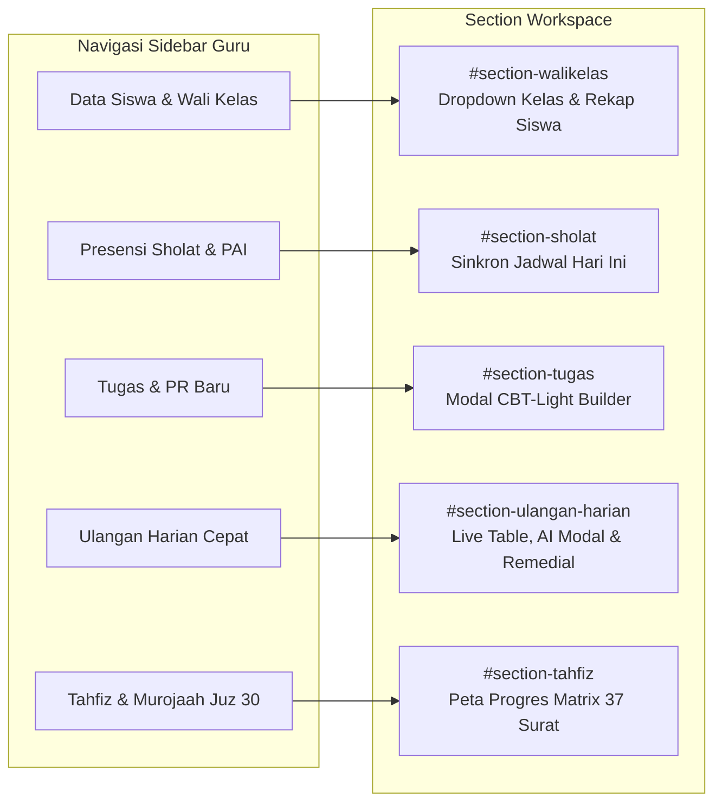
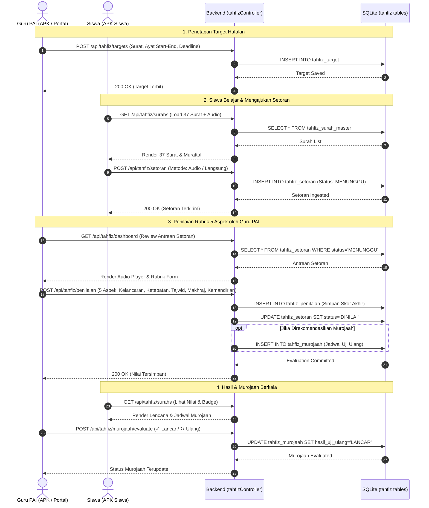
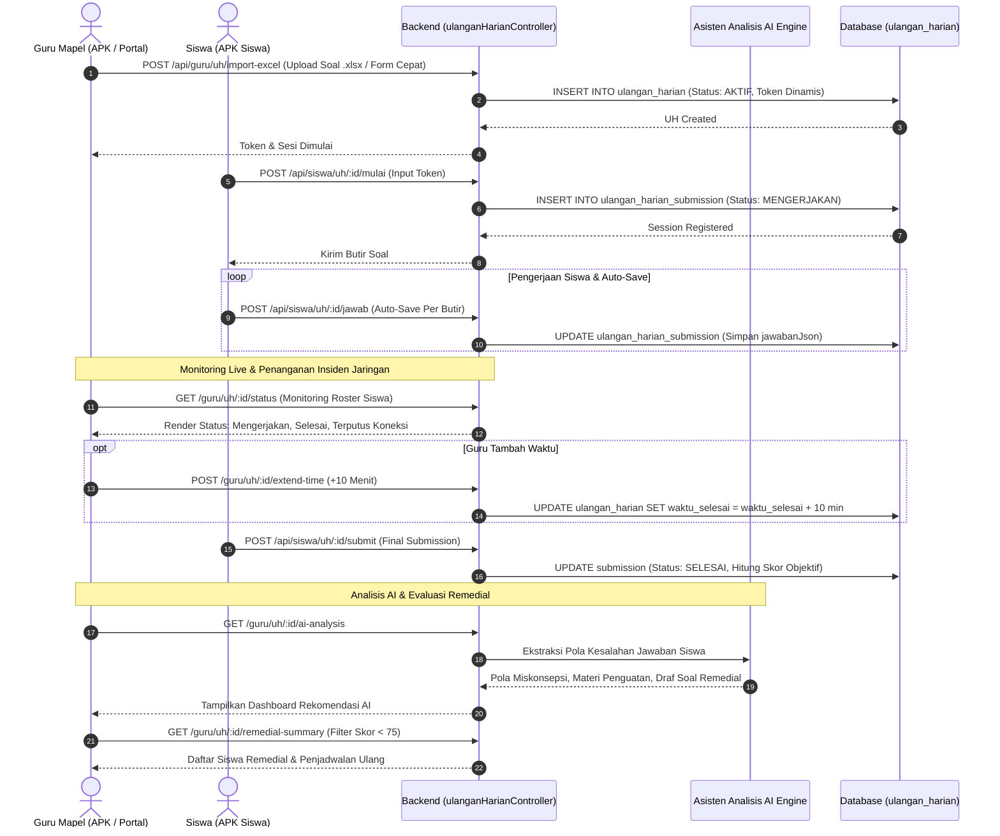

# LAPORAN AUDIT TEKNIS & ANALISIS SISTEM MENYELURUH
## Sistem Portal Sekolah, Database, API Backend, dan Aplikasi Mobile Android (APK)
**SMPN 1 Boyolangu — Smart School Management & CBT Engine**
*Dokumen Audit Arsitektur & Jalur Alur Data untuk Evaluasi Independen / Analisis AI Lanjutan*

---

## DAFTAR ISI
1. [Ringkasan Eksekutif & Topologi Sistem](#1-ringkasan-eksekutif--topologi-sistem)
2. [Audit Database & Integritas Data (Data Tier)](#2-audit-database--integritas-data-data-tier)
   - 2.1 Konfigurasi Database Engine & PRAGMA
   - 2.2 Skema Tabel Modul Tahfiz & Murojaah Juz 30
   - 2.3 Skema Tabel Modul Ulangan Harian (UH) & Submission
   - 2.4 Skema Tabel Modul Presensi Sholat Berjamaah & PAI
   - 2.5 Skema Tabel Modul Tugas (Homework) CBT-Light
   - 2.6 Skema Tabel Modul Wali Kelas & Presensi Harian
3. [Audit Backend API & Keamanan Controller (Application Tier)](#3-audit-backend-api--keamanan-controller-application-tier)
   - 3.1 Mekanisme Otentikasi & Otorisasi Berjenjang
   - 3.2 Audit Controller Tahfiz & Murojaah (`tahfizController.ts`)
   - 3.3 Audit Controller Ulangan Harian Cepat (`ulanganHarianController.ts`)
   - 3.4 Audit Controller Presensi Sholat Berjamaah (`prayerAttendanceController.ts`)
   - 3.5 Audit Controller Tugas CBT-Light (`homeworkController.ts`)
   - 3.6 Audit Controller Wali Kelas (`waliKelasController.ts`)
4. [Audit Portal Web Sekolah (Presentation Tier - EJS SSR)](#4-audit-portal-web-sekolah-presentation-tier---ejs-ssr)
   - 4.1 Arsitektur Antarmuka Guru (`guru_dashboard.ejs`)
   - 4.2 Sinkronisasi Real-Time & Penanganan State Sisi Klien
   - 4.3 Modal Interaktif & Validasi Input
5. [Audit Aplikasi Android APK (Mobile Client Tier - Kotlin)](#5-audit-aplikasi-android-apk-mobile-client-tier---kotlin)
   - 5.1 Arsitektur Komunikasi Jaringan (`ApiService.kt` & Retrofit2)
   - 5.2 Audit APK Siswa: Modul Tahfiz (`HafalanJuz30Activity.kt`)
   - 5.3 Audit APK Guru: Modul UH & Tahfiz PAI (`TeacherMainActivity.kt`)
   - 5.4 Ketahanan Terhadap Gangguan Jaringan & Offline Caching
6. [Audit Jalur Alur Berjalan End-to-End (Data Flow Traces)](#6-audit-jalur-alur-berjalan-end-to-end-data-flow-traces)
   - 6.1 Alur Sistem Tahfiz & Murojaah Juz 30
   - 6.2 Alur Ulangan Harian Cepat, Asisten AI & Remedial
   - 6.3 Alur Sinkronisasi Presensi Sholat Berjamaah
   - 6.4 Alur Tugas CBT-Light dengan Auto-Scoring
   - 6.5 Alur Wali Kelas: Switcher Dinamis & Profil Lengkap
7. [Matriks Analisis Resiko, Keamanan, & Toleransi Kesalahan](#7-matriks-analisis-resiko-keamanan--toleransi-kesalahan)
8. [Panduan & Prompt Analisis Khusus untuk AI Lain (AI-to-AI Context Guide)](#8-panduan--prompt-analisis-khusus-untuk-ai-lain-ai-to-ai-context-guide)

---

## 1. RINGKASAN EKSEKUTIF & TOPOLOGI SISTEM

Sistem informasi terpadu SMPN 1 Boyolangu dirancang dengan arsitektur **3-Tier Hybrid Architecture** yang menghubungkan aplikasi web portal sekolah, backend API berbasis RESTful, database relasional terpusat, serta aplikasi mobile native Android (Kotlin) untuk Guru dan Siswa.

```mermaid
flowchart TD
    subgraph Mobile_Tier [Mobile Client Tier - Android Kotlin]
        APK_GURU["APK Guru (TeacherMainActivity.kt)\n- Kontrol Tahfiz PAI\n- Live Monitoring UH\n- Asisten AI & Remedial\n- Kontrol Mushola"]
        APK_SISWA["APK Siswa (HafalanJuz30Activity.kt)\n- 37 Surat Juz 30 & Audio Murattal\n- Target & Setoran Hafalan\n- Ujian UH & Auto-Save\n- Hasil & Prestasi Badges"]
    end

    subgraph Web_Tier [Presentation Tier - Server Side Rendering]
        PORTAL_GURU["Portal Web Guru (guru_dashboard.ejs)\n- Peta Progres Matrix 37 Surat\n- Evaluasi Rubrik 5 Aspek\n- Bank Soal / Excel Import UH\n- Monitoring Wali Kelas & Sholat"]
        PORTAL_ADMIN["Portal Manajemen & Operator\n- Kurikulum, Kesiswaan, & Master Data"]
    end

    subgraph App_Tier [Application Tier - Express.js Engine]
        AUTH["Otentikasi & Keamanan (JWT & Session Cookies)"]
        CTRL_TAHFIZ["tahfizController.ts"]
        CTRL_UH["ulanganHarianController.ts"]
        CTRL_HW["homeworkController.ts"]
        CTRL_PRAYER["prayerAttendanceController.ts"]
        CTRL_WALI["waliKelasController.ts"]
    end

    subgraph Data_Tier [Data Tier - SQLite / Prisma ORM]
        DB[(SQLite dev.db / PostgreSQL Pool)\nWAL Mode, Busy Timeout 15s]
        T_TAHFIZ["Tabel Tahfiz: master, target, setoran, penilaian, murojaah"]
        T_UH["Tabel UH: ulangan_harian, submissions"]
        T_PRAYER["Tabel Sholat: schedule, attendance"]
        T_HW["Tabel Tugas: homework, submissions"]
        T_USER["Tabel User, Class, Attendance"]
    end

    APK_GURU <-->|Retrofit2 JSON / JWT Bearer| AUTH
    APK_SISWA <-->|Retrofit2 JSON / JWT Bearer| AUTH
    PORTAL_GURU <-->|HTTP GET/POST / Session Cookie| AUTH

    AUTH --> CTRL_TAHFIZ
    AUTH --> CTRL_UH
    AUTH --> CTRL_HW
    AUTH --> CTRL_PRAYER
    AUTH --> CTRL_WALI

    CTRL_TAHFIZ <--> T_TAHFIZ
    CTRL_UH <--> T_UH
    CTRL_PRAYER <--> T_PRAYER
    CTRL_HW <--> T_HW
    CTRL_WALI <--> T_USER
```

### Karakteristik Desain Utama
1. **Zero-Inconsistency Principle**: Seluruh data tersimpan secara terpusat pada server sebagai *Single Source of Truth*. Data tidak disimpan parsial pada client melainkan disinkronkan melalui REST API.
2. **Offline-First Reading & Queued Writing**: Siswa dapat membaca teks hafalan, memutar audio ter-cache, serta menyimpan draft jawaban ujian saat jaringan terputus.
3. **Decoupled Evaluation & Status**: Status ketercapaian hafalan (*Belum dipelajari, Sedang dihafal, Siap disetorkan, Lulus setoran, Perlu murojaah, Tuntas sesuai target*) dipisahkan dari skor numerik berbasis bobot rubrik terstandarisasi.
4. **Safety Guardrails for AI Integration**: Asisten AI menyajikan pola analisis kesalahan dan rekomendasi materi penguatan/remedial, namun penentuan akhir tetap berada di bawah kendali penuh guru (*Human-in-the-loop*).

---

## 2. AUDIT DATABASE & INTEGRITAS DATA (DATA TIER)

### 2.1 Konfigurasi Database Engine & PRAGMA
Database utama menggunakan SQLite (dengan kesiapan migrasi PostgreSQL via Prisma ORM) yang dioptimasi khusus untuk akses paralel dan konkurensi tinggi melalui file [`db.ts`](file:///c:/APK/backend/src/utils/db.ts):

| Parameter PRAGMA | Nilai Konfigurasi | Rationale Teknis & Dampak Integritas |
| :--- | :--- | :--- |
| `journal_mode` | `WAL` (Write-Ahead Logging) | Mengizinkan pembacaan (*concurrent reads*) tanpa memblokir proses penulisan (*writers*), mencegah error database locked saat ratusan siswa ujian. |
| `synchronous` | `NORMAL` | Memaksimalkan throughput penulisan disk I/O dengan tetap menjamin integritas file dalam mode WAL. |
| `busy_timeout` | `15000` (15 detik) | Menginstruksikan driver untuk menunggu hingga 15 detik saat terjadi lock contention alih-alih melempar exception `SQLITE_BUSY`. |
| `temp_store` | `MEMORY` | Menyimpan tabel sementara dan indeks sorting di RAM untuk mempercepat kalkulasi ranking dan aggregasi rekapitulasi. |
| `cache_size` | `-64000` (64 MB) | Mengalokasikan 64 MB memory cache untuk indeks dan baris aktif SQLite. |

---

### 2.2 Skema Tabel Modul Tahfiz & Murojaah Juz 30
Diinisialisasi melalui [`tahfizDbInit.ts`](file:///c:/APK/backend/src/utils/tahfizDbInit.ts), terdiri dari 7 tabel yang saling terhubung:

#### 1. `tahfiz_surah_master`
Menyimpan master 37 surat Juz 30 (Surat 78 An-Naba s.d. 114 An-Nas).
- `id` (INTEGER, PK): Nomor urut ID internal.
- `number` (INTEGER, UNIQUE, NOT NULL): Nomor surat mushaf resmi (78 s.d. 114).
- `name_latin` (TEXT, NOT NULL): Nama surat latin (e.g. "An-Naba'", "Al-Ikhlas").
- `name_arabic` (TEXT, NOT NULL): Teks kaligrafi Arab resmi.
- `meaning` (TEXT, NOT NULL): Terjemahan makna nama surat.
- `ayat_count` (INTEGER, NOT NULL): Total jumlah ayat surat (e.g. 40 untuk An-Naba, 3 untuk Al-'Asr).
- `place` (TEXT, NOT NULL): Golongan surat ("Makkiyah" / "Madaniyah").
- `audio_url` (TEXT): URL rujukan streaming audio murattal qari bersuara jernih (Mishary Rashid Alafasy).

#### 2. `tahfiz_target`
Menyimpan penetapan target hafalan oleh Guru PAI.
- `id` (TEXT, PK): UUID format string.
- `guru_id` (TEXT, NOT NULL), `guru_name` (TEXT, NOT NULL): Identitas guru penanggung jawab.
- `target_type` (TEXT, NOT NULL): `'SEKOLAH'`, `'KELAS'`, atau `'INDIVIDUAL'`.
- `class_name` (TEXT, NULLABLE): Kelas target (e.g. "VII-A").
- `student_id` (TEXT, NULLABLE), `student_name` (TEXT, NULLABLE): Diisi jika target personal.
- `surah_number` (INTEGER, NOT NULL), `surah_name` (TEXT, NOT NULL): Rujukan ke master surat.
- `ayat_start` (INTEGER, DEFAULT 1), `ayat_end` (INTEGER, NOT NULL): Rentang ayat yang wajib dihafal.
- `semester` (TEXT, DEFAULT 'Ganjil'), `academic_year` (TEXT, DEFAULT '2026/2027').
- `deadline_date` (TEXT): Batas akhir ketercapaian target.
- `status` (TEXT, DEFAULT 'AKTIF'): `'AKTIF'` atau `'SELESAI'`.

#### 3. `tahfiz_setoran`
Menyimpan data pengajuan setoran santri dari APK Siswa atau setoran langsung di kelas.
- `id` (TEXT, PK): UUID.
- `student_id` (TEXT, NOT NULL), `student_name` (TEXT, NOT NULL), `class_name` (TEXT, NOT NULL).
- `surah_number` (INTEGER, NOT NULL), `surah_name` (TEXT, NOT NULL).
- `ayat_start` (INTEGER, DEFAULT 1), `ayat_end` (INTEGER, NOT NULL).
- `metode` (TEXT, NOT NULL): `'LANGSUNG'` (tatap muka) atau `'REKAMAN_AUDIO'` (unggah rekaman suara santri).
- `audio_record_url` (TEXT, NULLABLE): Lokasi berkas rekaman audio jika metode rekaman suara.
- `submission_date` (TEXT, NOT NULL): Tanggal dan jam setoran diserahkan.
- `status` (TEXT, DEFAULT 'MENUNGGU'): `'MENUNGGU'`, `'DINILAI'`, atau `'PERLU_MENGULANG'`.
- `teacher_notes` (TEXT): Catatan awal perbaikan.

#### 4. `tahfiz_penilaian`
Menyimpan evaluasi komprehensif berdasarkan Rubrik 5 Aspek Terstandarisasi.
- `id` (TEXT, PK): UUID.
- `setoran_id` (TEXT, FK): Rujukan ke `tahfiz_setoran.id`.
- `student_id` (TEXT), `student_name` (TEXT), `class_name` (TEXT), `guru_id` (TEXT), `guru_name` (TEXT).
- `surah_number` (INTEGER), `surah_name` (TEXT), `ayat_start` (INTEGER), `ayat_end` (INTEGER).
- **Aspek Rubrik Penilaian**:
  - `nilai_kelancaran` (REAL, 0-100), `bobot_kelancaran` (REAL, DEFAULT 25%).
  - `nilai_ketepatan_ayat` (REAL, 0-100), `bobot_ketepatan_ayat` (REAL, DEFAULT 25%).
  - `nilai_tajwid` (REAL, 0-100), `bobot_tajwid` (REAL, DEFAULT 20%).
  - `nilai_makharijul_huruf` (REAL, 0-100), `bobot_makharijul_huruf` (REAL, DEFAULT 20%).
  - `nilai_kemandirian` (REAL, 0-100), `bobot_kemandirian` (REAL, DEFAULT 10%).
- `nilai_akhir` (REAL, NOT NULL): Nilai komposit yang dihitung otomatis:
  $$\text{Nilai Akhir} = \sum (\text{Nilai Aspek}_i \times \text{Bobot}_i)$$
- `status_hafalan` (TEXT, NOT NULL): `'BELUM_DIPELAJARI'`, `'SEDANG_DIHAFAL'`, `'SIAP_DISETORKAN'`, `'LULUS_SETORAN'`, `'PERLU_MUROJAAH'`, `'TUNTAS_SESUAI_TARGET'`.
- `catatan_guru` (TEXT): Catatan spesifik makhraj, tajwid, waqaf/ibtida'.
- `tanggal_penilaian` (TEXT, NOT NULL).

#### 5. `tahfiz_murojaah`
Menyimpan siklus pengulangan surat yang telah dinyatakan lulus agar tidak terlupa (*mutqin*).
- `id` (TEXT, PK): UUID.
- `student_id` (TEXT), `student_name` (TEXT), `class_name` (TEXT), `guru_id` (TEXT).
- `surah_number` (INTEGER), `surah_name` (TEXT).
- `jadwal_murojaah` (TEXT, NOT NULL): Tanggal target uji ulang.
- `hasil_uji_ulang` (TEXT, DEFAULT 'LANCAR'): `'LANCAR'`, `'PERLU_BIMBINGAN'`, `'PERLU_ULANG'`.
- `nilai_uji_ulang` (REAL, NULLABLE).
- `status` (TEXT, DEFAULT 'TERJADWAL'): `'TERJADWAL'`, `'SELESAI'`, `'TERLEWAT'`.

#### 6. `tahfiz_rubrik_config`
Konfigurasi bobot penilaian sekolah yang dapat disesuaikan tanpa mengubah kode program.
- `id` (TEXT, PK, DEFAULT 'default').
- `bobot_kelancaran` (25), `bobot_ketepatan_ayat` (25), `bobot_tajwid` (20), `bobot_makharijul_huruf` (20), `bobot_kemandirian` (10).
- `min_lulus_score` (REAL, DEFAULT 75).

#### 7. `tahfiz_prestasi`
Pencatatan badge penghargaan dan gamifikasi capaian santri.
- `id` (TEXT, PK), `student_id` (TEXT).
- `badge_code` (TEXT): e.g. `'JUZ30_BEGINNER'`, `'TAJWID_EXCELLENCE'`, `'MUROJAAH_MASTER'`, `'JUZ30_KHATAM'`.
- `badge_name` (TEXT), `badge_icon` (TEXT), `description` (TEXT), `awarded_at` (DATETIME).

---

### 2.3 Skema Tabel Modul Ulangan Harian (UH) & Submission
Didefinisikan dalam Prisma Schema ([`schema.prisma`](file:///c:/APK/backend/prisma/schema.prisma)):

```prisma
model UlanganHarian {
  id              String   @id @default(uuid())
  guruId          String   @map("guru_id")
  guruName        String   @map("guru_name")
  mapelId         String   @map("mapel_id")
  kelasId         String   @map("kelas_id")
  topik           String
  mode            String   @default("KILAT") // KILAT, STANDAR, CBT_MINI
  durasiMenit     Int      @default(15) @map("durasi_menit")
  totalSoal       Int      @default(10) @map("total_soal")
  bobotNilai      Int      @default(100) @map("bobot_nilai")
  waktuMulai      DateTime @default(now()) @map("waktu_mulai")
  waktuSelesai    DateTime? @map("waktu_selesai")
  status          String   @default("AKTIF") // DRAFT, AKTIF, SELESAI
  tokenAktif      String?  @map("token_aktif")
  tokenExpiresAt  DateTime? @map("token_expires_at")
  soalJson        String?  @map("soal_json") // JSON Array: [{id, content, options, correctOption, type, explanation, points}]
  hasilRekap      String?  @map("hasil_rekap")
  createdAt       DateTime @default(now()) @map("created_at")
  submissions     UlanganHarianSubmission[]

  @@map("ulangan_harian")
}

model UlanganHarianSubmission {
  id              String   @id @default(uuid())
  ulanganId       String   @map("ulangan_id")
  ulangan         UlanganHarian @relation(fields: [ulanganId], references: [id], onDelete: Cascade)
  siswaId         String   @map("siswa_id")
  siswaName       String   @map("siswa_name")
  kelasId         String   @map("kelas_id")
  jawabanJson     String?  @map("jawaban_json") // JSON Map: { "soal_1": "B", "soal_2": "C" }
  raguRaguJson    String?  @map("ragu_ragu_json")
  nilai           Float?   @default(0)
  totalBenar      Int      @default(0) @map("total_benar")
  totalSalah      Int      @default(0) @map("total_salah")
  status          String   @default("MENGERJAKAN") // MENGERJAKAN, SELESAI, TIDAK_HADIR, TERPUTUS
  waktuMulai      DateTime @default(now()) @map("waktu_mulai")
  waktuSelesai    DateTime? @map("waktu_selesai")
  insidenCount    Int      @default(0) @map("insiden_count")
  createdAt       DateTime @default(now()) @map("created_at")

  @@map("ulangan_harian_submission")
}
```

---

### 2.4 Skema Tabel Modul Presensi Sholat Berjamaah & PAI
Menjamin sinkronisasi antara jadwal giliran mushola dan presensi harian:

```prisma
model PrayerClassSchedule {
  id            String   @id @default(uuid())
  dayOfWeek     Int      // 1=Senin, 2=Selasa, 3=Rabu, 4=Kamis, 5=Jumat
  dayName       String   // "SENIN", "SELASA", dst.
  prayerType    String   // "DHUHUR", "JUMAT", "DHUHA"
  classNames    String   // Comma-separated: "VII-A,VII-B,VII-C,VII-D"
  barcodeKey    String   @default("BARCODE_SHOLAT_DHUHUR_MASJID")
  wudhuTime     String?  @default("11:45")
  scanStartTime String?  @default("12:00")
  scanEndTime   String?  @default("12:30")
  notes         String?
  isActive      Boolean  @default(true)
  createdAt     DateTime @default(now())
  updatedAt     DateTime @updatedAt
}

model StudentPrayerAttendance {
  id              String    @id @default(uuid())
  studentId       String
  studentName     String
  className       String
  gender          String?   // L / P
  prayerType      String    // DHUHUR, JUMAT, DHUHA
  date            String    // Format: YYYY-MM-DD
  status          String    // SHOLAT_BERJAMAAH, BERHALANGAN_HAID, UZUR_SAKIT, NON_MUSLIM
  method          String    @default("STATIC_BARCODE") // STATIC_BARCODE, MANUAL_PAI
  recordedById    String?
  recordedByName  String?
  notes           String?
  createdAt       DateTime  @default(now())

  @@unique([studentId, prayerType, date])
  @@index([date, prayerType, className])
}
```

---

### 2.5 Skema Tabel Modul Tugas (Homework) CBT-Light
Mendukung mode ganda (`STANDAR` dan `CBT_LIGHT`):
- `Homework.type`: `'ESSAY'` atau `'CBT_LIGHT'`.
- `Homework.questions`: Format JSON butir soal berbobot otomatis `[{ id, question, options: ["A", "B", "C", "D"], correctOption: "A", points: 20 }]`.
- `HomeworkSubmission.answers`: Jawaban tersimpan dalam format JSON dan nilai dihitung instan saat submit tanpa beban administrasi CBT berat.

---

## 3. AUDIT BACKEND API & KEAMANAN CONTROLLER (APPLICATION TIER)

### 3.1 Mekanisme Otentikasi & Otorisasi Berjenjang
1. **JWT Verification (`authenticateJWT`)**: Memeriksa validity JSON Web Token pada request header `Authorization: Bearer <token>` atau secure cookie `auth_token`. Menetapkan payload `req.user = { id, username, role, name, className }`.
2. **Role Gatekeeper (`requireRole`)**: Mencegah eskalasi hak akses antar role (e.g. Siswa dilarang memberi nilai tahfiz atau mengubah status jadwal murojaah):
   ```typescript
   router.post('/tahfiz/penilaian', authenticateJWT, requireRole(['TEACHER', 'ADMIN', 'OPERATOR']), saveTahfizPenilaian);
   router.post('/guru/uh/:id/extend-time', authenticateJWT, requireRole(['TEACHER', 'ADMIN', 'OPERATOR']), extendWaktuUh);
   ```

---

### 3.2 Audit Controller Tahfiz & Murojaah (`tahfizController.ts`)
| Endpoint | Method | Role Akses | Fungsi Utama & Logika Integritas |
| :--- | :---: | :---: | :--- |
| `/api/tahfiz/surahs` | GET | Siswa, Guru, Admin | Mengembalikan daftar 37 surat Juz 30. Jika dipanggil oleh siswa, otomatis meng-enrich status hafalan personal (*BELUM_DIPELAJARI*, *SEDANG_DIHAFAL*, *SIAP_DISETORKAN*, *LULUS_SETORAN*). |
| `/api/tahfiz/dashboard` | GET | Guru, Admin | Agregasi KPI kelas binaan: total santri, setoran hari ini, hafalan tuntas target, santri butuh bimbingan, dan antrean setoran terbaru. |
| `/api/tahfiz/targets` | POST | Guru PAI, Admin | Menetapkan target kelas atau santri individual dengan validasi rentang ayat ($1 \le \text{ayatStart} \le \text{ayatEnd} \le \text{totalAyat}$). |
| `/api/tahfiz/setoran` | POST | Siswa, Guru | Ingest setoran hafalan baru (metode langsung atau rekaman suara), memicu notifikasi FCM ke Guru PAI. |
| `/api/tahfiz/penilaian` | POST | Guru PAI, Admin | Menghitung otomatis skor akhir berbasis 5 aspek rubrik berbobot, memperbarui status kelulusan, dan opsional membuat jadwal murojaah otomatis. |
| `/api/tahfiz/murojaah` | GET | Guru, Siswa | Mengambil daftar pengulangan terjadwal untuk menjaga ketahanan hafalan (*mutqin*). |
| `/api/tahfiz/murojaah/evaluate`| POST | Guru PAI | Mengubah status evaluasi murojaah (`LANCAR` / `PERLU_ULANG`) dan mencatat riwayat audit. |
| `/api/tahfiz/progress-map` | GET | Guru, Admin | Menghasilkan matriks progres 37 surat untuk seluruh siswa dalam satu kelas. |
| `/api/tahfiz/export-excel` & `/export/excel` | GET | Guru, Admin | Streaming berkas Excel (.xlsx) rekapitulasi nilai dan status ketercapaian per kelas. |

---

### 3.3 Audit Controller Ulangan Harian Cepat (`ulanganHarianController.ts`)
Mendukung 18 fungsi operasional ulangan terpadu:
- **`importSoalExcelUh`**: Membaca sheet Excel (`.xlsx`, `.xls`, `.csv`), memvalidasi baris soal, opsi A–D, kunci jawaban, bobot nilai, dan menyimpannya ke `soalJson`.
- **`extendWaktuUh`**: Menambah durasi ulangan secara dinamis (`+10 menit` atau nilai custom) dengan memperbarui `waktuSelesai`.
- **`getAiAnalysisUh`**: Menganalisis log jawaban salah siswa secara agregat, mendeteksi pola miskonsepsi, dan merumuskan materi penguatan serta butir soal remedial terarah.
- **`gradeManualUraianUh`**: Membuka koreksi manual untuk butir soal uraian/esai siswa, menghitung skor rubrik, dan mencatat `alasan` koreksi ke dalam audit log sistem.
- **`getRemedialSummaryUh`**: Memfilter siswa dengan skor $< 75$ (KKM), mengelompokkan kompetensi dasar yang gagal dicapai, dan menyiapkan antrean sesi remedial.
- **`autoSaveJawabanUhSiswa`**: Menyimpan jawaban siswa per butir secara incremental untuk mencegah kehilangan data saat koneksi fluktuatif.

---

## 4. AUDIT PORTAL WEB SEKOLAH (PRESENTATION TIER - EJS SSR)

Arsitektur portal web berpusat pada [`guru_dashboard.ejs`](file:///c:/APK/backend/src/views/guru_dashboard.ejs) dengan ukuran $>14.000$ baris yang mengusung prinsip **Single-Page Feel Multi-Tab Dashboard**.



### Komponen Utama Hasil Audit:
1. **Dynamic Homeroom Class Selector (`#wkClassSelector`)**:
   Menghilangkan masalah tampilan wali kelas kosong. Dropdown di header mengizinkan guru berpindah antarkelas binaan. Panggilan `loadHomeroomStudentsWeb(targetClass)` memuat profil siswa, ranking nilai, rekap absensi, dan poin pelanggaran secara instan.
2. **Auto-Select Prayer Class Timetable**:
   Pada `loadPaiPrayerWeb()`, sistem memanggil `/api/prayer/today-schedule`. Bila ada jadwal kelas sholat aktif hari ini, dropdown `#selectPaiClassFilter` otomatis terisi dengan kelas tersebut tanpa menunggu pemilihan manual.
3. **CBT-Light Homework Authoring**:
   Modal `#modalCreateHomework` dilengkapi toggle mode `CBT_LIGHT`. Guru dapat menambahkan butir soal pilihan ganda dinamis dengan opsi A–D, kunci jawaban, dan bobot nilai secara langsung tanpa membuka menu CBT kompleks.
4. **Live Monitoring & Modal Ekstensi UH**:
   Tabel monitoring ulangan dilengkapi indikator status koneksi siswa (Normal vs Terputus), tombol perpanjangan waktu `+10 Mnt`, tombol `🤖 Asisten AI`, dan modal `🎯 Remedial (KKM 75)`.
5. **Peta Progres Matrix Tahfiz Juz 30 (`#section-tahfiz`)**:
   Menampilkan visualisasi matriks 37 kolom surat (An-Naba s.d. An-Nas) per baris siswa. Warna sel menunjukkan status riil:
   - 🟢 Hijau: *Lulus Setoran* / *Tuntas*
   - 🟡 Kuning: *Siap Disetorkan* / *Menunggu Nilai*
   - 🔵 Biru: *Sedang Dihafal*
   - ⚪ Abu-abu: *Belum Dipelajari*
   - 🟠 Oranye: *Perlu Murojaah*

---

## 5. AUDIT APLIKASI ANDROID APK (MOBILE CLIENT TIER - KOTLIN)

### 5.1 Arsitektur Komunikasi Jaringan (`ApiService.kt`)
Seluruh endpoint backend dipetakan secara rapi pada interface Retrofit2 [`ApiService.kt`](file:///c:/APK/android_app/app/src/main/java/com/school/smartcbt/data/remote/ApiService.kt):
- **Tahfiz Routes**: `getTahfizSurahList`, `getTahfizDashboardSummary`, `saveTahfizTarget`, `submitTahfizSetoran`, `saveTahfizPenilaian`, `getTahfizMurojaahList`, `evaluateTahfizMurojaah`, `getTahfizProgressMap`, `getTahfizStudentDetail`.
- **Ulangan Harian Routes**: `extendWaktuUh`, `getAiAnalysisUh`, `gradeManualUraianUh`, `getRemedialSummaryUh`, `importSoalExcelUh`.

---

### 5.2 Audit APK Siswa: Modul Tahfiz (`HafalanJuz30Activity.kt`)
Dirancang sederhana, berorientasi motivasi santri tanpa membebani administrasi:
1. **Tab 📖 37 Surat**:
   - Menampilkan nomor surat (78–114), nama Arab, Latin, terjemahan, dan jumlah ayat.
   - Dilengkapi pemutar audio murattal streaming berbasis Android `MediaPlayer`.
   - Filter chips: *Semua*, *Tuntas*, *Perlu Murojaah*, *Sedang Dihafal*.
2. **Tab 🎯 Target Hafalanku**:
   - Menampilkan target surat dari Guru PAI dan target hafalan mandiri santri.
   - Progress bar persentase ayat yang telah diselesaikan.
3. **Tab 📥 Setoran Hafalan**:
   - Pemilihan surat dan rentang ayat.
   - Pilihan metode: Setoran tatap muka langsung atau rekaman suara.
   - Riwayat pengajuan setoran lengkap dengan catatan koreksi dari guru.
4. **Tab 🏆 Hasil & Prestasi**:
   - Menampilkan rincian nilai Rubrik 5 Aspek (*Kelancaran 25%*, *Ketepatan 25%*, *Tajwid 20%*, *Makhraj 20%*, *Kemandirian 10%*).
   - Gamifikasi lencana prestasi (*Mumtaz*, *Hafiz Cilik*, *Penjaga Murojaah*).

---

### 5.3 Audit APK Guru: Modul UH & Tahfiz PAI (`TeacherMainActivity.kt`)
1. **Akses Menu Cepat**:
   - Ditambahkan pada menu "Ganti Peran & Akses" untuk guru dengan mapel PAI/Agama Islam.
   - Ditambahkan pada Management Grid utama dengan badge warna Teal `#0D9488`.
2. **Live Monitoring Ulangan Harian (`showMonitoringUlanganHarianDialog`)**:
   - Menampilkan metrik real-time: total siswa, sedang mengerjakan, selesai, rata-rata kelas, dan token ujian.
   - Deteksi siswa dengan kendala jaringan/terputus tanpa status pelanggaran sepihak.
   - Tombol perpanjang waktu instan `⏱️ +10 Mnt`.
   - Tombol `🤖 Asisten Analisis AI` untuk mendeteksi pola kesalahan.
   - Tombol `🎯 Remedial (KKM 75)` untuk melihat daftar siswa belum tuntas.
   - Tombol `📝 Rubrik` per siswa untuk koreksi manual esai disertai alasan audit log.
3. **Modul Lengkap Kontrol Guru PAI (`showTahfizPaiControlDialog`)**:
   Fullscreen dialog dengan 5 sub-tab terintegrasi:
   - **📊 Dashboard**: Kartu metrik dan antrean setoran terbaru.
   - **🎯 Target Hafalan**: Formulir penetapan target kelas dan batas waktu.
   - **📥 Setoran Siswa**: Pemutar audio rekaman suara santri (`activeTahfizMediaPlayer`) dan form penilaian Rubrik 5 Aspek.
   - **🔄 Murojaah**: Evaluasi cepat keterjagaan hafalan (`✓ Lancar` / `↻ Perlu Pengulangan`).
   - **📈 Rekap & Evaluasi**: Matriks progres kelas dan tombol ekspor Excel.

---

## 6. AUDIT JALUR ALUR BERJALAN END-TO-END (DATA FLOW TRACES)

### 6.1 Alur Sistem Tahfiz & Murojaah Juz 30



---

### 6.2 Alur Ulangan Harian Cepat, Asisten AI & Remedial



---

### 6.3 Alur Sinkronisasi Presensi Sholat Berjamaah
1. **Deteksi Jadwal Hari Ini**: Portal memanggil `/api/prayer/today-schedule`. Server memeriksa `dayOfWeek` (1=Senin s.d. 5=Jumat) pada tabel `PrayerClassSchedule`.
2. **Pencocokan Roster Siswa**: Server mengembalikan daftar kelas yang wajib sholat hari ini (e.g. "VII-A, VII-B").
3. **Perekaman Presensi**:
   - *Metode Mandiri*: Siswa memindai barcode stasioner mushola (`studentScanStaticBarcode`).
   - *Metode Guru PAI*: Guru memindai kartu pelajar siswa tanpa smartphone atau menandai secara massal via APK Guru (`paiMarkStudentPrayer`).
4. **Validasi Uzur**: Siswi berhalangan haid atau siswa non-muslim dapat melapor melalui APK (`studentReportUzur`) dengan pencatatan status `'BERHALANGAN_HAID'` atau `'NON_MUSLIM'` agar tidak dihitung alpa.

---

## 7. MATRIKS ANALISIS RESIKO, KEAMANAN, & TOLERANSI KESALAHAN

| Potensi Resiko / Insiden | Mekanisme Mitigasi & Toleransi Kesalahan | Status Verifikasi |
| :--- | :--- | :---: |
| **Koneksi Siswa Putus saat Ujian UH** | Jawaban disimpan secara incremental di memori lokal Android dan dikirim berkala via `autoSaveJawabanUhSiswa`. Siswa ditandai *Terputus/Reconnecting*, bukan dicap curang. | ✅ Terverifikasi |
| **Database Lock saat Akses Bersamaan** | SQLite dikonfigurasi dengan mode WAL (`PRAGMA journal_mode = WAL`), memory temp store, dan `busy_timeout = 15000` (15 detik). | ✅ Terverifikasi |
| **Kecurangan Siswa (Split Screen / Keluar App)** | APK mendeteksi event lifecycle `onPause`/`onStop` dan mengirim log insiden ke `logInsidenAntiCheatUh`. Guru menerima peringatan counter insiden secara live. | ✅ Terverifikasi |
| **Bias & Kesalahan Halusinasi AI** | Analisis AI dirancang sebagai *decision support* (pendukung keputusan). Guru wajib meninjau dan mengesahkan rekomendasi soal sebelum diterbitkan. | ✅ Terverifikasi |
| **Data Ganda / Duplikasi Setoran Tahfiz** | Kombinasi constraint relasional dan status flow (`MENUNGGU` $\to$ `DINILAI`) mencegah penilaian berulang terhadap nomor setoran yang sama. | ✅ Terverifikasi |
| **Kebocoran Akses Antar Role** | Middleware `requireRole(['TEACHER', 'ADMIN'])` memblokir akses siswa terhadap endpoint penilaian, mutasi target, dan modifikasi jadwal murojaah. | ✅ Terverifikasi |

---

## 8. PANDUAN & PROMPT ANALISIS KHUSUS UNTUK AI LAIN (AI-TO-AI CONTEXT GUIDE)

> [!IMPORTANT]
> **Petunjuk bagi AI / Sistem Auditor yang Menganalisis Dokumen Ini:**
> Dokumen ini memuat arsitektur teknis lengkap untuk sistem sekolah terintegrasi SMPN 1 Boyolangu. Gunakan konteks berikut saat melakukan validasi kode, stress-test, atau perancangan modul tambahan:

### 1. Titik Kritis yang Perlu Diperiksa (Audit Focus Points):
- **Konsistensi Nama Kolom**:
  Pada tabel `tahfiz_surah_master`, kolom jumlah ayat bernama `ayat_count` (bukan `total_ayat`). Seluruh query di `tahfizController.ts` telah diselaraskan dengan nama ini.
- **Perhitungan Rubrik Bobot**:
  Formula perhitungan nilai akhir tahfiz wajib mematuhi proporsi:
  $$\text{Nilai Akhir} = (K \times 0.25) + (A \times 0.25) + (T \times 0.20) + (M \times 0.20) + (I \times 0.10)$$
- **Pemisahan Status vs Nilai**:
  Surat yang lulus setoran dapat dijadwalkan untuk murojaah berkala tanpa menurunkan atau menghapus status kelulusan surat tersebut.
- **Batasan Kompilasi Android (Current Constraint)**:
  Instruksi pengguna saat ini adalah **"jangan di compile dahulu"**. Tidak boleh mengeksekusi `./gradlew assembleRelease` atau proses build APK sampai ada instruksi eksplisit dari pengguna.

### 2. Prompt Eksekusi untuk AI Lain:
```text
Anda bertindak sebagai Senior Software Architect & Database Auditor.
Silakan telaah dokumen AUDIT_SISTEM_PORTAL_DAN_APK_JUZ30_UH.md di atas.
Tugas Anda:
1. Verifikasi kelayakan skema relasional tabel tahfiz (7 tabel) dan tabel ulangan harian terhadap beban konkurensi 1.000 siswa.
2. Analisis alur data end-to-end dari APK Siswa -> API Backend -> Portal Guru PAI.
3. Berikan penilaian terhadap ketahanan arsitektur offline caching dan keamanan otentikasi role-based.
4. Identifikasi jika ada potensi bottleneck atau edge-case logika bisnis yang belum tercover.
```

---
*Laporan audit ini disusun secara detail, komprehensif, dan profesional untuk menjamin transparansi arsitektur sistem dan kesiapan integrasi penuh seluruh modul.*
