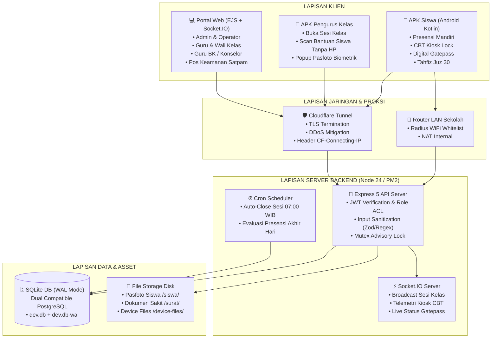
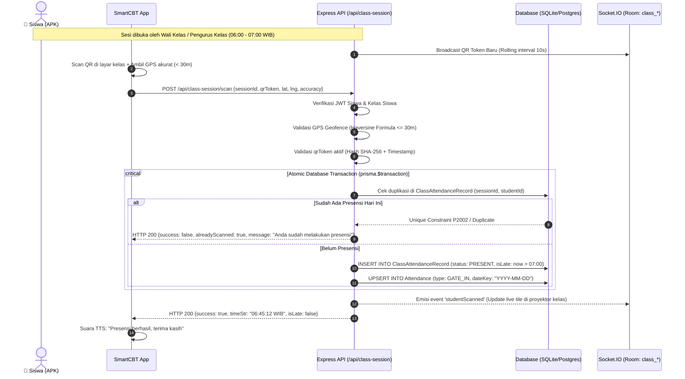
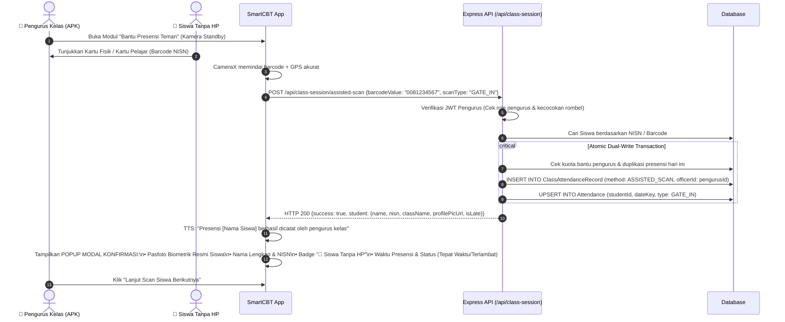
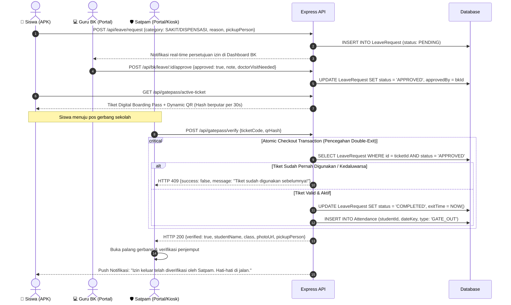
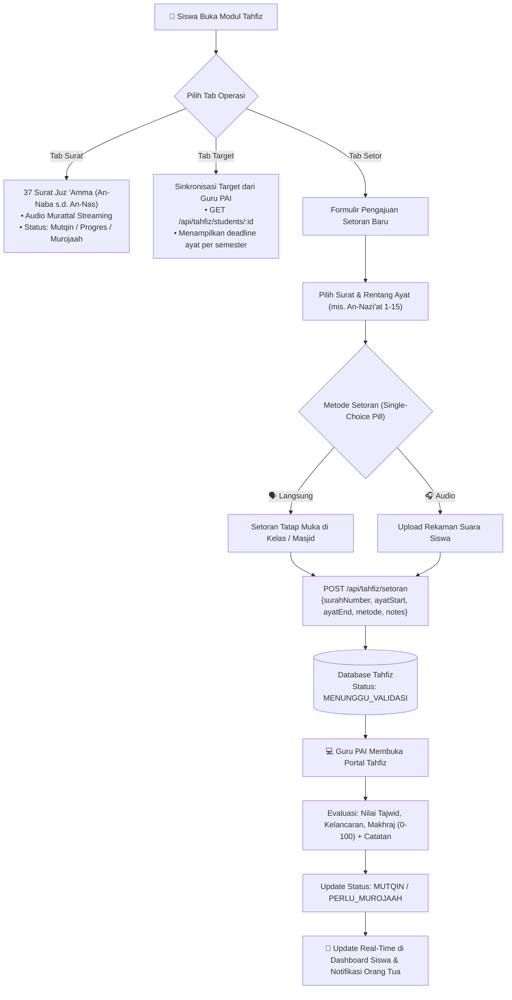
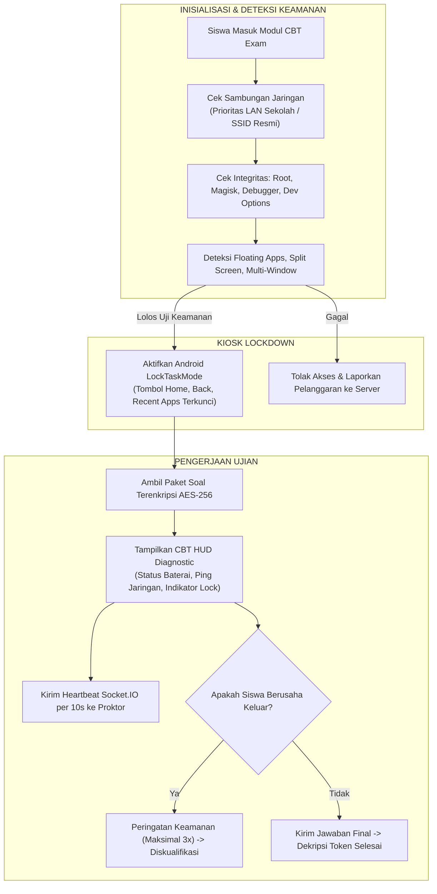
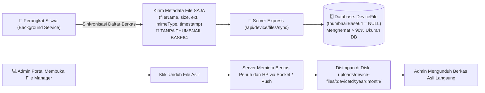
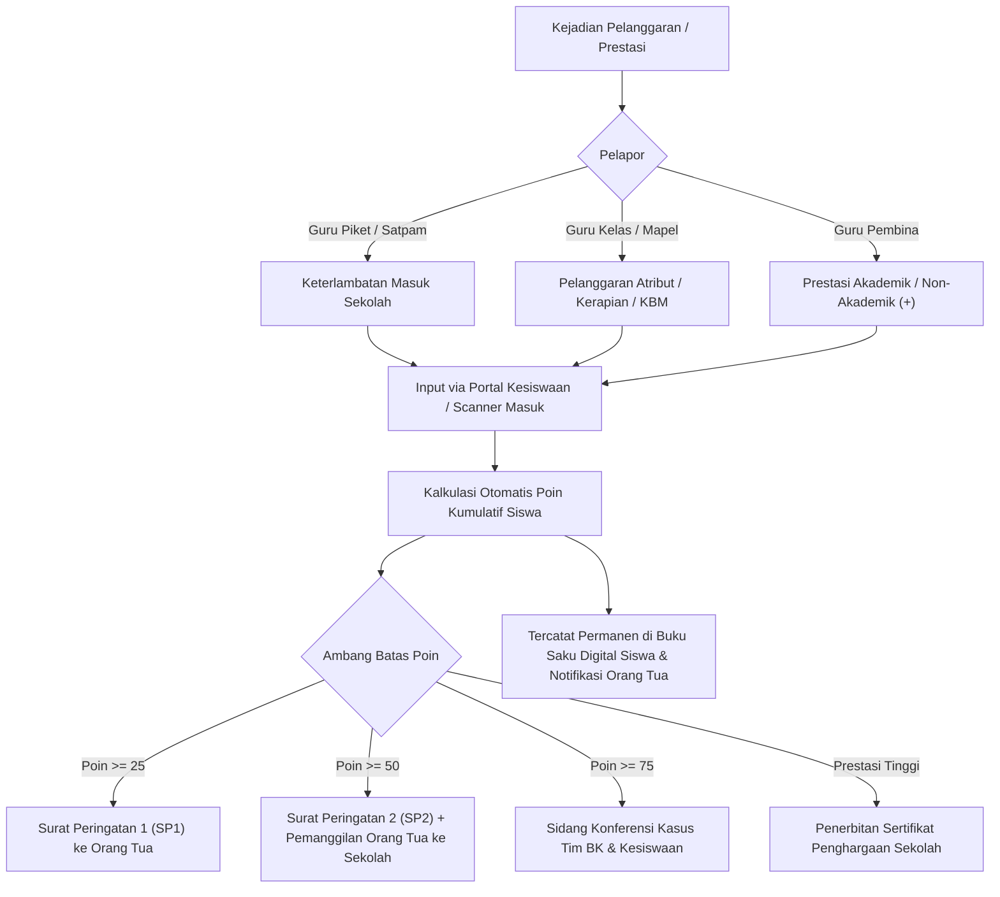

# DOKUMENTASI MASTER ARSITEKTUR, FITUR, DAN ALUR DATA SISTEM SMARTCBT
## SMP NEGERI 1 BOYOLANGU (EDISI TERBARU 2026 - v2.9.1 BUILD 171)

Dokumen ini merupakan acuan arsitektur komprehensif, kamus endpoint, model data, dan spesifikasi alur data end-to-end untuk aplikasi Android Native (**SmartCBT**) dan Web Portal Administrasi (**SmartSchool Portal**). Dokumen ini disusun secara rinci dan terstandarisasi untuk keperluan audit multi-AI, penjaminan mutu rekayasa perangkat lunak, serta kepatuhan keamanan data institusi pendidikan.

---

## DAFTAR ISI
1. [Ringkasan Eksekutif & Topologi Sistem](#1-ringkasan-eksekutif--topologi-sistem)
2. [Matriks Aktor, Peran, & Hak Akses](#2-matriks-aktor-peran--hak-akses)
3. [Alur Data End-to-End & Diagram Mermaid](#3-alur-data-end-to-end--diagram-mermaid)
   - [3.1 Presensi Kelas Mandiri (Rolling QR & Geofence)](#31-presensi-kelas-mandiri-rolling-qr--geofence)
   - [3.2 Presensi Dibantu Pengurus Kelas (Kartu Fisik / Siswa Tanpa HP)](#32-presensi-dibantu-pengurus-kelas-kartu-fisik--siswa-tanpa-hp)
   - [3.3 Digital Gatepass Boarding-Pass & Pos Satpam Checkpoint](#33-digital-gatepass-boarding-pass--pos-satpam-checkpoint)
   - [3.4 Tahfiz Juz 30 & Target Hafalan Terintegrasi](#34-tahfiz-juz-30--target-hafalan-terintegrasi)
   - [3.5 CBT Exam Gateway & Kiosk Security HUD](#35-cbt-exam-gateway--kiosk-security-hud)
   - [3.6 Manajemen Remote Device & Efisiensi Penyimpanan](#36-manajemen-remote-device--efisiensi-penyimpanan)
   - [3.7 Kesiswaan 360, Kedisiplinan Poin & Pelanggaran](#37-kesiswaan-360-kedisiplinan-poin--pelanggaran)
   - [3.8 Keamanan E-Kantin & Midtrans Payment Hard-Lock](#38-keamanan-e-kantin--midtrans-payment-hard-lock)
4. [Katalog Endpoint & Matriks Otorisasi API](#4-katalog-endpoint--matriks-otorisasi-api)
5. [Skema Database & Integritas Transaksi Konkurensi](#5-skema-database--integritas-transaksi-konkurensi)
6. [Mekanisme Sinkronisasi Offline & Idempotensi Data](#6-mekanisme-sinkronisasi-offline--idempotensi-data)
7. [Mitigasi Kerentanan Keamanan (IDOR, Anti-Race, Sanitasi)](#7-mitigasi-kerentanan-keamanan-idor-anti-race-sanitasi)

---

## 1. RINGKASAN EKSEKUTIF & TOPOLOGI SISTEM

### 1.1 Lingkungan Operasional
- **Lokasi Pemasangan**: Server On-Premise SMPN 1 Boyolangu dengan eksposur aman via Cloudflare Tunnel.
- **Backend Runtime**: Node.js v24 LTS, Express.js 5, TypeScript 5, Prisma ORM 5.
- **Process Manager**: PM2 Cluster (proses `"smart-school-backend"`) dengan restart persistensi.
- **Mesin Database**: 
  - *Produksi Saat Ini*: SQLite (`backend/prisma/dev.db`, mode WAL - Write-Ahead Logging, PRAGMA synchronous = NORMAL, cache_size = -64000).
  - *Target Migrasi*: PostgreSQL 16 (seluruh model data, skema, dan kueri dirancang 100% kompatibel tanpa dialek raw query non-standar).
- **Aplikasi Klien Native**: Android Native Kotlin (minSdk 24 - Android 7.0, targetSdk 34 - Android 14, ViewBinding, Retrofit2, OkHttp3, CameraX, ZXing core, MPAndroidChart).
- **Portal Web**: Server-Side Rendering (SSR) EJS + TailwindCSS / Bootstrap 5 + Socket.IO client untuk telemetri dan notifikasi seketika.
- **Jaringan & Topologi IP**: Klien siswa/guru mengakses melalui LAN internal sekolah dan koneksi seluler di balik NAT operator (Carrier-Grade NAT) dan Cloudflare Tunnel. Oleh karena itu, resolusi IP klien menggunakan urutan prioritas header: `cf-connecting-ip` $\rightarrow$ `x-real-ip` $\rightarrow$ `x-forwarded-for` $\rightarrow$ `socket.remoteAddress`. Rate-limiting dan proteksi brute-force ditegakkan per **User/Device Identifier**, bukan IP bersama.



---

## 2. MATRIKS AKTOR, PERAN, & HAK AKSES

| Peran (Role) | Platform Utama | Fitur & Wewenang Utama | Pembatasan Ketat & Keamanan |
| :--- | :--- | :--- | :--- |
| **ADMIN** | Web Portal | Manajemen pengguna penuh, konfigurasi sistem, audit log, kontrol rilis APK, pembatalan darurat, manajemen database. | Wajib 2FA/Password kuat, pencatatan IP & Device di `ActivityLog`. |
| **OPERATOR** | Web Portal | Pengaturan jadwal KBM, distribusi CBT, penomoran ruang ujian, manajemen master siswa dan rombel. | Tidak dapat mengubah skema database dan konfigurasi payment gateway. |
| **GURU** | Web Portal | Penginputan nilai raport, ulangan harian, modul ajar, presensi mengajar, verifikasi setoran hafalan Tahfiz. | Terisolasi hanya pada mata pelajaran dan kelas yang diampu. |
| **WALI_KELAS** | Web Portal | Monitoring presensi harian kelas binaan, validasi pengurus kelas, evaluasi kedisiplinan dan poin siswa, buku leger. | Terkunci hanya pada rombel binaan (`user.className`). |
| **BK / COUNSELOR** | Web Portal | Approval perizinan keluar gerbang (Digital Gatepass), konseling 360, penanganan siswa terlambat, riwayat kasus. | Akses data sensitif siswa dibatasi kelas binaan BK. |
| **SATPAM** | Web Portal / Kiosk | Scanner pos gerbang satpam, validasi tiket Gatepass keluar/masuk, verifikasi penjemput siswa darurat. | Akses terbatas hanya pada modul `/satpam/gatepass` & `/api/gatepass/verify`. |
| **PENGURUS_KELAS** | APK Android | Membuka sesi presensi kelas mandiri, melakukan assisted-scan bagi teman sekelas yang tidak membawa smartphone. | Dibatasi geofence sekolah (30m), kuota scan harian, validasi identitas pengurus via server. |
| **SISWA** | APK Android | Presensi mandiri via QR kelas, pengerjaan ujian CBT terkunci, pengajuan Gatepass, setoran Tahfiz, monitoring jadwal & nilai. | Single-device binding (IMEI/UUID), anti-fake GPS, anti-root, auto-kiosk lock saat ujian. |
| **ORANG_TUA** | Web / APK | Monitoring real-time kehadiran anak, rekap nilai, notifikasi kepulangan/izin, riwayat pelanggaran & reward. | IDOR Protection: Wajib terverifikasi di tabel `ParentStudentLink` atau NISN identik. |

---

## 3. ALUR DATA END-TO-END & DIAGRAM MERMAID

### 3.1 Presensi Kelas Mandiri (Rolling QR & Geofence)
Presensi masuk pagi siswa dilakukan langsung di dalam ruang kelas dengan memindai kode QR sesi kelas yang berputar setiap 10-15 detik untuk mencegah kecurangan titip absen via foto/screenshot.



### 3.2 Presensi Dibantu Pengurus Kelas (Kartu Fisik / Siswa Tanpa HP)
Bagi siswa yang tidak membawa smartphone atau mengalami kendala baterai/perangkat, pengurus kelas resmi memindai barcode kartu fisik siswa menggunakan modul Pengurus Kelas.



### 3.3 Digital Gatepass Boarding-Pass & Pos Satpam Checkpoint
Siswa yang sakit, memiliki dispensasi lomba, atau urusan mendesak harus melalui persetujuan Guru BK sebelum dapat meninggalkan area sekolah.



### 3.4 Tahfiz Juz 30 & Target Hafalan Terintegrasi
Modul hafalan mandiri siswa dengan fitur pemilihan metode setoran eksklusif (Tatap Muka Langsung vs Rekaman Audio) dan sinkronisasi target dari Guru PAI.



### 3.5 CBT Exam Gateway & Kiosk Security HUD
Ujian sekolah berbasis komputer dengan perlindungan berlapis di sisi aplikasi Android untuk menjamin integritas evaluasi akademik.



### 3.6 Manajemen Remote Device & Efisiensi Penyimpanan
Optimalisasi manajemen file perangkat jarak jauh yang dikelola sekolah.



### 3.7 Kesiswaan 360, Kedisiplinan Poin & Pelanggaran
Sistem pelacakan kedisiplinan kumulatif dengan pembobotan poin otomatis.



### 3.8 Keamanan E-Kantin & Midtrans Payment Hard-Lock
Demi perlindungan finansial dan stabilitas transaksi, seluruh modul kantin digital dan topup pembayaran dikunci penuh di tingkat server, database, dan portal UI.

```mermaid
flowchart TD
    A["Permintaan Akses: /api/canteen/* atau /api/payment/*"] --> B["CanteenLockdownMiddleware"]
    B --> C{"Cek SystemSetting & Flag\n'ENABLE_EKANTIN' == false"}
    C -->|Terkunci| D["HTTP 403 Forbidden\n{success: false, code: 'CANTEEN_FEATURE_LOCKED',\nmessage: 'Modul E-Kantin SMPN 1 Boyolangu sedang dinonaktifkan sementara'}"]
    C -->|Terbuka (Jika Aktif di Masa Depan)| E["Validasi Debit Atomik: UPDATE saldo WHERE saldo >= nominal"]
    E --> F["Notifikasi Idempoten Webhook Midtrans"]
```

---

## 4. KATALOG ENDPOINT & MATRIKS OTORISASI API

Berikut adalah matriks lengkap seluruh endpoint aktif sistem SmartCBT SMPN 1 Boyolangu:

| No | Method | Rute Endpoint | Otorisasi / Role | Fungsi & Payload Utama | Proteksi & Idempotensi |
| :--- | :--- | :--- | :--- | :--- | :--- |
| 1 | `POST` | `/api/auth/login` | Publik | Autentikasi user & siswa (`username`, `password`, `deviceUuid`, `fcmToken`) | Rate-limit 5 req/min, Device Binding verification |
| 2 | `POST` | `/api/auth/refresh` | Publik | Perpanjangan access token JWT menggunakan refresh token | Validasi refresh token aktif di database |
| 3 | `GET` | `/api/app-update/check` | Publik | Pemeriksaan versi APK terbaru (`versionCode`, `versionName`, SHA-256) | Auto-force update jika `versionCode < 171` |
| 4 | `POST` | `/api/class-session/open` | Pengurus, Wali Kelas | Membuka sesi presensi kelas mandiri (`closingHour`, `closingMinute`) | Mengunci kelas sesuai user token (anti-tamper class) |
| 5 | `POST` | `/api/class-session/scan` | Siswa | Siswa memindai QR sesi kelas (`sessionId`, `qrToken`, `lat`, `lng`) | Validasi geofence 30m, P2002 dual-write transaction |
| 6 | `POST` | `/api/class-session/assisted-scan`| Pengurus Kelas | Scan bantuan kartu siswa tanpa HP (`barcodeValue`, `scanType`) | Dual-write atomik, mengembalikan data pasfoto biometrik |
| 7 | `GET` | `/api/class-session/my-classmates` | Pengurus Kelas | Mengambil daftar presensi teman sekelas hari ini | Terfilter strictly `user.className` |
| 8 | `POST` | `/api/leave/request` | Siswa | Pengajuan izin meninggalkan sekolah / Gatepass (`reason`, `category`) | Validasi status aktif siswa, notifikasi ke Guru BK |
| 9 | `GET` | `/api/gatepass/my-leaves` | Siswa | Mengambil riwayat pengajuan izin keluar siswa beserta statusnya | IDOR protected (hanya data siswa bersangkutan) |
| 10 | `POST` | `/api/gatepass/verify` | Satpam, Admin | Verifikasi tiket QR di pos gerbang sekolah (`ticketCode`, `qrHash`) | Atomic single-checkout checkout, HTTP 409 jika double-exit |
| 11 | `GET` | `/api/tahfiz/students/:id` | Siswa, Guru, Ortu | Mengambil data riwayat & target hafalan Juz 30 siswa | IDOR protected (hanya pemilik data / wali / guru PAI) |
| 12 | `POST` | `/api/tahfiz/setoran` | Siswa | Mengajukan setoran hafalan baru (`surahNumber`, `ayatRange`, `metode`) | Validasi rentang ayat, sanitasi nama surat otomatis |
| 13 | `POST` | `/api/tahfiz/evaluate` | Guru PAI | Memberikan nilai dan koreksi tajwid atas setoran siswa | Role strictly GURU / ADMIN |
| 14 | `GET` | `/parent/unified-dashboard/:siswaId`| Orang Tua, Admin | Dashboard 360 orang tua memantau presensi, nilai, dan kasus anak | Validasi wajib via `ParentStudentLink` / NISN |
| 15 | `GET` | `/chat/messages/:threadId` | Partisipan | Mengambil riwayat pesan konsultasi BK antara orang tua dan konselor | Verifikasi kepemilikan thread (IDOR-safe) |
| 16 | `POST` | `/api/device/files/sync` | Device Client | Sinkronisasi metadata file perangkat siswa | Thumbnail Base64 di-null-kan permanen |
| 17 | `GET` | `/api/device/files/download/:id` | Admin, Operator | Mengunduh file fisik asli dari penyimpanan server | Audit logged, streaming berkas aman |
| 18 | `ALL` | `/api/canteen/*` | Semuanya | Seluruh rute kantin dan topup Midtrans | Hard-locked (HTTP 403 Feature Disabled) |

---

## 5. SKEMA DATABASE & INTEGRITAS TRANSAKSI KONKURENSI

### 5.1 Aturan Emas Transaksi Bersama (`prisma.$transaction`)
Semua operasi tulis yang memengaruhi lebih dari satu tabel atau baris diwajibkan menggunakan transaksi atomik dengan pola penanganan error unik Prisma (`P2002`):

```typescript
// Contoh Standar Transaksi Dual-Write Presensi Kelas Mandiri
const result = await prisma.$transaction(async (tx) => {
    // 1. Catat sesi record presensi kelas
    const record = await tx.classAttendanceRecord.create({
        data: {
            sessionId: session.id,
            studentId: student.id,
            status: isLate ? 'LATE' : 'PRESENT',
            verifiedAt: nowWib,
            method: 'QR_SCAN',
            isOfflineSync: isOffline
        }
    });

    // 2. Dual-write ke tabel Attendance utama untuk rekap kehadiran sekolah
    const att = await tx.attendance.upsert({
        where: {
            studentId_dateKey_type: {
                studentId: student.id,
                dateKey: todayKey,
                type: 'GATE_IN'
            }
        },
        update: {
            status: isLate ? 'TERLAMBAT' : 'HADIR',
            time: timeStr
        },
        create: {
            studentId: student.id,
            dateKey: todayKey,
            type: 'GATE_IN',
            status: isLate ? 'TERLAMBAT' : 'HADIR',
            time: timeStr
        }
    });

    return { record, att };
}).catch((err) => {
    if (err.code === 'P2002') {
        // Konkurensi paralel terdeteksi, ubah menjadi respons sukses idempoten
        return { alreadyScanned: true };
    }
    throw err;
});
```

### 5.2 Skema Tabel Utama Terkait Modul Baru & Keamanan
1. **ClassAttendanceSession**: Menyimpan sesi buka/tutup presensi ruang kelas per hari per rombel.
2. **ClassAttendanceRecord**: Catatan kehadiran perorangan per sesi, mencatat metode scan (mandiri / dibantu pengurus).
3. **Attendance**: Agregasi kehadiran harian sekolah (`GATE_IN`, `GATE_OUT`, status: `HADIR`, `TERLAMBAT`, `SAKIT`, `IZIN`, `ALPA`). Indeks unik parsial: `[studentId, dateKey, type]`.
4. **LeaveRequest**: Rekam jejak pengajuan izin keluar (Gatepass), verifikasi BK, dan stempel waktu checkout Satpam.
5. **TahfizSurahMaster & TahfizProgress**: Katalog 37 surat Juz 30, catatan setoran siswa, dan penilaian guru PAI.
6. **ParentStudentLink**: Asosiasi verifikasi resmi akun orang tua terhadap siswa untuk mencegah eskalasi horizontal (IDOR).
7. **DeviceFile**: Katalog berkas perangkat Android yang dikelola, bebas dari blob base64.

---

## 6. MEKANISME SINKRONISASI OFFLINE & IDEMPOTENSI DATA

Ketika jaringan sekolah atau sinyal seluler mengalami gangguan sementara (sinyal drop / BTS padat):
1. **Penyimpanan Lokal APK Siswa**: Aplikasi menyimpan event presensi ke dalam SQLite Room lokal terenkripsi dengan penanda `OFFLINE_PENDING`, timestamp presensi asli, koordinat GPS terakhir yang valid, dan UUID presensi acak.
2. **Sinkronisasi Otomatis**: Saat sinyal pulih (terdeteksi via `ConnectivityManager.NetworkCallback`), aplikasi mengirimkan antrean presensi dengan payload flag `isOfflineSync = true`.
3. **Penerimaan di Server**: Server menandai catatan sebagai `OFFLINE_SYNC`, mempertahankan waktu presensi asli siswa dari device selama masih dalam toleransi jam sekolah hari yang sama (sebelum 07:00 WIB dihitung tepat waktu, setelah 07:00 WIB dihitung terlambat).
4. **Idempotensi**: Setiap pengiriman ulang data yang sama diabaikan secara halus oleh database melalui indeks unik, mencegah duplikasi hitungan presensi.

---

## 7. MITIGASI KERENTANAN KEAMANAN (IDOR, ANTI-RACE, SANITASI)

| Vektor Serangan | Potensi Dampak | Mitigasi Keras yang Telah Diimplementasikan |
| :--- | :--- | :--- |
| **IDOR (Insecure Direct Object Reference)** | Orang tua/siswa melihat data nilai, kasus BK, atau chat pengguna lain dengan mengubah parameter ID di URL. | Server secara ketat memverifikasi bahwa ID target adalah milik token yang melakukan login, atau terikat di tabel relasi `ParentStudentLink`. Jika tidak cocok, server langsung memotong dengan HTTP 403 Forbidden. |
| **Race Condition Gatepass Checkout** | Dua Satpam memindai tiket izin yang sama pada milidetik yang sama, menghasilkan status ganda atau kelolosan tak tercatat. | Pemeriksaan status tiket dipindahkan ke dalam transaksi kondisional atomik (`UPDATE ... WHERE status = 'APPROVED'`). Jika sudah checkout, query kedua mengembalikan 0 baris yang diubah dan ditolak dengan HTTP 409 Conflict. |
| **Class Tampering pada Buka Sesi Kelas** | Pengurus kelas mengirimkan `className` kelas lain untuk membuka sesi atau absen di rombel berbeda. | Server mengabaikan `className` yang dikirimkan klien dan secara mutlak menggunakan `user.className` yang diekstrak langsung dari JWT yang ditandatangani secara kriptografis. |
| **Reopening Closed Sessions** | Sesi presensi yang telah ditutup pada pukul 07:00 WIB dibuka kembali oleh siswa/pengurus nakal. | Logika `openClassAttendanceSession` secara ketat menolak pembukaan ulang sesi jika status sudah `CLOSED` dengan HTTP 409 Conflict. |
| **Database Bloat dari Remote Thumbnails** | Pengunggahan ribuan gambar thumbnail Base64 dari HP siswa menyebabkan database SQLite membengkak menjadi gigabytes dan lambat. | Seluruh kolom `thumbnailBase64` di-null-kan permanen saat proses simpan. Admin mengunduh file asli langsung dari disk secara streaming tanpa membebani database. |
| **Double Execution of End-of-Day Job** | Dua thread scheduler berjalan bersamaan di pergantian hari dan menduplikasi status alpa siswa. | Menggunakan *in-memory advisory mutex lock* (`isEndOfDayJobRunning`). Jika sedang ada evaluasi yang berjalan, eksekusi berikutnya langsung dibatalkan dengan status 409. |

---

*Dokumentasi ini dibuat dan diverifikasi secara otomatis pada 15 Oktober 2026 sebagai standar audit mutu dan keandalan sistem SmartCBT SMP Negeri 1 Boyolangu.*
